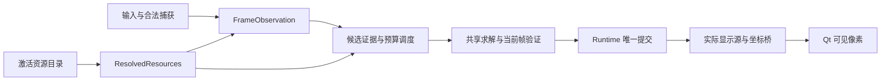

# 四模式识别、贴合与资源导入统一方案

核查日期：2026-11-10。状态：**P0 调查/设计完成；P1 空资源默认入口与 P2 保存基础已接线，外部识别 decoder、语义激活与四模式回放尚未接通**。本文件同时作为现状清单、设计和实施台账，不另建重复任务说明。第 2–4 节现状引用绑定原核查 commit，后续实施状态另见第 8 节。

## 1. 范围与基线

- 工作区：`E:\codex\worktrees\cd7b\星图`。开始时工作树干净、detached HEAD，源码 `cc5100c6e3cea425ac4dbed82df92623754f81fa`，fetch 后与 `origin/main` 一致；文档分支为 `codex/unified-recognition-resources-plan-20261110`。
- 目标为原星图的 `s0:difficult`、`s0:nightmare`、`s1:difficult`、`s1:nightmare`。S1 `difficulty2` 是已停用的历史普通模式。当前 `experiments/qt_quick/` 实为默认产品客户端，不能按目录名忽略。独立 Python/C#、WPF、Qt/C# 迁移实验不归本任务，不改其代码或分支。
- 当前源码已包含 `7991dbbe` 之后 PR #126 的 S0 控件几何修复；不能据此推断 S1 问题已解决或实机已通过。
- [PR #111](https://github.com/chenhuanh9-a11y/xiaochao-assistant/pull/111) 已关闭、未合并，由 [PR #112](https://github.com/chenhuanh9-a11y/xiaochao-assistant/pull/112) 替代。#112 合并提交 `eb67407f7b5b3e608b0f4e90b50fb6ba294bd466` 经 `git merge-base --is-ancestor ... HEAD` 确认为当前祖先。复用既有通用 V2 作者包、制包器和快照，不重做 #111 的独立加载器。
- 用户允许新架构停止支持全部旧包，不授权现在删除原图、安装资源、个人数据、备份或历史事务。本轮只改文档，不执行资源迁移、清理、安装、程序启停、游戏操作或发布。

以下“现状”来自该 commit 源码及第 7 节本轮测试；“目标”均待实现。历史通过数量不当作本轮执行结果。

## 2. 四模式实际调用与验收清单

### 2.1 默认入口及四组合矩阵

[qt_client_entry.py:20](https://github.com/chenhuanh9-a11y/xiaochao-assistant/blob/cc5100c6e3cea425ac4dbed82df92623754f81fa/tools/qt_client_entry.py#L20) → `client.main` → [QtClient:125](https://github.com/chenhuanh9-a11y/xiaochao-assistant/blob/cc5100c6e3cea425ac4dbed82df92623754f81fa/experiments/qt_quick/client.py#L125) 构造 providers、LiveRuntime、Session。游戏输入/显式操作经 Session 到 runtime；捕获、控件观测、候选报告、最终显示是不同证据端点。

| 组合 | 楼层控件：入口、输入与输出 | 地图识别：实际核心与结果语义 | 贴合与依赖资源 |
| --- | --- | --- | --- |
| S0 困难 | `LiveRuntime._observe` → `observe_s0_map` → `locate_vertical_floor_controls` → `classify_label`。输入当前客户区帧及模式合同；输出地图界面观测、控件 ROI/标签/高亮、语义层及失败原因。层 ID `1/2`。 | `_rank_identity` → `NativeDifficultCandidateEngine.rank` → `MapIdentityEngine.rank`；已建立组可走 `rank_established_group`。输入当前帧、层、预算/组上下文；输出 rank rows 和入口/结构证据，由 runtime 提交。 | 共用 `_AlignmentHost.fit` → fast/recovery/independent fit → 当前帧 residual → commit。依赖 `difficult-native-manifest.json` interfaces、identity pack、typed NPZ、坐标/版本绑定、入口索引、出口图标及两层实际显示桥。 |
| S0 噩梦 | 同一 S0 detector/模板分类器；合同 `B1/1/2`，验证完整三行与实际高亮，不借困难槽位猜层。 | 同一 `MapIdentityEngine.rank` / `rank_established_group` 框架，使用噩梦 pack、入口和结构证据；资源池与门语义不等同于困难。 | 同一求解/验证/提交。依赖 `nightmare-map-pack.json`、shared-structure index、canonical coordinate pack、version bindings、`nightmare-entries/`、结构显示及可选作者绑定。 |
| S1 困难 | `_observe` → `detect_s1_floor`，完整带符号竖列 + 独立地图 UI 几何；输入帧、`s1/difficult` 与相关帧范围，输出 `observedFloorValidated` 等证据。层 ID `-1/-2/-3/-4`。 | `_rank_identity` → `_rank_s1_structure` → `qt_s1_structure_scan` → `StructureCandidateScanner.scan/rank_rows` → `StructureEvidenceSession.commit`。输入完整 catalog、当前层、预算/顺序；输出支持/未知/未扫描集合及 pose。**排序不等于正式身份确认**。 | 共用 host/solver；上层显式 ROI、prepared scan、多岛/组件恢复。基础根 `seasons/s1/difficult/`：native manifest、typed/坐标/入口/版本产品。私测坐标先验另有入口，不授予正式身份。 |
| S1 噩梦 | 与 S1 困难同一观测算法，传 `s1/nightmare` 与四负层合同。 | 同一 scanner/session，但 catalog 与完整候选池来自噩梦根；正式、手选、私测能力仍受当前产品策略限制。 | 同一求解/验证/提交；根 `seasons/s1/nightmare/`，各层参考和绑定独立，不能串用困难地图池。 |

关键代码依据：

- 层合同：[floor_contract.py:47](https://github.com/chenhuanh9-a11y/xiaochao-assistant/blob/cc5100c6e3cea425ac4dbed82df92623754f81fa/app/floor_contract.py#L47)。S0 包装 [s0_vertical_controls.py:199](https://github.com/chenhuanh9-a11y/xiaochao-assistant/blob/cc5100c6e3cea425ac4dbed82df92623754f81fa/app/s0_vertical_controls.py#L199)，标签消费 [floor_control_region.py:172](https://github.com/chenhuanh9-a11y/xiaochao-assistant/blob/cc5100c6e3cea425ac4dbed82df92623754f81fa/app/floor_control_region.py#L172)，列检测 `:331`；[s0_floor_templates.py:29](https://github.com/chenhuanh9-a11y/xiaochao-assistant/blob/cc5100c6e3cea425ac4dbed82df92623754f81fa/app/s0_floor_templates.py#L29)、`:54` 是代码合成模板，尚非外置素材库。
- S1 [s1_floor_observation.py:104](https://github.com/chenhuanh9-a11y/xiaochao-assistant/blob/cc5100c6e3cea425ac4dbed82df92623754f81fa/app/s1_floor_observation.py#L104)、`:169`；几何原语 [s1_map_ui_geometry.py:129](https://github.com/chenhuanh9-a11y/xiaochao-assistant/blob/cc5100c6e3cea425ac4dbed82df92623754f81fa/app/s1_map_ui_geometry.py#L129) 同样被 [S0:188](https://github.com/chenhuanh9-a11y/xiaochao-assistant/blob/cc5100c6e3cea425ac4dbed82df92623754f81fa/app/s0_vertical_controls.py#L188) 消费，不能按文件名前缀认定专属。
- runtime 分流：[client_live_runtime.py:6083](https://github.com/chenhuanh9-a11y/xiaochao-assistant/blob/cc5100c6e3cea425ac4dbed82df92623754f81fa/experiments/qt_quick/client_live_runtime.py#L6083)、`:1760`、`:1117`；S0 [map_identity_engine.py:737](https://github.com/chenhuanh9-a11y/xiaochao-assistant/blob/cc5100c6e3cea425ac4dbed82df92623754f81fa/app/map_identity_engine.py#L737)、`:998`，困难 [difficult_native_identity.py:64](https://github.com/chenhuanh9-a11y/xiaochao-assistant/blob/cc5100c6e3cea425ac4dbed82df92623754f81fa/app/difficult_native_identity.py#L64)。历史 `DifficultCandidateEngine` 不能代替当前 native 默认路径。
- provider 根及构建：[client_providers.py:214](https://github.com/chenhuanh9-a11y/xiaochao-assistant/blob/cc5100c6e3cea425ac4dbed82df92623754f81fa/experiments/qt_quick/client_providers.py#L214)、`:278`、`:334`；S1 scanner 注入 `:450`；报告/会话 [s1_structure_selection.py:91](https://github.com/chenhuanh9-a11y/xiaochao-assistant/blob/cc5100c6e3cea425ac4dbed82df92623754f81fa/app/s1_structure_selection.py#L91)、`:135`、`:235`。
- S1 静态回放能力仍声明 `liveValidated=False`，native context 仍有 live gaps：[s1_native_resources.py:18](https://github.com/chenhuanh9-a11y/xiaochao-assistant/blob/cc5100c6e3cea425ac4dbed82df92623754f81fa/app/s1_native_resources.py#L18)、`:133`、`:141`。四组合是统一目标，不是当前四组合均具相同自动权限的结论。

### 2.2 贴合的共享与外围分歧

现有真实共享链是：当前捕获/楼层 → 候选或已锁图 → `_AlignmentHost.fit` → `_fit_observation_uncached` → steady（适用时）/fast → 同层平移、登记层关系、入口复核恢复 → 独立求解 → 当前帧 canonical residual → runtime `_solve_observation` → group/core/render → 实际显示层与坐标桥 → Qt 像素。

依据：[host:156](https://github.com/chenhuanh9-a11y/xiaochao-assistant/blob/cc5100c6e3cea425ac4dbed82df92623754f81fa/experiments/qt_quick/client_live_runtime.py#L156)、[fit:355](https://github.com/chenhuanh9-a11y/xiaochao-assistant/blob/cc5100c6e3cea425ac4dbed82df92623754f81fa/experiments/qt_quick/client_live_runtime.py#L355)、[求解次序:559](https://github.com/chenhuanh9-a11y/xiaochao-assistant/blob/cc5100c6e3cea425ac4dbed82df92623754f81fa/experiments/qt_quick/client_live_runtime.py#L559)、[fast_structure_alignment.py:420](https://github.com/chenhuanh9-a11y/xiaochao-assistant/blob/cc5100c6e3cea425ac4dbed82df92623754f81fa/app/fast_structure_alignment.py#L420)、[single_map_structure.py:620](https://github.com/chenhuanh9-a11y/xiaochao-assistant/blob/cc5100c6e3cea425ac4dbed82df92623754f81fa/app/single_map_structure.py#L620)。首贴与重开都须当前帧验证，历史 pose 只是种子。

| 接缝 | 当前事实 | 需要收敛 |
| --- | --- | --- |
| ROI/组件 | 默认无 bounds 路径与 S1 显式 ROI 路径不同；后者有最多 32 岛分解及一致性复核。 | 一次 FrameObservation 明示地图/控件 ROI、遮挡/组件，求解策略依观测质量选路径；不能直接删除多岛恢复或一律扫描最大区域。 |
| 候选 | S0 rank 与 S1 scanner 产物、预算、续扫与会话不同。 | 提取实际证据生产和公共调度/消费循环，最终退出两套候选控制器；wrapper 不是完成。 |
| 状态 | RoundLayerGroup 管局内层关系，AlignmentCoreV2 管 pose/显示授权，runtime `_render` 管当前渲染；职责不同。 | runtime 唯一提交，group/core 为内部模型；worker 返回结果，不另写 UI/候选池，整理重复的外围上下文。 |
| 显示 | 作者/路线是显示；S0/S1 provider 的能力接入不全相同。 | 同一 DisplayResolver 返回实际来源与桥；缺作者可回退同层结构，缺结构不能借作者图识别。 |
| 取消/迟到 | 已有 Session generation、runtime epoch、capture、structure ticket、settings/display generation。 | 统一构造和校验，保留实际相关 guard，不能为了字段整齐删校验。 |

最终状态写者：[client_live_runtime.py:5747](https://github.com/chenhuanh9-a11y/xiaochao-assistant/blob/cc5100c6e3cea425ac4dbed82df92623754f81fa/experiments/qt_quick/client_live_runtime.py#L5747) 求解前/后及 commit 前核上下文，`:5970` 后更新 core/group/render；关图撤销 `:3379`。手动层意图 `_set_floor:2943` 与观测 floor policy 分开，观测函数返回不是直接改层的授权。Session 范围见 [client_session.py:163](https://github.com/chenhuanh9-a11y/xiaochao-assistant/blob/cc5100c6e3cea425ac4dbed82df92623754f81fa/experiments/qt_quick/client_session.py#L163)。显示消费者见 [client_route_preferences.py:106](https://github.com/chenhuanh9-a11y/xiaochao-assistant/blob/cc5100c6e3cea425ac4dbed82df92623754f81fa/experiments/qt_quick/client_route_preferences.py#L106) 和 runtime `:6145`；换作者不得改变身份/结构位姿/层，结构回退也须绑定实际渲染来源。

### 2.3 现有测试与未验内容

以下为可复用入口，不代表本轮全部执行。测试中真实调用了函数，不代表用了真实生产资源。

| 范围 | 测试及替身边界 | 仍需真实资源/实机 |
| --- | --- | --- |
| S0 两模式控件 | `test_floor_contract`、`test_s0_floor_highlight_geometry`；Qt `test_client_floor_region`、`test_client_s0_vertical`，含合成 glyph/曝光及 mock 分流；真实回放需 `S0_FLOOR_CONTROL_FIXTURE_ROOT`。 | 困难两层、噩梦三层原帧；亮/暗、过渡、遮挡、非地图，核实际 ROI 与层真值。 |
| S1 两模式控件 | `test_s1_recorded_floor_observation`、`test_s1_floor_observation`，数学竖列/map-interface 替身；真实回放需 `S1_FLOOR_FIXTURE_ROOT`。 | 各模式 B1–B4 完整客户区与裁剪；缺行/旧帧/高亮不稳不得猜层。 |
| S0 身份 | Qt `test_client_engine`，`test_native_similarity_runtime`、`test_front_gate_observation`、`test_side_entry_search`；部分真实 rank 注入空/合成资源。 | 导入资源构建实际 provider：正门/侧门/相似组/未知与不唯一，独立身份真值。 |
| S1 候选/资格 | `test_s1_structure_selection`，Qt `test_client_g_cycle_admission`、`test_client_g_cycle_solver_input`；adapter 可真实调用但捕获/solver fixture 非游戏。 | 两模式完整池、预算耗尽/未扫描/失败帧；首行或单候选不得自动升级正式身份。 |
| 四组合贴合/生命周期 | Qt `test_client_live_runtime`、`test_client_group_queue`、`test_client_session`；`test_shared_recovery_residual_contract`、`test_wall_raster_local_distances`。多处 synthetic provider/frame/fit/residual。 | 从正式入口到真实结构及实际图层：首贴/重开/换层/无门/缺绑定/错岛/取消/迟到/关图；正确可见像素和长期稳定性。 |

本轮未获得四组合真实准确率、实机采集/显示同步或输入到像素耗时，不能推断既有 S1 故障已修复。

## 3. 统一架构与必要例外

### 3.1 单一链路和提交者



以下是设计名，实施优先整理现有模块，不新增并列框架或流程工具。

| 目标模型/接口 | 输入输出及职责 | 替代范围 |
| --- | --- | --- |
| ResolvedResources | season/mode + 已激活目录 → 地图/层、typed reference、坐标/层关系、controls、入口、display 与版本身份；只读解析，资源管理器负责激活。 | 业务自行拼 `_internal`、S1 子根、作者平面和私测路径；禁止扫目录猜上下文。 |
| RunContext | request/opening/round、frame/capture、season/mode、相关 map/floor、资源版本/显示源和既有 generation；runtime 构造/验证，worker 消费。 | 分散构造和比对；逐个迁移 guard，不能用 mode 字符串代替资源身份。 |
| FrameObservation | 一次捕获 → map-open、控件 ROI、floor evidence、地图 ROI/组件、质量与未知原因。S0/S1 detector 只负责图像策略。 | scanner/fit/恢复重复裁剪与观察；detector 不私有管理 session 或提交层状态。 |
| CandidateEvidence/Report | 完整 catalog + observation + 预算/提示 → 支持/明确矛盾/未知、已扫/未扫、证据类型和临时 pose；同一调度器拥有池/续扫。 | 以 S1 新候选/调度逻辑为统一主链，把 S0 困难/噩梦迁入；参数化真实资源和层/入口语义后删除旧 S0 候选控制器，不长期并列保留。不同旧分数不直接相加；未知不排除。 |
| AlignmentRequest/Result | reference + observation + 可选历史/入口种子 → pose/residual、失败/取消/恢复来源、资源身份。共享 host/solver。 | 统一恢复/验证/预算，不按四组合复制；worker 不写业务状态。 |
| RuntimeState | 当前上下文 + 验证结果 → 候选/组/身份、当前层、pose/render。一个提交点写，UI 线程呈现快照。 | 候选、暂定显示、正式身份分开；S1 实验锁不得冒充正式。 |
| DisplayResolver | 结构 pose + 偏好 + 对应快照 → 实际图像和 display→reference 桥。 | 更新作者/路线/结构回退源只失效相关显示缓存，不隐式重识别或改身份。 |
| 统一诊断事件 | request/stage、outcome/reason、耗时、实际资源与图像范围，沿用有界本地日志/样本写者。 | proposal/verified/visible 终点分开，不另造审计系统或模式专属含义。 |

完成标准是旧重复控制与资源读取退出生产链；公共 wrapper 分别调用完整旧 S0/S1 控制器只是迁移中间态，每阶段列明剩余旧调用及退出条件。

**用户明确的 P3/P4 方向（2026-11-10）**：P3 向 S1 新识别逻辑统一，不能反向把 S1 改回 S0 控制流程。当前可核对的入口绑定 `c27e3b78`：[LiveRuntime._stream_s1_observation](https://github.com/chenhuanh9-a11y/xiaochao-assistant/blob/c27e3b78e0c9decd2ae8b3109bc0266597602b1b/experiments/qt_quick/client_live_runtime.py#L1167)、[provider 的 structure_scan](https://github.com/chenhuanh9-a11y/xiaochao-assistant/blob/c27e3b78e0c9decd2ae8b3109bc0266597602b1b/experiments/qt_quick/client_providers.py#L471) 与 [StructureCandidateScanner.scan](https://github.com/chenhuanh9-a11y/xiaochao-assistant/blob/c27e3b78e0c9decd2ae8b3109bc0266597602b1b/app/s1_structure_selection.py#L91)。P3 开始实施时复核实际默认调用和正式/私测资格入口，移除其 season/floor 硬编码须保留真实数据语义；统一调度不自动扩大证据资格。P2 暂沿用原 solver 核资源路径，不把这一步认作最终识别统一。

P4 首个可用贴合允许先显示，再继续复核；首次显示与最终复核完成是不同状态，不能仍把全部后续复核挡在首次显示前。复核发现偏差时更新变换，无效时撤销。当前帧、楼层、资源和显示来源等既有上下文约束仍须对应本次结果，暂定画面不得冒充正式身份或最终验证。纯位置修正复用已解码图片/纹理与稳定图片标识，只更新变换；实际图片/图层内容变化才重取图片，取消/换图/换层后的迟到结果不得恢复旧画面。验收分别记录首个可用像素、后续复核、位置修正和撤销，包含图片未重载的实际证据。

### 3.2 有证据的必要区别

1. **控件/层语义**：S0 模板与列验证、S1 带符号竖列/地图几何有实际差别；困难/噩梦层数不同。用导入的层映射/controls profile 和程序支持的 detector ID 表达；UI 名称、观测数字、结构 ID 分开，不能统一改成 F1/B1。
2. **门/入口能力**：S1 manifest 明确 `sideEntries=False`（`s1_native_resources.registration:73`）；统一策略按能力工作，无侧门返回缺口，不填假门位或空成功索引。
3. **结构/坐标/层关系**：每层实际结构和桥独立；无登记层关系可独立当前帧求解新 root，不猜投影。见 [round_layer_group_commit.py:14](https://github.com/chenhuanh9-a11y/xiaochao-assistant/blob/cc5100c6e3cea425ac4dbed82df92623754f81fa/app/round_layer_group_commit.py#L14)。
4. **证据资格**：S0 正式身份、S1 录帧候选和私测累积资格不同。统一状态消费，不以 flag、自述已验或 singleton 自动授权；资源包不能开启正式权限。
5. **相似组**：当前明确名单在 [client_group_registry.py:14](https://github.com/chenhuanh9-a11y/xiaochao-assistant/blob/cc5100c6e3cea425ac4dbed82df92623754f81fa/experiments/qt_quick/client_group_registry.py#L14)。目标外置为独立的 reviewed-group-registry 组件，保留人工复核来源、精确成员和入口/层范围；其生产登记入口只接受项目按现有复核方式发布的登记数据，见 4.3。普通基础/作者包不能新增、改写或扩大名单，`reviewed=true`、provenance 自述均不授予资格。局部兼容、动态候选永不扩名单；缺权威表就独立处理并报缺口。

ROI 生成、预算续扫、状态提交、排队/取消、错误格式、缓存和资源发现不是默认应保留的赛季分支；图像策略差别须由真实帧/契约证明。

## 4. 统一资源导入与独立生命周期

### 4.1 复用点与必须改造的限制

| 当前代码 | 复用 | 必须改变 |
| --- | --- | --- |
| [star_map_import.py:531](https://github.com/chenhuanh9-a11y/xiaochao-assistant/blob/cc5100c6e3cea425ac4dbed82df92623754f81fa/app/star_map_import.py#L531) | ZIP 路径/大小/重名/链接/完整性校验，inspect/install API。 | 固定 package ID、旧版本/协议和安装相对路径分支；新作者 validator 不能获得基础结构写权限。 |
| [generic_author_package.py:15](https://github.com/chenhuanh9-a11y/xiaochao-assistant/blob/cc5100c6e3cea425ac4dbed82df92623754f81fa/app/generic_author_package.py#L15)、[author_package_builder.py](https://github.com/chenhuanh9-a11y/xiaochao-assistant/blob/cc5100c6e3cea425ac4dbed82df92623754f81fa/app/author_package_builder.py) | 任意作者、图片与完整仿射校验、真实 provider 制包，无需逐作者登记代码。 | V2 只有显示，`requiresFiles` 绑定安装路径与精确底模字节。复用验证函数与输入，不维持长期旧入口。 |
| [author_resource_snapshots.py:22](https://github.com/chenhuanh9-a11y/xiaochao-assistant/blob/cc5100c6e3cea425ac4dbed82df92623754f81fa/app/author_resource_snapshots.py#L22)、`:190`、`:519` | 不覆盖旧版本、激活代际、逐层状态、提交见证与恢复。 | 目前仅作者有快照；基础/controls 无同等导入。需一个完整激活目录，不能逐包换指针留下混合依赖。 |
| [managed_base_resources.py:23](https://github.com/chenhuanh9-a11y/xiaochao-assistant/blob/cc5100c6e3cea425ac4dbed82df92623754f81fa/app/managed_base_resources.py#L23)、`:363`、`:981` | 所有权/冲突、锁、持久恢复与受控回滚。 | `_internal/managed-base-resources` 候选及源码库存仍由程序控制；无默认结构的新装不能当损坏去强修。 |
| [client_resource_startup.py:9](https://github.com/chenhuanh9-a11y/xiaochao-assistant/blob/cc5100c6e3cea425ac4dbed82df92623754f81fa/experiments/qt_quick/client_resource_startup.py#L9)、[client_paths.py:63](https://github.com/chenhuanh9-a11y/xiaochao-assistant/blob/cc5100c6e3cea425ac4dbed82df92623754f81fa/experiments/qt_quick/client_paths.py#L63) | 资源消费者租约与 pending 恢复。 | production root 绑程序 `_MEIPASS`，状态在安装 `work/`；要拆程序路径/资源根/快照使用期，全进程租约不能原样限制独立激活。 |
| [client_resources.py:471](https://github.com/chenhuanh9-a11y/xiaochao-assistant/blob/cc5100c6e3cea425ac4dbed82df92623754f81fa/experiments/qt_quick/client_resources.py#L471)、[client.py:143](https://github.com/chenhuanh9-a11y/xiaochao-assistant/blob/cc5100c6e3cea425ac4dbed82df92623754f81fa/experiments/qt_quick/client.py#L143) | 本地/在线同服务、`versioned=True`、资源变化通知。 | 入口接受全部资源类型，激活后 provider/任务/缓存一并失效，不只刷新作者列表。 |
| [build_qt_client.py:982](https://github.com/chenhuanh9-a11y/xiaochao-assistant/blob/cc5100c6e3cea425ac4dbed82df92623754f81fa/tools/build_qt_client.py#L982)、`:1069`、[build_qtifw_trial.py:94](https://github.com/chenhuanh9-a11y/xiaochao-assistant/blob/cc5100c6e3cea425ac4dbed82df92623754f81fa/tools/build_qtifw_trial.py#L94)、[qtifw_map_seed.py:140](https://github.com/chenhuanh9-a11y/xiaochao-assistant/blob/cc5100c6e3cea425ac4dbed82df92623754f81fa/tools/qtifw_map_seed.py#L140) | 程序/数据分区、Setup、安装保护；QtIFW release 也复用 trial 命名脚本。 | QtIFW 仍带 seed ZIP 并先修 managed base；只处理旧 Inno 不够。常规升级不再带入/重置活动基础和作者资源。 |

数据还有源码限制：[season_map_resources.py:19](https://github.com/chenhuanh9-a11y/xiaochao-assistant/blob/cc5100c6e3cea425ac4dbed82df92623754f81fa/app/season_map_resources.py#L19) 的固定 source version/布局集合，[s1_native_resources.py:45](https://github.com/chenhuanh9-a11y/xiaochao-assistant/blob/cc5100c6e3cea425ac4dbed82df92623754f81fa/app/s1_native_resources.py#L45) 的固定地图数/成员/层和 OpenCV 版本校验，[generic_author_base.py:162](https://github.com/chenhuanh9-a11y/xiaochao-assistant/blob/cc5100c6e3cea425ac4dbed82df92623754f81fa/app/generic_author_base.py#L162) 的赛季路径，以及 provider `:429–448` 的私测文件/固定摘要。不调整这些职责，新增地图仍要发程序，不能宣称独立更新完成。

### 4.2 实际外置范围

采用一个 `xingtu-resource-package` 容器、格式版本 1，内部组件按类型验证。容器清单与只读 catalog 已开始实现，组件语义 decoder 和正式样包尚未完成；不新增冻结 gate。一套版本/依赖/导入/恢复，组件 parser 验证数据语义，不另造四套安装事务。

**默认制包与交付边界**：基础结构 ZIP 一并提供干净结构、门/出口、楼层/坐标关系、配套识别贴合预处理和 controls 数据，用户不必另找控件下载包。包内保留 recognition-base 与 controls-profile 的组件及精确依赖划分；这是随结构资源发布，不是放回软件本体。作者路线图片、路点和逐层配准独立为 display/路线资源，不混入干净基础结构。

| 组件 | 进入受管理导入的内容 | 程序保留 |
| --- | --- | --- |
| recognition-base | 地图/层注册、typed NPZ 的 mask/墙/门/通道/实际消费特征、identity pack、结构/版本索引、坐标画布/变换、可靠层关系、入口模板/索引、侧门搜索产品、出口图标、基础结构显示素材/配置。包含当前消费者确需的参考图，不默认复制整份游戏原包。 | 求解、特征计算、证据验证与安全解码器；地图成员不硬编码。作者显示不反向授权结构身份。 |
| reviewed-group-registry | 项目明确复核登记的精确成员、season/mode/入口/层范围、依赖的实际结构版本及复核来源；独立版本分发。 | 登记来源资格与成员范围校验；普通结构/作者/动态扫描不得取得此权限，登记也不授予 pose。 |
| controls-profile | 合法层/标签映射、列/地图 UI 布局数据；S0 合成模板库及生成参数/来源；S1 几何 detector 的游戏布局 profile 与适用尺寸。同季两模式可依赖同一组件及不同层合同。 | detector 算法、数据类型/合理范围校验、通用数值稳定/安全阈值。新模板可更新数据，新控件机制可能要改算法。 |
| display | 作者/原生/结构显示图片与元数据、每层 display→reference 配准，精确依赖结构/坐标版本，允许层子集。 | 解码、仿射验证、渲染、用户选择。无作者时可显示同层结构自身来源。 |
| 可选 recognition-hints | 当前确有消费者的入口坐标 prior、预制索引、来源及坐标依赖；`s1-private-assets` 不绕过 resolver。 | 是否启用相应实验算法由程序策略决定；prior 只作种子，不替代当前帧验证。未采用实验产品不是强制基础依赖。 |

品牌、Qt 图标、教程和许可证仍为程序素材。不能按 `assets/`、`references/` 名称全部迁出；exporter 从授权真实资源输入解析消费者清单。原始游戏数据/未授权素材不进源码 Git，新格式也不授予分发许可。

S0 当前模板由 OpenCV Hershey 字形合成，并无现成模板图片包。先从当前生成器导出等价数据并验证分类消费，运行时从 controls 读取；缺模板明确不可用，不能在程序静默生成默认库。预处理缓存可从已导入数据重算，缓存不是默认基础资源。

软件携带算法与解码器。与地图结构绑定、计算重且可复用的轮廓、距离场、特征索引和入口描述随结构资源并绑定对应版本；控件模板/层映射随包内 controls 组件。当前帧特征、依赖视口的中间量和临时求解在运行时计算；已解码图片及可重算缓存留内存或独立本地缓存，不能改写导入包。这是目标归属，现有预处理消费者仍须逐项迁移并回放，不能因文档解释就宣称已经外置完成。

### 4.3 版本、依赖与持久目录

| manifest 字段 | 目标语义 |
| --- | --- |
| formatVersion | 容器/manifest 协议，与程序版本、资源内容版本分离。 |
| packageId / resourceVersion | 稳定逻辑 ID 与不可覆盖的内容版本；同 ID/版本异内容拒绝，新版保留旧版。 |
| components | componentId/type/schemaVersion、season/mode/map/floor 范围、实际能力与数据文件；能力逐项核验，不能自封正式资格。 |
| files | 组件内相对路径、大小和既有完整性 SHA256；不写安装路径，不叠加重复 hash/freeze 体系。 |
| dependencies | 精确 package/resourceVersion/component 引用及结构/坐标依赖闭包；缺失列明，不用程序显示版本/文件名推兼容。 |
| clientCompatibility | 所需资源协议、组件 schema、decoder/算法能力和必要范围。程序公开支持能力，包不能加载代码/脚本或注册未知算法。 |
| provenance | 来源、制包工具、适用游戏源版本；人工复核成员有来源记录。字段本身不是真实性认证或权限。 |

ResourceRoot 与 ProgramRoot 分开。建议默认当前用户 `%LOCALAPPDATA%\Xingtu\resources`，保存明确持久资源根设置。实施核对管理员启动及子进程得到同一用户/根，不以临时目录为默认；现有个人偏好/路线本轮不迁移。

```text
ProgramRoot/                         # Setup：EXE、运行库、界面素材、程序协议声明
ResourceRoot/
  packages/<packageId>/<resourceVersion>/   # 完整已验版本和清单，不原地重写
  catalog.json                       # 一次切换完整激活依赖集合和 generation
  staging/<transactionId>/           # 未发布数据，复用既有事务见证语义
  transactions/                      # pending/恢复；未知文件不自动认领
PersonalData/                        # 偏好、个人路线、记录，独立于资源所有权
```

Setup 只管理 ProgramRoot。ResourceRoot 的所有权来自导入记录，不来自新 EXE 清单；升级不覆盖它。不支持的资源保留并提示，不能清空。

基础、controls、display、hints 经**同一事务与 catalog**管理，一个归档可有多组件，也可分包依赖。首次完整导入激活闭包，后续只更新受影响包。作者先导入可为“已保存、缺基础/绑定”，只有依赖成立的层进入显示；基础包声明有文件却缺失属于损坏，整次拒绝。合法层子集须在覆盖范围明确表达，未覆盖层不可用。

**跨包唯一来源**：catalog 为每个实际识别键（season/mode/map/floor/产品角色）只绑定一个活动组件。首个协议版本进一步限定每个 season/mode 只选择一个 recognition-base 组件，由它完整声明该上下文支持的地图/层及局部资源树；一个 ZIP 可同时含四组合组件，仍是一套导入/事务，不是四套安装器。新增地图可更新该组件的数据版本，不要求逐地图写程序。暂不支持把多个基础包的不同层/地图合并成一个上下文；未来若支持，须实现内存 pack/typed-store 聚合消费者，不能合成 `_internal` 平面或只改 schema 宣称支持。部分地图/层还须由真实 provider 支持该声明，不能拿缺文件冒充层子集。

每个 season/mode 的 controls 角色同样只选择一个活动组件，组件内部确定不同视口 profile。不同 packageId 的基础/controls 声明重叠时不得按导入顺序、较新版本或同 bytes 自动抢占；默认拒绝激活并保留旧集合，明确替换时重算全部依赖再一次切换。display 可多作者并存，由偏好选择；结构回退来源仍唯一。

**权威登记来源**：项目复核后发布的登记索引是 reviewed-group-registry 的唯一生产来源，索引为独立资源数据，不跟程序版本逐条枚举成员。复用现有 HTTPS 下载及归档 bytes/SHA256 校验（[star_map_download.py:117](https://github.com/chenhuanh9-a11y/xiaochao-assistant/blob/cc5100c6e3cea425ac4dbed82df92623754f81fa/app/star_map_download.py#L117)），由资源服务记录索引条目与实际归档的来源关系。项目登记源角色由程序配置的项目来源入口赋予；现有任意可配置的作者下载 index_url、索引正文和包内字段都不能自行取得该角色，HTTPS 本身也不是人工复核证据。本地登记组件必须匹配已取得的项目发布索引条目；缺失/离线无法核实时仅保存为未启用，保留旧可信登记或独立处理。新增/改变成员先由项目实际复核再更新登记资源，不是确认普通包就生成资格；不新增签名服务或逐包程序白名单。现有下载索引尚无此角色区分，P2 须实现并测试；未实现前不能消费普通基础包的 groups 为名单。

### 4.4 完整导入与更新流程

1. 文件选择/在线下载统一 inspect：校验容器、协议、完整库存、语义/空间，计算新增/替换/依赖/受影响层。普通新增沿现有交互直接执行；必要替换/依赖停用显示具体影响后确认，不加泛化审批。
2. staging 写完整版本并重验，沿用路径/链接/大小/对象身份/锁/持久化规则。未知对象不覆盖；归档或依赖在预检后变化则重新检查。
3. 构造完整新 catalog，核对受影响闭包/坐标/层/能力、跨包来源唯一性和登记组件来源资格。新结构与旧作者绑定不匹配时默认保留旧激活集合，要求新绑定或明确接受停用受影响显示；不能猜配准或改哈希凑兼容。
4. staging 可与读取并行；**激活限无活动对局且相关 worker 排空后**，先撤销旧任务/像素授权。全进程 runtime 租约须改成资源使用期/激活的协调租约，不能偷偷释放仍被使用的租约。资源页/UI 壳不依赖基础包。
5. 唯一写者复核旧 catalog 和已知对象后，原子发布整个新 catalog，沿用已验证的 commit 见证。不得逐包激活留下混合集合，也不承诺多文件在断电下天然原子。
6. 可证明未提交时取消/崩溃恢复旧集合；提交后只核验/收尾，取消不能冒称撤销。提交见证的准备副本已出现而正式见证缺失时，无法区分“发布中断”和“已提交见证丢失”，须保留为结果未确定，不自动回滚。pending/见证/对象冲突时保留现场并给原因，仍能打开资源恢复页；不删除未知文件。
7. catalog generation 变化一次通知资源服务/provider/runtime/图库/作者/预览，失效相关缓存，迟到任务不能显示或确认。页面实例稳定，可见页补最新状态，隐藏任务有界。旧快照引用排空后释放内存，不自动删除磁盘历史。

缓存用实际组件版本/资源身份、map/floor、实际显示源及相关 generation；不能只按模式或路径缓存。收敛现有 `resourcesChanged` → provider invalidate → runtime invalidate 链，不能只刷新文字。

### 4.5 程序升级、旧包退役与免程序更新的边界

- 无默认结构时正常进入主壳/资源导入/诊断；四组合分别报缺 recognition-base/controls 的具体原因。禁用实际识别/贴合，不造假默认图、不静默退随程序结构，不因合法空状态弹损坏后退出。
- 常规程序升级保留 catalog、版本和个人数据，兼容则继续消费，不兼容则保留并提示。回退程序也先核资源协议，不能让旧启动修复覆盖新资源；已存在 pending 按其支持协议恢复，不能忽略。
- 新格式是唯一长期运行路径。旧 S0/S1 固定包和当前 V2 ZIP 在新入口明确 `legacy-format-unsupported`：“旧图包格式已停用，请获取新版资源包；已有文件已保留。”不自动走旧 importer 或安装树 fallback。
- 复用 V2 图片/配准验证及快照经验，提供一次性离线 exporter 转换有权使用的基础/作者数据，仅写新的输出位置，不改原件。历史 pending 的只读识别/受控恢复用于保全事务，不是长期旧包导入支持。
- 旧资源不自动成为新 catalog 所有物。首轮重新导入新包，旧平面/快照/备份不删；清空间另按明确清单与授权。安装器 reset/seed 和 managed-base 修复退出**新协议常规升级链**，同时保留历史未完成事务保护。

| 变化 | 只更新资源的条件 | 需要更新程序的情况 |
| --- | --- | --- |
| 支持模式新增地图/层、结构/入口更新 | 现有 schema、坐标、detector/solver 可表达且真实回放成立；成员不再代码枚举。 | 新门/层语义、特征或求解算法不支持。 |
| 新作者/路线/重配准 | display schema、仿射/坐标模型已支持，依赖明确。 | 新变换/图像编码未支持。 |
| 字形/布局变化 | 已支持 detector 的 profile 能表达并通过实帧。 | 新控件机制/采集协议或 detector。 |
| 预计算产品/OpenCV 变化 | 明确可移植 schema，或满足已有 decoder ABI/算法能力。 | 精确版本检查确有产物差别时重建资源或升算法；不直接删 OpenCV 检查。 |
| 新赛季 | 完整复用既有层/坐标/控件/证据模型，运行资格有证据。 | 出现新模型/策略；不承诺所有未来变化免发程序。 |

### 4.6 P1/P2 首条纵向流程的接口细化

首个容器采用顶层 `manifest.json`，数据为 `data/<componentId>/<path>`；安装原样保存为 `packages/<packageId>/<resourceVersion>/`，不复制/链接成安装 `_internal` 平面。manifest 包含第 4.3 节的字段；`components` 每项为 `componentId/type/schemaVersion/contexts/entrypoint/dependencies`，`files` 每项为 `componentId/path/bytes/sha256`。库存必须精确等于数据文件集。识别组件内可保留真实 `assets/`、`references/` 局部树，其 `resource-context.json` 明确实际 runtimeInterfaces；provider 获得该组件真实根，不再自行拼赛季子目录。

序列化只接受一种形状：组件 `contexts` 是 `[{"season":"s0","mode":"nightmare"}]` 对象列表，每项恰好 season/mode；不是字符串上下文列表。具体 map/floor 范围在该基础组件的 identity/typed 数据中声明，不再在组件上下文重复维护。`dependencies` 是别名到引用的字典，空为 `{}`，例如 `{"base":{"componentId":"s0-nightmare-base"}}`；不是引用列表，显示层的 baseDependency 按此别名解析。组件类型统一用 `controls-profile`。

引用分开表达：组件内文件只有相对 `path`；同包依赖为 `{componentId}`；跨包依赖为完整 `{packageId,resourceVersion,componentId,manifestSha256}`。resolver 展开后的 FileRef 总是完整组件身份加 path。沿用已有快照清单摘要绑定，避免同包 manifest 声明自身摘要的循环；不是新增逐地图程序白名单。

激活目录的最小形状为：

```json
{
  "schema": "xingtu-resource-catalog-v1",
  "generation": "本次激活代际",
  "contexts": {
    "s0:nightmare": {
      "recognitionBase": {"packageId": "example", "resourceVersion": "1", "componentId": "base", "manifestSha256": "完整摘要"},
      "controls": {"packageId": "example", "resourceVersion": "1", "componentId": "controls", "manifestSha256": "完整摘要"},
      "reviewedGroups": null
    }
  },
  "displays": []
}
```

此例只是接口形状，不是可导入的生产资源。空 contexts/displays 合法，四活动 context 严格区分，S1 普通不进入新协议。派生的逐层可用状态由实际解析生成，不重复落盘为包自述的验证结论。

`CatalogSnapshot` 提供 generation、assert_current、resolve_context、resolve_layer、resolve_display 及 FileRef 的有界读取。ContextResources 返回实际 base/controls/groups/displays 与逐角色缺口；BaseLayerContract 返回 typed/native FileRef、层、形状、坐标/结构版本与完整依赖；DisplayLayer 返回实际来源、矩阵、对应基础层与状态。缓存绑定该快照，不把路径等同永久信任。

作者语义从现有 V2 中复用图片编码/尺寸、仿射、结构/坐标/版本、权限为 false 和完整闭包验证，改为显式基础依赖别名和组件内图片/reference路径。不能复用旧 receipt 的安装命名空间，尤其不能继承 `SnapshotPackage.path()` 未命中时回退安装根的行为；新 PackageView 未声明文件就拒绝，跨组件必须显式引用。prospective catalog 读取 staging 中的真实组件，也不搭假平面。

事务复用既有有界身份读取、独占写入、不覆盖移动、文件匹配、hardlink/move 发布、pending 与 commit 见证；旧 `_activate_locked` 的作者收据/目标协议不直接套新类型。新激活事务只有固定业务写入目标 catalog.json，不接收包指定的任意目标。未提交新版本可保留未启用，提交前取消保留旧 catalog，提交后仅收尾；不靠自动清历史实现回滚。

第一条完整切片先用 S0 噩梦：空资源根真实 GUI → 文件选择新版 base/controls/display ZIP → prospective 校验 → 一次激活 → 实际组件根的 NightmarePack/typed store/engine/solver → 作者显示或同层结构回退 → 同一程序导入第二版并撤销旧任务。其余三组合随后接同一实现。controls 仅登记不够：运行时必须读取导入模板/层合同，S0 负号和干扰类竞争不因困难只有两层而缩减。P2 的成功还须四组合真实包回放，首条切片不能代替全阶段验收。

## 5. 分阶段实施与完成条件

各阶段按小批次交付并更新本文件，避免同时重写所有链路。

| 阶段 | 范围与交付 | 退出条件 |
| --- | --- | --- |
| P0 本轮调查 | 入口/写者/资源/测试、必要例外、统一方案。 | 文档与基线核查完成，不算运行统一。 |
| P1 路径/启动 | 拆 client_paths 的 ProgramRoot/ResourceRoot，单一只读 resolver，调整启动与 provider/资源服务，算法暂留。无结构可进资源页、缺项明确，个人数据不改写。 | 临时空根走默认启动/资源选择/失败反馈/旧任务失效，不能只 self-check。 |
| P2 完整导入 | 新容器、基础/controls/display、catalog/事务恢复、登记索引来源角色、一次性 exporter；同一程序首次完整导入、独立更新、多依赖激活。 | 四组合真实包从 resolver→实际 provider→原 solver 回放；错包/错依赖/重叠来源/假登记/中断恢复通过。先临时根，不改用户安装。 |
| P3 观察/候选 | 以实际 S1 新候选与调度链统一 S0 困难/噩梦，整理 observation、入口证据、预算/续扫与池。 | 默认入口实际用同一调度/提交；移除旧 S0 候选控制器，不以 wrapper 保留两套；未知/未扫/矛盾、相似组及证据资格如实保留。 |
| P4 贴合/显示外围 | 统一 ROI/恢复/context/提交；首可用结果先显示，后台继续复核、修正或撤销；位置更新复用图片/纹理。 | 首贴/重开/换层/换作者/取消同链；实际证明首次显示早于后续复核、纯变换不重载、无效会撤销、迟到结果不复活，不建四套 host。 |
| P5 Setup/退役/验收 | 新打包与 QtIFW/旧安装接缝、停止旧格式、真实 GUI/游戏。Setup 无默认基础结构/资源覆盖，同一程序消费第二版资源，升级保留数据。 | 最终远端 commit 的检查和 Setup 绑定；安装、实机、发布分别记录，未授权不安装/发布。 |

P2 先外置资源、沿用现有算法，可分清数据/路径与算法故障。P3/P4 不得长期停在 wrapper，每项记录被替代的实际旧调用。全流程验收前不宣传“统一完成”。

## 6. 验收标准与测试计划

### 6.1 场景与证据分层

| 场景 | 单元/组件 | 集成与真实资源回放 | Windows Setup | 实机/GUI |
| --- | --- | --- | --- | --- |
| 四组合一致/必要例外 | 参数化 context/floor/证据/取消；未知不排除、proposal 不确认。 | 各组合正确导入包→默认入口，追踪同一调度/solver/commit；控件策略可不同。 | 成品入口/协议/依赖实际对应源码。 | 真帧、门/遮挡、不唯一、最终贴合像素。 |
| 纯净无默认结构 | 缺组件非默认值，资源服务独立构造。 | 新临时根默认启动到资源页，开始/重试反馈，不触达空 solver。 | 干净用户安装启动，无包不退出/强修。 | 正确空状态是 GUI 验收，无需操作游戏。 |
| 首次完整导入 | manifest/引用、typed/坐标/图片验证。 | 文件选择→inspect/install→catalog→provider→求解→显示，完整四模式闭包。 | 冻结 helper、中文/长路径/权限、重启/正常退出。 | 实际选包及反馈，然后真实开图/贴合。 |
| 资源单独更新 | 同版异内容、依赖冲突、逐层状态。 | 同一程序二进制/commit 导入新版，核实际 reference/像素，旧任务/缓存不复活。 | 不跑 Setup 完成更新，重启仍新 catalog。 | 前后真帧的正确层/显示桥。 |
| 程序升级保留 | 程序/资源所有权隔离。 | catalog/版本/作者选择/个人路线保留；不兼容仅停用。 | 新装→导入→升级→重启；失败/取消/回退也保留，核实际消费。 | 升级后开图/作者选择；目录仍在不代表可消费。 |
| 缺包/缺层/依赖错 | 缺依赖、合法未覆盖、声明缺文件、坐标/schema 不支持分开。 | 只隔离受影响层/组件，无假默认/跨模式回退，其他健康包可管理。 | 缺资源非程序损坏，冻结提示与错误码一致。 | 错层不可显示，补正确包恢复。 |
| 重叠来源/伪造登记 | 跨 ID 重叠 base/controls 拒绝，普通包伪造 reviewed/provenance/成员不得授权。 | 保持旧 catalog；显式替换重算闭包；登记归档与发布索引一致仍须核精确范围及实际结构，离线无来源不启用新组。 | 冻结包不内置新成员列表，来源/角色记录重启保持。 | 多作者并存按偏好，资源冲突提示准确，不扩大手选名单。 |
| 损坏/不安全包 | 截断/库存/大小/hash、重名/越界/链接/超限、坏 NPZ/图片/矩阵。 | 整次拒绝、旧 catalog 不变；预检后归档/依赖变化也拒绝。 | 真实权限、空间不足的失败/恢复。 | GUI 清楚反馈，parser 拒绝无需用游戏证明。 |
| 中断/回滚 | staging、发布前、catalog commit、提交后清理故障注入。 | 真进程损失：提交前旧集、后新集；外来对象/坏 journal 保留，重复恢复幂等。 | 冻结 helper/锁/子进程，安装中断与资源 pending 接缝。 | 恢复页/取消/确认，资源恢复后再开图。 |
| 旧格式停止支持 | 旧 schema 分别拒绝，不自动 fallback。 | 旧包明确提示且旧原件/收据/备份不改；exporter 新输出走新入口。 | 带旧资源升级不清空/认领；旧 pending 不绕过。 | 格式停用及获取新版提示，不冒称成功。 |
| 关图/换层/结束/退出 | 当前 context/取消和单一写者。 | 阻塞 worker 后换资源/层/局再放行，无旧结果显示/确认，正常退出排空。 | 自有进程正常结束、重启加载正确 catalog。 | 像素真实撤销，后台/恢复仍同步，非仅日志。 |

真实回放必须从同一导入 catalog 建 engine，以保存的完整客户区帧走正式观察/候选/贴合；不能换容易成功的直接 solver。身份/层/pose 真值独立标注，求解前不注入答案；失败帧不移出统计，缺资源/真值记未知。

### 6.2 复用入口与取证

- P1/P2 复用 `test_generic_author_package`、`test_author_resource_snapshots`、`test_resource_transaction`、`test_managed_base_resources` 的输入/故障模型，改接新 parser/resolver/catalog 生产调用；旧测试通过不能替代新流程，不能全部 mock 核心。
- 资源变化接 Qt `test_client_import_upgrade_parity`、`test_s1_resources_changed_chain`、`test_probe_resource_context` 和恢复 helper/lease；逐项记录替身。Qt GUI 组单独进程，避免单例污染。
- `test_s1_production_*` 和 packaged resource 检查当前依赖固定库存；改造时核程序协议/消费者与外部真实包，不取消安全检查，也不把新地图继续写进程序 lock。
- 交付只用 Setup。记录最终同一远端 commit、版本、实际资源包/协议、完整性记录、Setup 字节数/SHA256；安装、实机、发布各自标状态。本轮不构建 Setup。
- 首贴约 500ms、锁图首贴成功后每次重开约 300ms 仍是目标；不得放宽正确性。计算与输入→首个正确可见像素分别记录 n/p50/p95/max、未显示和有真值的错层次数，注明判定窗口/百分位算法。回放起点是保存帧/事件注入，不能冒称真实按键端点。

## 7. 本轮执行记录、下一步与缺口

本节是 P0 调查完成时的执行快照，不代表后续实现始终停留于此状态；实施增量见第 8 节。

执行了工作区/规则/fetch、PR 状态/#112 祖先核验、实际调用/状态/导入/Setup 调查。两位只读 Explorer 分别调查识别与贴合，主任务核资源与集成；未操作用户程序/游戏。

环境：Windows CPython 3.13.3、OpenCV 5.0.0、NumPy 2.2.5、PySide6 6.11.1；并非已证明与生产 S1 manifest 匹配的完整资源环境。

```powershell
$env:PYTHONPATH='app;tools;tests;experiments/qt_quick'
$env:QT_QPA_PLATFORM='offscreen'
python -m unittest test_floor_contract test_s0_floor_highlight_geometry test_s1_recorded_floor_observation -q
python -m unittest test_generic_author_package test_author_resource_snapshots test_resource_transaction -q
```

- 控件/楼层组：18 项，16 通过、2 跳过，0.917s；真实 S0/S1 截图根未配置。合成像素/合同不等于游戏控件验收。
- 作者/资源事务组：65 项，64 通过、1 跳过（Windows 无 POSIX FIFO 类型检查），35.966s。生产 parser/文件系统/事务使用临时合成基础结构和 PNG/ZIP；故障/部分等待边界是显式替身，含本机 Windows stat/fstat 诊断；不是生产地图或 Setup 验收。
- 合计 83 项，80 通过、3 跳过。没有新增测试、新资源协议实现、算法修改或安装包。
- 文档的 40 个本地源码链接通过存在性与行号范围检查（初稿）；独立复核提出“登记来源资格”和“跨包重叠范围”两项边界，已补入 3.2、4.3、P2 和负例计划。此复核不是新架构运行验收。

下一步可直接实施 P1 的路径/启动分离和定向集成，再做 P2 的完整导入纵向流程。**调查/设计无阻碍，运行统一尚未实施。** 后续验收的具体缺口：

1. 仓库没有完整可分发的四组合结构/控件输入/作者素材，需要从有权使用的实际源导出新包并核库存，不能用空例子或合成 NPZ 填生产地图。
2. 本轮未配置私人完整客户区原帧及独立身份/层/pose 真值，无法给真实准确率/错层/端到端耗时；已知 S1 深层失败应纳入，不能移出通过统计。
3. 当前 S1 正式与实验能力不等价；提升正式自动识别需真实证据/算法验证，统一接口及外置数据不会自动完成提升。
4. 新 parser、完整 catalog 切换、基础 exporter、持久资源根、无结构 GUI、程序升级保留资源都是待实现项，作者快照回归不能代替。
5. reset/seed、旧 pending 保护与全进程租约接缝需实际改造；暂无新架构 Setup/覆盖升级/游戏验收，不因本方案承诺通过。

## 8. 实施增量

- 原生 goal 已创建且 active，无预算；目标为完整 P0–P5 及协调启动优化，不自动正式合并/发版/发布。
- P0 文档提交 `adab32a`、草稿 PR #131 已推送；生产基线仍是 `cc5100c6`，不把草稿文档算作新架构实现。
- 启动路径优化已单独完成至 `0ba7ce83`、草稿 PR #132，独立干净 checkout 的 Setup 已隔离安装验证。该包仍是原资源架构，不包含 P1/P2。启动测量和边界在本地交接记录，不能把其构建/GUI结果迁作统一资源验收。
- P1 路径预备提交 `42e7d66`：现有 RuntimePaths 增加 program_root/imported_resource_root，生产导入根独立于安装位置，个人路径保留；12 项定向测试及独立复核通过。resource_root 消费者暂未切换，不算 P1 完成；非法 LOCALAPPDATA/链接/文件父目录会明确阻断路径解析，这是新增行为。
- 新 PackageView/CatalogSnapshot/ResourceResolver 与共享有界读取已实现：显式组件库存、无安装根 fallback、稳定文件读取、上下文/返回视图的代际失效和程序指定的登记来源角色。运行时只检查清单与被读文件；完整库存校验是显式导入/激活预检，不反复扫描整包。入口缺文件或缺目录报告 unavailable，清单存在不等于可用；ready_for_validation 仍只表示可以进入语义验证，不是识别或游戏授权。
- 当前读侧定向测试使用真实临时目录/ZIP、合成声明与内容；原作者快照共享读取和历史/删除回归同时执行。尚未接默认启动/资源页/provider，没有新版实际地图包、真实四组合资源回放或统一架构 Setup，不宣称 P1/P2 完成。
- 读侧已提交并推送 `aff826d`。后续 `inspect_selection` 核完整库存、程序能力和精确依赖闭包，显示依赖不能重新激活旧基础组件；仍需程序 decoder 核语义，不把预检当地图可用。
- 正在验证单 catalog 的持久切换：固定 `catalog.json`，复用既有 ResourceRoot 锁、同句柄移动、no-replace 发布和元数据见证；不可变 journal 用已有对象 stamp 绑定 pending/commit，不增加另一种计划 hash。真实子进程在 pending、保留旧目录、新目录发布和 commit 后退出，覆盖 hardlink/move 两协议；见证准备中断/丢失、外来对象冲突保持现场。读侧 pending 先报恢复，不把移动窗口当空资源。这些是临时文件与进程损失验证，未证明断电耐久、语义 decoder、Qt 或游戏。
- 预检按 catalog 的实际激活上下文传播依赖；组件同时支持两模式，不要求同时启用两者。持久写入函数返回原创建句柄的对象身份，新 catalog 在绑定 journal 前重读实际 bytes 并核该身份，避免把被改写的 staging 重新当成已验证内容。目录/选择/激活定向 29 项通过；共享写入影响的资源锁及作者读取组联合执行 83 项，82 通过、1 POSIX FIFO 跳过。
- 新资源锁必须绑定持久 ResourceRoot，不能用每个安装的锁代替；旧安装锁仅保护旧 pending/历史恢复。下一切片先打通同一 resolver 的空资源 QtClient，再接新格式完整导入与实际消费者。

### 默认入口与保存清单接线

- 新格式 ZIP 流式检查及不可变保存已提交 `3b1507e`，版本清单已提交 `fcd2240`。快速清单不扫描 payload，完整检查显式执行；返回前重核 catalog 和已观察 manifest 的身份/摘要。合法 2000 文件包与读取期间实际替换的回归通过，行数据不包含完整 file inventory。
- 默认 `main → QtClient` 取消旧资源自动修复/复制；ProgramRoot 生命周期锁仍保护运行代码。识别 factory、两个图库 Backend、主页预览、资源服务共用一个 ResourceResolver，旧安装资源不作回退；个人数据路径保留。新版资源页用稳定 ID 的模型列出独立版本，导入只保存、不改 catalog。旧格式明确拒绝并保留原件。旧安装 pending 记录保留，Setup/reset 中断仍阻止越过程序保护边界。
- 默认入口离屏集成覆盖实际 QtClient/QML/worker：空根打开 → 旧格式失败反馈 → 新 ZIP 保存 → 列表实际出现一行 → 正常关闭/排空。替身限原生输入、采集、单实例 IPC 和网络；不是冻结安装版、物理可见像素或游戏验收。650×470、1000×720 渲染核对只证明该源代码资源页布局；不证明文件选择器真实选包。
- **外部识别 decoder 尚未启用**。初版把 component root 传给旧可信资源 loader 的桥接已撤回：真实临时样本证明嵌套 `resourcePath` 可越过 component，地图 ID 可进入个人样本写入路径。完整文件库存不足以校验 JSON 内引用。四组合遇到完整角色声明仍返回 `recognition-decoder-unavailable`，不授予程序能力；图库/主页也不读取未接通的 display。后续 P2 必须由实际 decoder 核对引用、写入 ID 和延迟读取，再接语义激活和真实包回放。
- S0 controls 的程序内消费接缝已通过 LiveRuntime 实际观察测试：外置模板、重排控件、独立像素、楼层 ID 映射与点击结果；identity/ranking 使用明确 fixture，不是新包完整识别。默认新包 factory 不因这项局部通过而宣称可用。P2、P3–P5 和统一架构 Setup 尚未验收。
