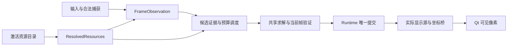

# 四模式识别、贴合与资源导入统一方案

原始核查日期：2026-11-11。后续实施截至 2026-11-12：**P0 调查/设计完成；P1 空资源默认入口及 P2 四组合基础/controls、作者与结构显示、S1 预处理、基础包内相似组登记、导入即启用和缺基础禁选/禁作者导入已接线；P3 实际候选已进入公共任务调度，旧 S0/S1 独立候选控制器退出；共享求解及登记楼层恢复已移入 app；P4 观察、资源和提交外围仍在收敛。S0 困难已接通当前帧结构候选、手动确认及原完整 native local 验证后的身份提交，整包 rank 声明和学习仍未开放；导入 S1 保留观测资格限制。完整四模式生产入口、首贴/重开速度与实机验收尚未完成**。本文件同时作为现状清单、设计和实施台账，不另建重复任务说明。第 2–4 节现状引用绑定原核查 commit，后续实施状态另见第 8 节。

**2026-11-11 用户修订**：项目实际复核的相似组直接登记在识别基础结构包内，随其版本制包、导入和更新。本轮交付采用这一归属；历史台账中的独立登记包、专用发布索引和联网来源认证要求已撤销，历史证据保留，不能继续作为新增交付前提。

**同日导入交互修订**：基础结构与楼层控件同一个资源包，导入成功后自动启用对应上下文；未导入可用基础资源的模式按钮置灰且不可选择，也不得导入对应作者图。现有内部组件类型和依赖校验可复用，不能要求用户另行导入控件或再点一次启用。必要的替换影响仍须展示并沿既有事务处理；作者更新不能绕过基础结构的实际可用性。接线与定向验证见第 8 节，以下历史台账中的“仅保存、不启用”和“作者可先保存”不再是最终产品要求。

## 识别与贴合的新执行规则（2026-11-12 用户修订，待实施）

识别由两条策略并行竞争：结构不足以直接确认地图时，候选识别持续提供证据和当前帧候选贴合；结构充分时，预处理结构索引直接识别地图。两条策略同时启动，共用不可变帧和资源上下文，四模式共用同一调度、取消和提交核心，不按模式复制控制器。

- 尚未锁图时，使用候选提供的当前帧预贴合。这一要求覆盖历史“S0 困难不开放候选预贴合”的产品选择；预贴合仍与已确认身份分开。
- 任一路先产生有效锁图结果，就立即采用该结果，不等待另一路锁图或结束。一个提交者接纳赢家、取消另一任务，迟到结果不能覆盖已锁地图；候选列表和未确认提案不能冒充锁图。
- 锁定地图与已有可用位姿是两个状态。若赢家与预贴合地图相同，只有同帧、同层、同实际资源且仍通过当前验证的位姿才能复用；若地图不同，先撤旧预贴合，再求解锁定地图。关闭、换图、换层、结束本局和资源失效仍按实际任务上下文撤销，不能由旧结果恢复显示。
- 工作线程只生产结果，runtime 保持唯一身份、位姿和显示提交者。取消另一任务不能阻塞首个有效结果的提交；后台收尾保持有界。共享只读结构和预处理观测，各策略的可变求解状态独立。
- 直接结构识别需要真实的跨地图检索与正向身份依据。现有单图 pose index、fast 预计算或粗排序不能改名当成已完成的结构身份识别；目录缺口、原有结构/身份权限与楼层资格继续如实表达，不能由调度器补成有效锁图，也不要求另一条已有效的锁图路径等待它。
- 分别测候选识别、直接结构识别和固定地图/楼层的完整贴合，再记录首锁图、预贴合可用、首个正确可见像素及整链耗时。识别内部实际调用的几何计算明确标注，不重复相加；fast 分支日志不能叫完整首次贴合耗时。

**同日职责与并发修订**：识别算法和贴合整理分别实施，不要求识别等待贴合完成。资源准备、几何计算、结果生命周期也必须明确分开：

- 资源准备与更新负责实际文件、依赖、catalog/manifest、控件及输入资格校验，向算法提供有界缓存中的已验证只读 RAM 数据。准备后的内存内容不因磁盘随后变化而改变；受管理更新沿既有资源失效链撤销旧上下文，磁盘损坏由下一次准备或完整性检查发现。不能在数值计算中反复读盘来证明已持有内存的正确性。
- 几何计算只消费已准备结构、当前帧和明确的位姿/参数输入。复用原有求解编排及算法，保留当前帧像素残差与几何复核；不读取文件、检查 catalog/controls 或提交身份/显示，也不把资源 IO 藏进 fallback。
- runtime 独占请求、帧、地图/层、资源上下文和显示提交，在结果收取与发布处核对实际相关的内存代际；取消、迟到结果、关闭和更新不属于几何求解器。复用既有失效机制，不另造生命周期或校验凭证。
- 分别报告资源准备、纯几何计算和完整入口耗时；原版与整合版在相同输入、参数和算法路径下比较。既有 `e7361ff` 四模式“独立 fit”数据计时为 host 构造加完整 `fit`，包含资源 IO/复核，只能作为固定地图组件测量，不能称纯算法耗时。准备开销仍计入实际发生该准备的端到端流程，不从总体验中消失。

当前只完成两路并行计算的诊断接线，尚未完成上述竞争锁图：直接结构结果固定 `authorizesIdentity=False`、`lock=False`，候选扫描返回会取消其任务。以下历史实现与回放记录不能当作这项修订已经完成。固定测试包 `b75b7a1` 的用户反馈为首贴/重开慢、无法锁图及候选显示闪烁；条件贴合的离线函数耗时不能代替这条实际链路的验收。

后续开发新增 `constraint_kind='corner-centre'` 的索引、观测和独立 B 验证接口，只约束实际角点中心及射线方向；默认仍为 `full-chain`，生产 Qt 尚未切换。该接口不授予身份或锁图资格，目录缺口、观测独立性、当前帧全局复核及资源资格仍须分别解决。两种约束不得混用；方向门槛只影响新中心模型，原完整链模型的端点容差保持原行为。回归模块 `test_structure_identity_corner_centre` 纳入既有 fit-simulation CI。

直接结构接线的计算接口进一步分为同步 `compute()` 与固定 proposal 的当前帧复核：前者返回实际 typed observation/recognition，后者消费已准备只读资源并调用原 canonical residual，不运行完整 `fit()`、改矩阵或选择最低残差。完整识别状态、未决/失败家族及输入顺序保留；姿态通过不能代替完整地图排他证据。`preparation_resources` 仅记录初次实际读取的 prepared FileRef（可能没有可用解码），不授予几何或身份资格。诊断线程复用同步计算，真正 race/runtime 唯一赢家接线仍待完成。定向模块 `test_structure_identity_fixed_pose` 纳入同一既有 CI。

原 local 链独立于上述新指纹检索：完整 `SideEntryEvidence` 竞争与 `SidePoseRecovery`/`verified_side_candidate` 已得到合格 native 赢家时，不能再由整包 `qt_rank_ready=False` 将它抹掉。消费者按实际 side entry 的地图、层、区域、产品及源用途核对赢家，legacy、缺绑定或明确禁止仍拒绝，不删除竞争者另找次优。main proposal 的真实用途限制、未完成/歧义/失败与资源失效检查保持；只有当前 local 结论进入既有 runtime 身份归约，不提升整包声明、学习或语义门库存。生产 `map` 入口的定向模块 `test_client_local_identity_commit` 纳入既有 runtime CI。

首次贴合准备复用同一次短期 operation 的已验证静态模型和绑定，避免每个 getter 再次解析路径、读取 manifest。首阶段仅取得快照，实际成功的 typed byte batch attach 后才可 fresh 读取；末次实际字节、上下文、模型归属及取消检查保留，失败或未知 loader 沿原 guarded 路径。真实导出/安装的 cold S0D fixture 中 manifest 读取 52→25、catalog proof 134→53；这是调用次数回归，尚非实际首贴耗时结论。`test_structure_pose_preparation_context` 纳入既有 fit-simulation CI，四模式与 legacy 等联合回归 52 项通过。

显式结构底图在同一次 solve 中只生成一次像素，渐进和最终 publish 仍各自通过原 provider 读取实际 reference 身份并核资源当前性，不以预期版本表替代实际缓存中的来源。首次材料的小元数据与坐标桥独立，像素直接复用；作者、自定义路线及结构回退仍执行原显示源复核。这只移除重复栅格化，不跳过提交时的当前帧、楼层、设置、取消及资源归属检查，也不代表首贴已达到目标。

同 fit 的残差复用也覆盖未显式指定 observation bounds 的默认开图入口：最终 canonical 包装使用本次 solver 自行提取的同一 visible 观测，保留原数值核与完整缓存键。不同帧、矩阵、reference 或 visible 仍重新计算，fit 结束后清空；不信任 sensor 自报的 residual，也不跨帧延用结论。

## 新增阶段目标：流程清晰且处理耗时恢复原版水平（2026-11-12）

四模式共用可追踪的识别与贴合管线，在保留既有证据、候选竞争和结果资格的前提下，让整合版对同批真实样本的处理耗时恢复到原版代码水平。此阶段目标补充 P3/P4，不替代首贴约 500ms、已锁图重开约 300ms 的最终目标，也不将原版耗时视为用户体验合格线。

- **流程与职责**：按实际算法明确观测、候选范围、位姿提案、当前帧复核和结果提交的输入、输出与先验；四模式使用同一编排和实现，差异来自资源 provider、楼层/坐标合同及有依据的参数与能力。用真实算法名称说明模块，不能只改名、套 wrapper 或保留四条隐式分支。ORB 等新算法先经同输入对比，再决定是否采用。
- **同批可比**：使用用户提供的完整客户区样本，绑定原版/整合版源码和实际消费资源、环境、缓存状态与计时端点；交替重复测量，报告逐帧配对结果及各模式 n/p50/p95/max。识别首贴、已锁图后重新开图分别测量，阶段计时和最终处理计时分别记录；嵌套阶段不相加。仅有函数或 dispatch 返回时，不称首次正确可见像素。
- **不以功能损失换速度**：启动拒绝、未执行、未显示、失败、预算耗尽均保留；不能记为零耗时，不能缩小应竞争的资源池、跳过验证或提高未经证明的资格来凑速度。原版与整合版的输出和失败差异逐条核对；原版输出本身不能代替独立地图、楼层和位姿真值。
- **完成依据**：四模式实际生产入口均完成可比回放；处理耗时分布恢复原版水平，重复结果能区分测量波动与持续回退，仍存在的明显逐帧/尾部回退已定位并解决；实现的模块边界与实际调用一致，相关取消、关图、换层及迟到结果回归通过。不能只用平均数、局部特征速度或少量成功样本宣布完成。真实游戏和可见像素证据不足时继续单列未测。

当前对比起点为原版 `0ba7ce83`、整合版 `7b23b6f` 与 `g-map-watch-20261109-02` 的 371 张完整客户区：S0 困难142、S0噩梦75、S1困难62、S1噩梦92。既有整合版三个上下文的启动拒绝属于待解决的功能缺口，不是速度结果。后续修订绑定各自新提交，保留本轮记录；性能原始记录与游戏样本留本地，不随源码提交。CartoVeil 同样本函数测试仅作外部参考，不替代原版配对比较。

### 根据耗时审查制定的修复方案（2026-11-12，实施中）

对照原版 `0ba7ce83` 与整合版 `9b7bbe9`。S0 困难 event97 的两次回放中，整合版数值 fit 为 104–106 ms，原版为 132–140 ms。整合版冷准备耗时 315–324 ms，已锁图重开时命中缓存约 0.1 ms，但重开的首份材料仍需 515–530 ms，原版约 259 ms。先修两条路径都经过的显示与提交，再修首次资源准备。识别和 S1 控件可以同步推进，共用文件由一个负责人合入。

| 实施项 | 修改位置与行为 | 验证结果应满足的条件 |
| --- | --- | --- |
| 1. 显示材料按来源复用 | 在显示 provider 和 `client_route_preferences` 中，以实际地图、楼层、结构或作者来源、版本、变体及自定义路线内容代际复用 RGBA 像素与坐标桥。初次实际读取和转换完成后检查来源。在一次有边界的资源消费中合并嵌套的相同检查。runtime 提交只处理当前结果、变换和显示状态。 | 同源同层连续重开及渐进到最终发布时，已有材料直接复用。换作者、同路径换资源、自定义路线编辑或切到结构回退层时重新取得正确材料。通过实际显示入口检查读取次数、像素、矩阵及迟到结果。 |
| 2. 静态准备前移，控制内存 | 制包时保存可持久化的距离场和结构描述。资源启用后复用已经解码的坐标、入口模型和索引。全域索引与楼层索引共享描述数据。关图期间优先准备当前模式的公共数据，已锁图时优先当前图及可能使用的楼层。复用既有有界缓存与准备任务，同一资源请求只准备一次。开图时优先取得当前目标，未命中才补该目标。 | 分别测引擎就绪、后台准备、冷开图、缓存命中及保留内存。开图能抢占无关预热，换包后的旧任务无法发布。首次从未访问的地图也进入统计，启动及开始本局的等待单列。 |
| 3. 同帧观测与位姿复用 | 捕获一次完整客户区，按同一帧和观测范围共享轮廓、墙线和拐角。候选特有的投影、未知区域及竞争判断分别保留。识别已给出唯一位姿时，核对地图、层、帧、来源、坐标桥和用途，在当前结构上复核该位姿，精度不足才细化。仅身份唯一、位姿仍有歧义或验证失败时，沿用原版距离场匹配与局部恢复。 | 已验证且可复用的位姿跳过全局搜索。对同图多位姿、错误位姿、跨帧及坐标桥不一致，用真实求解入口验证仍能拒绝或恢复。比对最终投影和竞争结论，记录实际省下的搜索次数与时间。 |
| 4. 完成未锁图的两路竞争 | 候选识别与预处理结构检索使用同一帧并行工作。候选可先提供预贴合。任一路产生完整、符合用途的唯一身份时，runtime 立即锁图并取消另一任务。直接检索须保留全体竞争者、缺失层和独立观察复核。正式接入前将纯诊断计算按需运行，单列其初始化成本。已锁图重开直接定位当前地图。 | 分别复现候选先赢、结构先赢、仅预贴合、双方未决和关图后结果迟到。记录首锁时间、预贴合时间及取消后实际停止的工作。缺少可靠来源绑定的地图继续计入竞争与缺口。 |
| 5. 恢复 S1 默认控件的原版行为 | 在楼层观察器核对解码后的完整参数，包括楼层顺序、搜索区域、UI 尺寸与阈值。与原版默认参数等价时使用原版坐标及 UI 复核规则，复用其已有保存帧资格。每帧实际读取高亮楼层。不同参数按对应证据确定资格。 | 两个实际导入包均从开始本局、开图进入观察和候选扫描。以图像中高亮控件的独立读数核对楼层。关闭画面、未知层和过期资源仍能正确处理。普通实时使用资格单独验证。 |
| 6. 保留同次开图的成功材料 | runtime 持有已完成材料的原始帧和显示授权。同层普通刷新失败、取消或临时读不到楼层时继续显示已有材料。新结果完整通过后原子替换。确认关图、明确换层或资源来源失效时结束旧显示。首次只有待复核预览时，继续标明其状态。 | 从实际刷新入口核对显示端的像素与令牌。失败期间旧图可见，新观察独立验证。旧材料确认不能提交新帧，换层、关图、换包后的迟到结果不能恢复旧图。 |

**交付顺序与测量。** 先按资源显示、S1 观察、材料保留三块处理现有未提交修改及其集成失败，分别形成可验证提交。显示负责人和材料保留负责人串行合入共同的发布与刷新接缝。第 1 项先用已锁图重开验证收益，第 2 项再用冷开图验证收益。第 3、4 项按同一帧的识别、固定地图贴合、结果提交三个边界联合回放。识别启动前 66–69 ms 和首次发布外围 181–182 ms 目前是混合区间，实施时补足取帧快照、资源读取、显示消费及提交的独立计时，按实际子调用决定取舍。

每项先用 event97 交替回放验证具体故障，再用四模式预先选定的每模式 8 帧检查整条入口。最终在同一资源、缓存策略和确认条件下，使用既有 371 张完整客户区样本与原版配对，分别报告识别、贴合、首份预览、最终材料、已锁图重开和引擎准备的 n/p50/p95/max，以及启动拒绝、无材料和有图像真值支持的错层次数。先达到原版处理耗时水平，再用带显示端点的验证检查首个正确可见像素约 500 ms、已锁图重开约 300 ms 的目标。

全域结构索引新增楼层分区复用，楼层索引直接复用已构造的描述子，保留对应缺口、完整域和原工作顺序。实际 native 工厂的三楼层 fixture 从 4 次索引构造降到 1 次；与独立楼层索引对照，完整链和角点中心的检索、预算、取消及缺失/禁止/域外项保持一致。相关 76 项通过。这是功能和工作量验证，最终干净版本的引擎准备及开图耗时仍待复测。新模块纳入既有 fit-simulation CI。

显示消费已合并同一 native 读取的重复检查，保留原两个实际 guard。显式结构底图按实际只读来源复用 BGRA/RGBA 和坐标桥，缓存最多三条、192 MiB；未知 provider、legacy、作者、自定义路线及结构回退保留原路径。实际锁图、关闭后重开及渐进到最终材料的功能回归只栅格化、转换各一次。独立线程复核曾发现普通 LRU 淘汰被误报资源变化，已把消费及末次核对保持在原同一 RLock 内，并验证正常读取仍全部完成。336 项相关联合及修后 20 项专项通过；这是工作量与正确性检查，毫秒收益待干净版本复测。

同次开图的完整成功材料继续持有自己的帧、授权和捕获上下文，新观察与旧材料 ACK 分开；新最终结果合格后替换。普通失败、取消和临时未知层保留旧材料，关图、明确换层、资源或捕获上下文失效及原两帧强身份冲突仍撤销。协议回归按实际关图再重开、禁止已知组重复 rank、实际控件调用签名核对，49 项通过；历史联合的四项旧断言失败记录保留，不能倒写成当时全绿。

等价默认 S1 controls 已恢复原观察器数值与资格语义，仍不提升一般 live 身份或点击权限。实际两份安装包与预选 16 张完整客户区的观察器回放中，13 张有独立可读楼层的图片全部一致，三张无楼层读数；16 张与原默认观察器返回值相等。地图身份、位姿及 GUI 显示尚不能由此判定。

直接结构路径另增加成熟局部拐角/射线算法的预处理索引，保留原精确搜索、竞争 band 和最终验证。距离下界只剔除不可能支持原四拐角门槛的 seed；显式完整目录缺成员时保持未决，不可靠数值范围放弃筛选。实际四模式 source/样本的原新局部搜索逐值对照保持一致，event97 精确评估从 2234 次降到 778 次，仍保留全部 30 图及 legacy 竞争者。这不是处理毫秒或整链准确率结论。

上述 local 工作已接入 S0 生产竞争锁图，继续共用原 passport、main、local、recovery 和登记条件；prepared adapter 复用已准备的静态模型，每帧使用独立查询缓存，并保持 S1 entry 的既有用途拒绝。runtime 在发起两 lane 前取得 priority/context 快照，后台不回读其加锁状态；结果仍由 owner 校验当前票据后提交。三种实际工作次序及原关闭/设置/结束/资源更新的 20 个细分场景通过，定向联合共 14 项。当前帧完整 work 的位姿已沿生产调用传入首贴；event97 生产配置模拟功能回放完成真实锁图和重开，替换边界仅为采集/currentness 与产品身份，不能作为正式性能。S1 公共坐标资源声明与 RAM provider 已另提交；其 source Work 接入共同 race 的当前实现通过了受控测量的双模式功能回归，完整实帧速度尚待最终版本复测。**关图准备和四模式配对耗时阶段仍未完成**。

S1 的结构 lane 使用 `CommonCoordinateObservationWork`：先计算原公共坐标报告，由 runtime 的单一候选池归约入口消费，再按真实池的唯一 ID 做原 fixed fit。完整当前 Work 直接交原材质、round/core 链，既不往单 scanner 的 seq/pose ledger 注入另一来源，也不重新准备 typed/fast 或再 fit。候选先贴仍可显示，结构排除该候选时只撤其显示凭据，保留观察票据给另一路。普通关图后实际已完成的报告只交历史队列应用一次；未开始的 source 原子撤销后才采用历史计算，避免同帧两次提取。已锁重开不再启动身份竞争，但必须取得新帧的贴合材料。普通单路材质异常保留另一条路径继续恢复，实际上下文失效仍撤销整次请求。两模式 16 项 runtime 次序/失败回归与 6 项 Work 边界、45 项现有策略联合 67 项通过；数值测量/采集/显示图为显式替身，不代表算法准确率或游戏验收。真实 event256 已从隔离新包进入两 lane，公共坐标未决，候选正常提供预贴合，未声称唯一锁图。公开 race 诊断只投影状态，不能嵌入指向 terminal 本身的原始结果而形成循环。

退出沿用现有 Coordinator/startup cleanup 的异步 busy 轮询，纳入本 runtime 实际用过的 race 队列。`cancel()` 非永久停止并保留同 engine 的后续 runtime 复用；停止准入、普通新 run 排号和实际提交号分别表达，旧 preflight 不能取消新观察。阻塞输家数值核时 busy 仍为 true，UI 不 join，排空后才完成退出。31 项定向回归及独立增量复核通过。

## 1. 范围与基线

- 工作区：`E:\codex\worktrees\cd7b\星图`。开始时工作树干净、detached HEAD，源码 `cc5100c6e3cea425ac4dbed82df92623754f81fa`，fetch 后与 `origin/main` 一致；文档分支为 `codex/unified-recognition-resources-plan-20261110`。
- 目标为原星图的 `s0:difficult`、`s0:nightmare`、`s1:difficult`、`s1:nightmare`。S1 `difficulty2` 是已停用的历史普通模式。当前 `experiments/qt_quick/` 实为默认产品客户端，不能按目录名忽略。独立 Python/C#、WPF、Qt/C# 迁移实验不归本任务，不改其代码或分支。
- 当前源码已包含 `7991dbbe` 之后 PR #126 的 S0 控件几何修复；不能据此推断 S1 问题已解决或实机已通过。
- [PR #111](https://github.com/chenhuanh9-a11y/xiaochao-assistant/pull/111) 已关闭、未合并，由 [PR #112](https://github.com/chenhuanh9-a11y/xiaochao-assistant/pull/112) 替代。#112 合并提交 `eb67407f7b5b3e608b0f4e90b50fb6ba294bd466` 经 `git merge-base --is-ancestor ... HEAD` 确认为当前祖先。复用既有通用 V2 作者包、制包器和快照，不重做 #111 的独立加载器。
- 用户允许新架构停止支持全部旧包，不授权现在删除原图、安装资源、个人数据、备份或历史事务。本轮只改文档，不执行资源迁移、清理、安装、程序启停、游戏操作或发布。

以下“现状”来自该 commit 源码及第 7 节本轮测试；“目标”均待实现。历史通过数量不当作本轮执行结果。

## 2. 四模式实际调用与验收清单

### 2.1 默认入口及四组合矩阵

[qt_client_entry.py:20](https://github.com/chenhuanh9-a11y/xiaochao-assistant/blob/cc5100c6e3cea425ac4dbed82df92623754f81fa/tools/qt_client_entry.py#L20) → `client.main` → [QtClient:125](https://github.com/chenhuanh9-a11y/xiaochao-assistant/blob/cc5100c6e3cea425ac4dbed82df92623754f81fa/experiments/qt_quick/client.py#L125) 构造 providers、LiveRuntime、Session。游戏输入/显式操作经 Session 到 runtime；捕获、控件观测、候选报告、最终显示是不同证据端点。

| 组合 | 楼层控件：入口、输入与输出 | 地图识别：实际核心与结果语义 | 贴合与依赖资源 |
| --- | --- | --- | --- |
| S0 困难 | `LiveRuntime._observe` → `observe_s0_map` → `locate_vertical_floor_controls` → `classify_label`。输入当前客户区帧及模式合同；输出地图界面观测、控件 ROI/标签/高亮、语义层及失败原因。层 ID `1/2`。 | `_rank_identity` → `NativeDifficultCandidateEngine.rank` → `MapIdentityEngine.rank`；已建立组可走 `rank_established_group`。输入当前帧、层、预算/组上下文；输出 rank rows 和入口/结构证据，由 runtime 提交。 | 共用 `_AlignmentHost.fit` → fast/recovery/independent fit → 当前帧 residual → commit。依赖 `difficult-native-manifest.json` interfaces、identity pack、typed NPZ、坐标/版本绑定、入口索引、出口图标及两层实际显示桥。 |
| S0 噩梦 | 同一 S0 detector/模板分类器；合同 `B1/1/2`，验证完整三行与实际高亮，不借困难槽位猜层。 | 同一 `MapIdentityEngine.rank` / `rank_established_group` 框架，使用噩梦 pack、入口和结构证据；资源池与门语义不等同于困难。 | 同一求解/验证/提交。依赖 `nightmare-map-pack.json`、shared-structure index、canonical coordinate pack、version bindings、`nightmare-entries/`、结构显示及可选作者绑定。 |
| S1 困难 | `_observe` → `detect_s1_floor`，完整带符号竖列 + 独立地图 UI 几何；输入帧、`s1/difficult` 与相关帧范围，输出 `observedFloorValidated` 等证据。层 ID `-1/-2/-3/-4`。 | `_rank_identity` → `_rank_s1_structure` → `qt_s1_structure_scan` → `StructureCandidateScanner.scan/rank_rows` → `StructureEvidenceSession.commit`。输入完整 catalog、当前层、预算/顺序；输出支持/未知/未扫描集合及 pose。**排序不等于正式身份确认**。 | 共用 host/solver；上层显式 ROI、prepared scan、多岛/组件恢复。基础根 `seasons/s1/difficult/`：native manifest、typed/坐标/入口/版本产品。私测坐标先验另有入口，不授予正式身份。 |
| S1 噩梦 | 与 S1 困难同一观测算法，传 `s1/nightmare` 与四负层合同。 | 同一 scanner/session，但 catalog 与完整候选池来自噩梦根；正式、手选、私测能力仍受当前产品策略限制。 | 同一求解/验证/提交；根 `seasons/s1/nightmare/`，各层参考和绑定独立，不能串用困难地图池。 |

关键代码依据：

- 层合同：[floor_contract.py:47](https://github.com/chenhuanh9-a11y/xiaochao-assistant/blob/cc5100c6e3cea425ac4dbed82df92623754f81fa/app/floor_contract.py#L47)。S0 包装 [s0_vertical_controls.py:199](https://github.com/chenhuanh9-a11y/xiaochao-assistant/blob/cc5100c6e3cea425ac4dbed82df92623754f81fa/app/s0_vertical_controls.py#L199)，标签消费 [floor_control_region.py:172](https://github.com/chenhuanh9-a11y/xiaochao-assistant/blob/cc5100c6e3cea425ac4dbed82df92623754f81fa/app/floor_control_region.py#L172)，列检测 `:331`；[s0_floor_templates.py:29](https://github.com/chenhuanh9-a11y/xiaochao-assistant/blob/cc5100c6e3cea425ac4dbed82df92623754f81fa/app/s0_floor_templates.py#L29)、`:54` 是代码合成模板，尚非外置素材库。
- S1 [s1_floor_observation.py:104](https://github.com/chenhuanh9-a11y/xiaochao-assistant/blob/cc5100c6e3cea425ac4dbed82df92623754f81fa/app/s1_floor_observation.py#L104)、`:169`；几何原语 [s1_map_ui_geometry.py:129](https://github.com/chenhuanh9-a11y/xiaochao-assistant/blob/cc5100c6e3cea425ac4dbed82df92623754f81fa/app/s1_map_ui_geometry.py#L129) 同样被 [S0:188](https://github.com/chenhuanh9-a11y/xiaochao-assistant/blob/cc5100c6e3cea425ac4dbed82df92623754f81fa/app/s0_vertical_controls.py#L188) 消费，不能按文件名前缀认定专属。
- runtime 分流：[client_live_runtime.py:6083](https://github.com/chenhuanh9-a11y/xiaochao-assistant/blob/cc5100c6e3cea425ac4dbed82df92623754f81fa/experiments/qt_quick/client_live_runtime.py#L6083)、`:1760`、`:1117`；S0 [map_identity_engine.py:737](https://github.com/chenhuanh9-a11y/xiaochao-assistant/blob/cc5100c6e3cea425ac4dbed82df92623754f81fa/app/map_identity_engine.py#L737)、`:998`，困难 [difficult_native_identity.py:64](https://github.com/chenhuanh9-a11y/xiaochao-assistant/blob/cc5100c6e3cea425ac4dbed82df92623754f81fa/app/difficult_native_identity.py#L64)。历史 `DifficultCandidateEngine` 不能代替当前 native 默认路径。
- provider 根及构建：[client_providers.py:214](https://github.com/chenhuanh9-a11y/xiaochao-assistant/blob/cc5100c6e3cea425ac4dbed82df92623754f81fa/experiments/qt_quick/client_providers.py#L214)、`:278`、`:334`；S1 scanner 注入 `:450`；报告/会话 [s1_structure_selection.py:91](https://github.com/chenhuanh9-a11y/xiaochao-assistant/blob/cc5100c6e3cea425ac4dbed82df92623754f81fa/app/s1_structure_selection.py#L91)、`:135`、`:235`。
- S1 静态回放能力仍声明 `liveValidated=False`，native context 仍有 live gaps：[s1_native_resources.py:18](https://github.com/chenhuanh9-a11y/xiaochao-assistant/blob/cc5100c6e3cea425ac4dbed82df92623754f81fa/app/s1_native_resources.py#L18)、`:133`、`:141`。四组合是统一目标，不是当前四组合均具相同自动权限的结论。

### 2.2 贴合的共享与外围分歧

现有真实共享链是：当前捕获/楼层 → 候选或已锁图 → `_AlignmentHost.fit` → `_fit_observation_uncached` → steady（适用时）/fast → 同层平移、登记层关系、入口复核恢复 → 独立求解 → 当前帧 canonical residual → runtime `_solve_observation` → group/core/render → 实际显示层与坐标桥 → Qt 像素。

依据：[host:156](https://github.com/chenhuanh9-a11y/xiaochao-assistant/blob/cc5100c6e3cea425ac4dbed82df92623754f81fa/experiments/qt_quick/client_live_runtime.py#L156)、[fit:355](https://github.com/chenhuanh9-a11y/xiaochao-assistant/blob/cc5100c6e3cea425ac4dbed82df92623754f81fa/experiments/qt_quick/client_live_runtime.py#L355)、[求解次序:559](https://github.com/chenhuanh9-a11y/xiaochao-assistant/blob/cc5100c6e3cea425ac4dbed82df92623754f81fa/experiments/qt_quick/client_live_runtime.py#L559)、[fast_structure_alignment.py:420](https://github.com/chenhuanh9-a11y/xiaochao-assistant/blob/cc5100c6e3cea425ac4dbed82df92623754f81fa/app/fast_structure_alignment.py#L420)、[single_map_structure.py:620](https://github.com/chenhuanh9-a11y/xiaochao-assistant/blob/cc5100c6e3cea425ac4dbed82df92623754f81fa/app/single_map_structure.py#L620)。首贴与重开都须当前帧验证，历史 pose 只是种子。

| 接缝 | 当前事实 | 需要收敛 |
| --- | --- | --- |
| ROI/组件 | 默认无 bounds 路径与 S1 显式 ROI 路径不同；后者有最多 32 岛分解及一致性复核。 | 一次 FrameObservation 明示地图/控件 ROI、遮挡/组件，求解策略依观测质量选路径；不能直接删除多岛恢复或一律扫描最大区域。 |
| 候选 | S0 rank 与 S1 scanner 产物、预算、续扫与会话不同。 | 提取实际证据生产和公共调度/消费循环，最终退出两套候选控制器；wrapper 不是完成。 |
| 状态 | RoundLayerGroup 管局内层关系，AlignmentCoreV2 管 pose/显示授权，runtime `_render` 管当前渲染；职责不同。 | runtime 唯一提交，group/core 为内部模型；worker 返回结果，不另写 UI/候选池，整理重复的外围上下文。 |
| 显示 | 作者/路线是显示；S0/S1 provider 的能力接入不全相同。 | 同一 DisplayResolver 返回实际来源与桥；缺作者可回退同层结构，缺结构不能借作者图识别。 |
| 取消/迟到 | 已有 Session generation、runtime epoch、capture、structure ticket、settings/display generation。 | 统一构造和校验，保留实际相关 guard，不能为了字段整齐删校验。 |

最终状态写者：[client_live_runtime.py:5747](https://github.com/chenhuanh9-a11y/xiaochao-assistant/blob/cc5100c6e3cea425ac4dbed82df92623754f81fa/experiments/qt_quick/client_live_runtime.py#L5747) 求解前/后及 commit 前核上下文，`:5970` 后更新 core/group/render；关图撤销 `:3379`。手动层意图 `_set_floor:2943` 与观测 floor policy 分开，观测函数返回不是直接改层的授权。Session 范围见 [client_session.py:163](https://github.com/chenhuanh9-a11y/xiaochao-assistant/blob/cc5100c6e3cea425ac4dbed82df92623754f81fa/experiments/qt_quick/client_session.py#L163)。显示消费者见 [client_route_preferences.py:106](https://github.com/chenhuanh9-a11y/xiaochao-assistant/blob/cc5100c6e3cea425ac4dbed82df92623754f81fa/experiments/qt_quick/client_route_preferences.py#L106) 和 runtime `:6145`；换作者不得改变身份/结构位姿/层，结构回退也须绑定实际渲染来源。

### 2.3 现有测试与未验内容

以下为可复用入口，不代表本轮全部执行。测试中真实调用了函数，不代表用了真实生产资源。

| 范围 | 测试及替身边界 | 仍需真实资源/实机 |
| --- | --- | --- |
| S0 两模式控件 | `test_floor_contract`、`test_s0_floor_highlight_geometry`；Qt `test_client_floor_region`、`test_client_s0_vertical`，含合成 glyph/曝光及 mock 分流；真实回放需 `S0_FLOOR_CONTROL_FIXTURE_ROOT`。 | 困难两层、噩梦三层原帧；亮/暗、过渡、遮挡、非地图，核实际 ROI 与层真值。 |
| S1 两模式控件 | `test_s1_recorded_floor_observation`、`test_s1_floor_observation`，数学竖列/map-interface 替身；真实回放需 `S1_FLOOR_FIXTURE_ROOT`。 | 各模式 B1–B4 完整客户区与裁剪；缺行/旧帧/高亮不稳不得猜层。 |
| S0 身份 | Qt `test_client_engine`，`test_native_similarity_runtime`、`test_front_gate_observation`、`test_side_entry_search`；部分真实 rank 注入空/合成资源。 | 导入资源构建实际 provider：正门/侧门/相似组/未知与不唯一，独立身份真值。 |
| S1 候选/资格 | `test_s1_structure_selection`，Qt `test_client_g_cycle_admission`、`test_client_g_cycle_solver_input`；adapter 可真实调用但捕获/solver fixture 非游戏。 | 两模式完整池、预算耗尽/未扫描/失败帧；首行或单候选不得自动升级正式身份。 |
| 四组合贴合/生命周期 | Qt `test_client_live_runtime`、`test_client_group_queue`、`test_client_session`；`test_shared_recovery_residual_contract`、`test_wall_raster_local_distances`。多处 synthetic provider/frame/fit/residual。 | 从正式入口到真实结构及实际图层：首贴/重开/换层/无门/缺绑定/错岛/取消/迟到/关图；正确可见像素和长期稳定性。 |

本轮未获得四组合真实准确率、实机采集/显示同步或输入到像素耗时，不能推断既有 S1 故障已修复。

## 3. 统一架构与必要例外

### 3.1 单一链路和提交者



以下是设计名，实施优先整理现有模块，不新增并列框架或流程工具。

| 目标模型/接口 | 输入输出及职责 | 替代范围 |
| --- | --- | --- |
| ResolvedResources | season/mode + 已激活目录 → 地图/层、typed reference、坐标/层关系、controls、入口、display 与版本身份；只读解析，资源管理器负责激活。 | 业务自行拼 `_internal`、S1 子根、作者平面和私测路径；禁止扫目录猜上下文。 |
| RunContext | request/opening/round、frame/capture、season/mode、相关 map/floor、资源版本/显示源和既有 generation；runtime 构造/验证，worker 消费。 | 分散构造和比对；逐个迁移 guard，不能用 mode 字符串代替资源身份。 |
| FrameObservation | 一次捕获 → map-open、控件 ROI、floor evidence、地图 ROI/组件、质量与未知原因。S0/S1 detector 只负责图像策略。 | scanner/fit/恢复重复裁剪与观察；detector 不私有管理 session 或提交层状态。 |
| CandidateEvidence/Report | 完整 catalog + observation + 预算/提示 → 支持/明确矛盾/未知、已扫/未扫、证据类型和临时 pose；同一调度器拥有池/续扫。 | 以 S1 新候选/调度逻辑为统一主链，把 S0 困难/噩梦迁入；参数化真实资源和层/入口语义后删除旧 S0 候选控制器，不长期并列保留。不同旧分数不直接相加；未知不排除。 |
| AlignmentRequest/Result | reference + observation + 可选历史/入口种子 → pose/residual、失败/取消/恢复来源、资源身份。共享 host/solver。 | 统一恢复/验证/预算，不按四组合复制；worker 不写业务状态。 |
| RuntimeState | 当前上下文 + 验证结果 → 候选/组/身份、当前层、pose/render。一个提交点写，UI 线程呈现快照。 | 候选、暂定显示、正式身份分开；S1 实验锁不得冒充正式。 |
| DisplayResolver | 结构 pose + 偏好 + 对应快照 → 实际图像和 display→reference 桥。 | 更新作者/路线/结构回退源只失效相关显示缓存，不隐式重识别或改身份。 |
| 统一诊断事件 | request/stage、outcome/reason、耗时、实际资源与图像范围，沿用有界本地日志/样本写者。 | proposal/verified/visible 终点分开，不另造审计系统或模式专属含义。 |

完成标准是旧重复控制与资源读取退出生产链；公共 wrapper 分别调用完整旧 S0/S1 控制器只是迁移中间态，每阶段列明剩余旧调用及退出条件。

**用户明确的 P3/P4 方向（2026-11-10）**：P3 向 S1 新识别逻辑统一，不能反向把 S1 改回 S0 控制流程。当前可核对的入口绑定 `c27e3b78`：[LiveRuntime._stream_s1_observation](https://github.com/chenhuanh9-a11y/xiaochao-assistant/blob/c27e3b78e0c9decd2ae8b3109bc0266597602b1b/experiments/qt_quick/client_live_runtime.py#L1167)、[provider 的 structure_scan](https://github.com/chenhuanh9-a11y/xiaochao-assistant/blob/c27e3b78e0c9decd2ae8b3109bc0266597602b1b/experiments/qt_quick/client_providers.py#L471) 与 [StructureCandidateScanner.scan](https://github.com/chenhuanh9-a11y/xiaochao-assistant/blob/c27e3b78e0c9decd2ae8b3109bc0266597602b1b/app/s1_structure_selection.py#L91)。P3 开始实施时复核实际默认调用和正式/私测资格入口，移除其 season/floor 硬编码须保留真实数据语义；统一调度不自动扩大证据资格。P2 暂沿用原 solver 核资源路径，不把这一步认作最终识别统一。

P4 首个可用贴合允许先显示，再继续复核；首次显示与最终复核完成是不同状态，不能仍把全部后续复核挡在首次显示前。复核发现偏差时更新变换，无效时撤销。当前帧、楼层、资源和显示来源等既有上下文约束仍须对应本次结果，暂定画面不得冒充正式身份或最终验证。纯位置修正复用已解码图片/纹理与稳定图片标识，只更新变换；实际图片/图层内容变化才重取图片，取消/换图/换层后的迟到结果不得恢复旧画面。验收分别记录首个可用像素、后续复核、位置修正和撤销，包含图片未重载的实际证据。

### 3.2 有证据的必要区别

1. **控件/层语义**：S0 模板与列验证、S1 带符号竖列/地图几何有实际差别；困难/噩梦层数不同。用导入的层映射/controls profile 和程序支持的 detector ID 表达；UI 名称、观测数字、结构 ID 分开，不能统一改成 F1/B1。
2. **门/入口能力**：S1 manifest 明确 `sideEntries=False`（`s1_native_resources.registration:73`）；统一策略按能力工作，无侧门返回缺口，不填假门位或空成功索引。
3. **结构/坐标/层关系**：每层实际结构和桥独立；无登记层关系可独立当前帧求解新 root，不猜投影。见 [round_layer_group_commit.py:14](https://github.com/chenhuanh9-a11y/xiaochao-assistant/blob/cc5100c6e3cea425ac4dbed82df92623754f81fa/app/round_layer_group_commit.py#L14)。
4. **证据资格**：S0 正式身份、S1 录帧候选和私测累积资格不同。统一状态消费，不以 flag、自述已验或 singleton 自动授权；资源包不能开启正式权限。
5. **相似组**：现有明确名单在 [client_group_registry.py:14](https://github.com/chenhuanh9-a11y/xiaochao-assistant/blob/cc5100c6e3cea425ac4dbed82df92623754f81fa/experiments/qt_quick/client_group_registry.py#L14)，仅 S0 两模式、F1 正门。项目复核后的精确成员、适用 season/mode/floor/入口及实际结构引用登记在 recognition-base 内，见 4.3。原名单原样迁移，新成员按实际复核更新；局部兼容、动态候选和条件扫描不生成或扩大登记。作者 display 不承担结构分组；缺表或缺绑定明确报告，S1/B3 与侧门不能借用旧 S0 F1 表。

ROI 生成、预算续扫、状态提交、排队/取消、错误格式、缓存和资源发现不是默认应保留的赛季分支；图像策略差别须由真实帧/契约证明。

## 4. 统一资源导入与独立生命周期

### 4.1 复用点与必须改造的限制

| 当前代码 | 复用 | 必须改变 |
| --- | --- | --- |
| [star_map_import.py:531](https://github.com/chenhuanh9-a11y/xiaochao-assistant/blob/cc5100c6e3cea425ac4dbed82df92623754f81fa/app/star_map_import.py#L531) | ZIP 路径/大小/重名/链接/完整性校验，inspect/install API。 | 固定 package ID、旧版本/协议和安装相对路径分支；新作者 validator 不能获得基础结构写权限。 |
| [generic_author_package.py:15](https://github.com/chenhuanh9-a11y/xiaochao-assistant/blob/cc5100c6e3cea425ac4dbed82df92623754f81fa/app/generic_author_package.py#L15)、[author_package_builder.py](https://github.com/chenhuanh9-a11y/xiaochao-assistant/blob/cc5100c6e3cea425ac4dbed82df92623754f81fa/app/author_package_builder.py) | 任意作者、图片与完整仿射校验、真实 provider 制包，无需逐作者登记代码。 | V2 只有显示，`requiresFiles` 绑定安装路径与精确底模字节。复用验证函数与输入，不维持长期旧入口。 |
| [author_resource_snapshots.py:22](https://github.com/chenhuanh9-a11y/xiaochao-assistant/blob/cc5100c6e3cea425ac4dbed82df92623754f81fa/app/author_resource_snapshots.py#L22)、`:190`、`:519` | 不覆盖旧版本、激活代际、逐层状态、提交见证与恢复。 | 目前仅作者有快照；基础/controls 无同等导入。需一个完整激活目录，不能逐包换指针留下混合依赖。 |
| [managed_base_resources.py:23](https://github.com/chenhuanh9-a11y/xiaochao-assistant/blob/cc5100c6e3cea425ac4dbed82df92623754f81fa/app/managed_base_resources.py#L23)、`:363`、`:981` | 所有权/冲突、锁、持久恢复与受控回滚。 | `_internal/managed-base-resources` 候选及源码库存仍由程序控制；无默认结构的新装不能当损坏去强修。 |
| [client_resource_startup.py:9](https://github.com/chenhuanh9-a11y/xiaochao-assistant/blob/cc5100c6e3cea425ac4dbed82df92623754f81fa/experiments/qt_quick/client_resource_startup.py#L9)、[client_paths.py:63](https://github.com/chenhuanh9-a11y/xiaochao-assistant/blob/cc5100c6e3cea425ac4dbed82df92623754f81fa/experiments/qt_quick/client_paths.py#L63) | 资源消费者租约与 pending 恢复。 | production root 绑程序 `_MEIPASS`，状态在安装 `work/`；要拆程序路径/资源根/快照使用期，全进程租约不能原样限制独立激活。 |
| [client_resources.py:471](https://github.com/chenhuanh9-a11y/xiaochao-assistant/blob/cc5100c6e3cea425ac4dbed82df92623754f81fa/experiments/qt_quick/client_resources.py#L471)、[client.py:143](https://github.com/chenhuanh9-a11y/xiaochao-assistant/blob/cc5100c6e3cea425ac4dbed82df92623754f81fa/experiments/qt_quick/client.py#L143) | 本地/在线同服务、`versioned=True`、资源变化通知。 | 入口接受全部资源类型，激活后 provider/任务/缓存一并失效，不只刷新作者列表。 |
| [build_qt_client.py:982](https://github.com/chenhuanh9-a11y/xiaochao-assistant/blob/cc5100c6e3cea425ac4dbed82df92623754f81fa/tools/build_qt_client.py#L982)、`:1069`、[build_qtifw_trial.py:94](https://github.com/chenhuanh9-a11y/xiaochao-assistant/blob/cc5100c6e3cea425ac4dbed82df92623754f81fa/tools/build_qtifw_trial.py#L94)、[qtifw_map_seed.py:140](https://github.com/chenhuanh9-a11y/xiaochao-assistant/blob/cc5100c6e3cea425ac4dbed82df92623754f81fa/tools/qtifw_map_seed.py#L140) | 程序/数据分区、Setup、安装保护；QtIFW release 也复用 trial 命名脚本。 | QtIFW 仍带 seed ZIP 并先修 managed base；只处理旧 Inno 不够。常规升级不再带入/重置活动基础和作者资源。 |

数据还有源码限制：[season_map_resources.py:19](https://github.com/chenhuanh9-a11y/xiaochao-assistant/blob/cc5100c6e3cea425ac4dbed82df92623754f81fa/app/season_map_resources.py#L19) 的固定 source version/布局集合，[s1_native_resources.py:45](https://github.com/chenhuanh9-a11y/xiaochao-assistant/blob/cc5100c6e3cea425ac4dbed82df92623754f81fa/app/s1_native_resources.py#L45) 的固定地图数/成员/层和 OpenCV 版本校验，[generic_author_base.py:162](https://github.com/chenhuanh9-a11y/xiaochao-assistant/blob/cc5100c6e3cea425ac4dbed82df92623754f81fa/app/generic_author_base.py#L162) 的赛季路径，以及 provider `:429–448` 的私测文件/固定摘要。不调整这些职责，新增地图仍要发程序，不能宣称独立更新完成。

### 4.2 实际外置范围

采用一个 `xingtu-resource-package` 容器、格式版本 1，内部组件按类型验证。容器清单与只读 catalog 已开始实现，组件语义 decoder 和正式样包尚未完成；不新增冻结 gate。一套版本/依赖/导入/恢复，组件 parser 验证数据语义，不另造四套安装事务。

**默认制包与交付边界**：基础结构 ZIP 一并提供干净结构、门/出口、楼层/坐标关系、配套识别贴合预处理和 controls 数据，用户不必另找控件下载包。包内保留 recognition-base 与 controls-profile 的组件及精确依赖划分；这是随结构资源发布，不是放回软件本体。作者路线图片、路点和逐层配准独立为 display/路线资源，不混入干净基础结构。

| 组件 | 进入受管理导入的内容 | 程序保留 |
| --- | --- | --- |
| recognition-base | 地图/层注册、typed NPZ 的 mask/墙/门/通道/实际消费特征、identity pack、结构/版本索引、坐标画布/变换、可靠层关系、入口模板/索引、侧门搜索产品、出口图标、基础结构显示素材/配置。包含当前消费者确需的参考图，不默认复制整份游戏原包。 | 求解、特征计算、证据验证与安全解码器；地图成员不硬编码。作者显示不反向授权结构身份。 |
| recognition-base 内的相似组登记 | 项目明确复核的精确成员、season/mode/入口/层范围、逐成员实际结构引用及复核来源；与结构版本一并发布。 | 校验声明、成员范围和实际结构绑定；数据制作中的复核责任保留，登记本身不授予 pose，也不改变模式的 rank/live/楼层资格。 |
| controls-profile | 合法层/标签映射、列/地图 UI 布局数据；S0 合成模板库及生成参数/来源；S1 几何 detector 的游戏布局 profile 与适用尺寸。同季两模式可依赖同一组件及不同层合同。 | detector 算法、数据类型/合理范围校验、通用数值稳定/安全阈值。新模板可更新数据，新控件机制可能要改算法。 |
| display | 作者/原生/结构显示图片与元数据、每层 display→reference 配准，精确依赖结构/坐标版本，允许层子集。 | 解码、仿射验证、渲染、用户选择。无作者时可显示同层结构自身来源。 |
| 可选 recognition-hints | 当前确有消费者的入口坐标 prior、预制索引、来源及坐标依赖；`s1-private-assets` 不绕过 resolver。 | 是否启用相应实验算法由程序策略决定；prior 只作种子，不替代当前帧验证。未采用实验产品不是强制基础依赖。 |

品牌、Qt 图标、教程和许可证仍为程序素材。不能按 `assets/`、`references/` 名称全部迁出；exporter 从授权真实资源输入解析消费者清单。原始游戏数据/未授权素材不进源码 Git，新格式也不授予分发许可。

S0 当前模板由 OpenCV Hershey 字形合成，并无现成模板图片包。先从当前生成器导出等价数据并验证分类消费，运行时从 controls 读取；缺模板明确不可用，不能在程序静默生成默认库。预处理缓存可从已导入数据重算，缓存不是默认基础资源。

软件携带算法与解码器。与地图结构绑定、计算重且可复用的轮廓、距离场、特征索引和入口描述随结构资源并绑定对应版本；控件模板/层映射随包内 controls 组件。当前帧特征、依赖视口的中间量和临时求解在运行时计算；已解码图片及可重算缓存留内存或独立本地缓存，不能改写导入包。这是目标归属，现有预处理消费者仍须逐项迁移并回放，不能因文档解释就宣称已经外置完成。

### 4.3 版本、依赖与持久目录

用户可见资源文件按内容分为 `.xingtu-base`（基础结构及同包楼层控件，可附识别提示）和 `.xingtu-route`（作者路线显示组件）。制包 CLI 必须输出对应后缀；导入窗口只展示这两类，发布前按实际 manifest 组件类型检查文件名，改名不能获得另一类身份。内部 ZIP 容器、清单、版本和依赖规则保持；底层 API 和旧下载地址的 `.zip` 只作兼容传输名，不代表旧版图包格式已经兼容。原文件不改名、不删除，不建立系统文件关联。

| manifest 字段 | 目标语义 |
| --- | --- |
| formatVersion | 容器/manifest 协议，与程序版本、资源内容版本分离。 |
| packageId / resourceVersion | 稳定逻辑 ID 与不可覆盖的内容版本；同 ID/版本异内容拒绝，新版保留旧版。 |
| components | componentId/type/schemaVersion、season/mode/map/floor 范围、实际能力与数据文件；能力逐项核验，不能自封正式资格。 |
| files | 组件内相对路径、大小和既有完整性 SHA256；不写安装路径，不叠加重复 hash/freeze 体系。 |
| dependencies | 精确 package/resourceVersion/component 引用及结构/坐标依赖闭包；缺失列明，不用程序显示版本/文件名推兼容。 |
| clientCompatibility | 所需资源协议、组件 schema、decoder/算法能力和必要范围。程序公开支持能力，包不能加载代码/脚本或注册未知算法。 |
| provenance | 来源、制包工具、适用游戏源版本；人工复核成员有来源记录。字段本身不是真实性认证或权限。 |

ResourceRoot 与 ProgramRoot 分开。建议默认当前用户 `%LOCALAPPDATA%\Xingtu\resources`，保存明确持久资源根设置。实施核对管理员启动及子进程得到同一用户/根，不以临时目录为默认；现有个人偏好/路线本轮不迁移。

```text
ProgramRoot/                         # Setup：EXE、运行库、界面素材、程序协议声明
ResourceRoot/
  packages/<packageId>/<resourceVersion>/   # 完整已验版本和清单，不原地重写
  catalog.json                       # 一次切换完整激活依赖集合和 generation
  staging/<transactionId>/           # 未发布数据，复用既有事务见证语义
  transactions/                      # pending/恢复；未知文件不自动认领
PersonalData/                        # 偏好、个人路线、记录，独立于资源所有权
```

Setup 只管理 ProgramRoot。ResourceRoot 的所有权来自导入记录，不来自新 EXE 清单；升级不覆盖它。不支持的资源保留并提示，不能清空。

基础、controls、display、hints 经**同一事务与 catalog**管理。基础结构归档须带同上下文的楼层控件，一次导入并启用完整闭包；作者图独立更新，保存前须确认对应基础资源已导入且可用，缺失时明确拒绝，不留下“作者先保存等待基础”的产品路径。基础包声明有文件却缺失属于损坏，整次拒绝。合法层子集须在覆盖范围明确表达，未覆盖层不可用。

**跨包唯一来源**：catalog 为每个实际识别键（season/mode/map/floor/产品角色）只绑定一个活动组件。首个协议版本进一步限定每个 season/mode 只选择一个 recognition-base 组件，由它完整声明该上下文支持的地图/层及局部资源树；一个 ZIP 可同时含四组合组件，仍是一套导入/事务，不是四套安装器。新增地图可更新该组件的数据版本，不要求逐地图写程序。暂不支持把多个基础包的不同层/地图合并成一个上下文；未来若支持，须实现内存 pack/typed-store 聚合消费者，不能合成 `_internal` 平面或只改 schema 宣称支持。部分地图/层还须由真实 provider 支持该声明，不能拿缺文件冒充层子集。

每个 season/mode 的 controls 角色同样只选择一个活动组件，组件内部确定不同视口 profile。不同 packageId 的基础/controls 声明重叠时不得按导入顺序、较新版本或同 bytes 自动抢占；默认拒绝激活并保留旧集合，明确替换时重算全部依赖再一次切换。display 可多作者并存，由偏好选择；结构回退来源仍唯一。

**相似组登记归属**：项目在制作识别基础结构包时登记已实际复核的相似组，程序读取该基础组件内的明确表及其结构绑定。本地和在线图包共用既有完整性、依赖、范围、版本和实际资源读取校验，无需独立登记 ZIP、专用项目索引或先联网认证。人工复核是数据制作要求，`reviewed=true` 或来源说明不能替代复核，也不构成新增在线认证门。初次迁移保留 `CONFIRMED_FRONT_GROUPS` 原成员及 S0/F1/正门范围；新成员须实际复核后更新包内表，程序不按相似度推导。作者不能通过 display 修改基础登记；缺表、成员不在本包、层/入口不支持或结构引用不成立时报告具体缺口，不填假绑定或缩改原名单。已有归档保护、catalog 事务和未支持旧组件的拒绝行为保留；本轮不新建独立分发系统。

### 4.4 完整导入与更新流程

1. 文件选择/在线下载统一 inspect：校验容器、协议、完整库存、语义/空间，计算新增/替换/依赖/受影响层。基础与配套控件一次导入并自动启用；作者导入先核对应基础可用。普通新增沿现有交互直接执行；必要替换/依赖停用显示具体影响后确认，不加泛化审批。
2. staging 写完整版本并重验，沿用路径/链接/大小/对象身份/锁/持久化规则。未知对象不覆盖；归档或依赖在预检后变化则重新检查。
3. 构造完整新 catalog，核对受影响闭包/坐标/层/能力、跨包来源唯一性，以及基础包内登记的成员、范围和实际结构绑定。新结构与旧作者绑定不匹配时默认保留旧激活集合，要求新绑定或明确接受停用受影响显示；不能猜配准或改哈希凑兼容。
4. staging 可与读取并行；**激活限无活动对局且相关 worker 排空后**，先撤销旧任务/像素授权。全进程 runtime 租约须改成资源使用期/激活的协调租约，不能偷偷释放仍被使用的租约。资源页/UI 壳不依赖基础包。
5. 唯一写者复核旧 catalog 和已知对象后，原子发布整个新 catalog，沿用已验证的 commit 见证。不得逐包激活留下混合集合，也不承诺多文件在断电下天然原子。
6. 可证明未提交时取消/崩溃恢复旧集合；提交后只核验/收尾，取消不能冒称撤销。提交见证的准备副本已出现而正式见证缺失时，无法区分“发布中断”和“已提交见证丢失”，须保留为结果未确定，不自动回滚。pending/见证/对象冲突时保留现场并给原因，仍能打开资源恢复页；不删除未知文件。
7. catalog generation 变化一次通知资源服务/provider/runtime/图库/作者/预览，失效相关缓存，迟到任务不能显示或确认。页面实例稳定，可见页补最新状态，隐藏任务有界。旧快照引用排空后释放内存，不自动删除磁盘历史。

缓存用实际组件版本/资源身份、map/floor、实际显示源及相关 generation；不能只按模式或路径缓存。收敛现有 `resourcesChanged` → provider invalidate → runtime invalidate 链，不能只刷新文字。

### 4.5 程序升级、旧包退役与免程序更新的边界

- 无默认结构时正常进入主壳/资源导入/诊断；四组合分别报缺 recognition-base/controls 的具体原因。禁用实际识别/贴合，不造假默认图、不静默退随程序结构，不因合法空状态弹损坏后退出。
- 常规程序升级保留 catalog、版本和个人数据，兼容则继续消费，不兼容则保留并提示。回退程序也先核资源协议，不能让旧启动修复覆盖新资源；已存在 pending 按其支持协议恢复，不能忽略。
- 新格式是唯一长期运行路径。旧 S0/S1 固定包和当前 V2 ZIP 在新入口明确 `legacy-format-unsupported`：“旧图包格式已停用，请获取新版资源包；已有文件已保留。”不自动走旧 importer 或安装树 fallback。
- 复用 V2 图片/配准验证及快照经验，提供一次性离线 exporter 转换有权使用的基础/作者数据，仅写新的输出位置，不改原件。历史 pending 的只读识别/受控恢复用于保全事务，不是长期旧包导入支持。
- 旧资源不自动成为新 catalog 所有物。首轮重新导入新包，旧平面/快照/备份不删；清空间另按明确清单与授权。安装器 reset/seed 和 managed-base 修复退出**新协议常规升级链**，同时保留历史未完成事务保护。

| 变化 | 只更新资源的条件 | 需要更新程序的情况 |
| --- | --- | --- |
| 支持模式新增地图/层、结构/入口更新 | 现有 schema、坐标、detector/solver 可表达且真实回放成立；成员不再代码枚举。 | 新门/层语义、特征或求解算法不支持。 |
| 新作者/路线/重配准 | display schema、仿射/坐标模型已支持，依赖明确。 | 新变换/图像编码未支持。 |
| 字形/布局变化 | 已支持 detector 的 profile 能表达并通过实帧。 | 新控件机制/采集协议或 detector。 |
| 预计算产品/OpenCV 变化 | 明确可移植 schema，或满足已有 decoder ABI/算法能力。 | 精确版本检查确有产物差别时重建资源或升算法；不直接删 OpenCV 检查。 |
| 新赛季 | 完整复用既有层/坐标/控件/证据模型，运行资格有证据。 | 出现新模型/策略；不承诺所有未来变化免发程序。 |

### 4.6 P1/P2 首条纵向流程的接口细化

首个容器采用顶层 `manifest.json`，数据为 `data/<componentId>/<path>`；安装原样保存为 `packages/<packageId>/<resourceVersion>/`，不复制/链接成安装 `_internal` 平面。manifest 包含第 4.3 节的字段；`components` 每项为 `componentId/type/schemaVersion/contexts/entrypoint/dependencies`，`files` 每项为 `componentId/path/bytes/sha256`。库存必须精确等于数据文件集。识别组件内可保留真实 `assets/`、`references/` 局部树，其 `resource-context.json` 明确实际 runtimeInterfaces；provider 获得该组件真实根，不再自行拼赛季子目录。

序列化只接受一种形状：组件 `contexts` 是 `[{"season":"s0","mode":"nightmare"}]` 对象列表，每项恰好 season/mode；不是字符串上下文列表。具体 map/floor 范围在该基础组件的 identity/typed 数据中声明，不再在组件上下文重复维护。`dependencies` 是别名到引用的字典，空为 `{}`，例如 `{"base":{"componentId":"s0-nightmare-base"}}`；不是引用列表，显示层的 baseDependency 按此别名解析。组件类型统一用 `controls-profile`。

引用分开表达：组件内文件只有相对 `path`；同包依赖为 `{componentId}`；跨包依赖为完整 `{packageId,resourceVersion,componentId,manifestSha256}`。resolver 展开后的 FileRef 总是完整组件身份加 path。沿用已有快照清单摘要绑定，避免同包 manifest 声明自身摘要的循环；不是新增逐地图程序白名单。

激活目录的最小形状为：

```json
{
  "schema": "xingtu-resource-catalog-v1",
  "generation": "本次激活代际",
  "contexts": {
    "s0:nightmare": {
      "recognitionBase": {"packageId": "example", "resourceVersion": "1", "componentId": "base", "manifestSha256": "完整摘要"},
      "controls": {"packageId": "example", "resourceVersion": "1", "componentId": "controls", "manifestSha256": "完整摘要"},
      "reviewedGroups": null
    }
  },
  "displays": []
}
```

此例只是接口形状，不是可导入的生产资源。空 contexts/displays 合法，四活动 context 严格区分，S1 普通不进入新协议。派生的逐层可用状态由实际解析生成，不重复落盘为包自述的验证结论。

`CatalogSnapshot` 提供 generation、assert_current、resolve_context、resolve_layer、resolve_display 及 FileRef 的有界读取。ContextResources 返回实际 base/controls/groups/displays 与逐角色缺口；既有 `reviewedGroups` 目录字段及旧组件保护保持兼容，本轮新登记由 base 内声明解析，不要求选择独立 groups 组件。BaseLayerContract 返回 typed/native FileRef、层、形状、坐标/结构版本与完整依赖；DisplayLayer 返回实际来源、矩阵、对应基础层与状态。缓存绑定该快照，不把路径等同永久信任。

作者语义从现有 V2 中复用图片编码/尺寸、仿射、结构/坐标/版本、权限为 false 和完整闭包验证，改为显式基础依赖别名和组件内图片/reference路径。不能复用旧 receipt 的安装命名空间，尤其不能继承 `SnapshotPackage.path()` 未命中时回退安装根的行为；新 PackageView 未声明文件就拒绝，跨组件必须显式引用。prospective catalog 读取 staging 中的真实组件，也不搭假平面。

事务复用既有有界身份读取、独占写入、不覆盖移动、文件匹配、hardlink/move 发布、pending 与 commit 见证；旧 `_activate_locked` 的作者收据/目标协议不直接套新类型。新激活事务只有固定业务写入目标 catalog.json，不接收包指定的任意目标。未提交新版本可保留未启用，提交前取消保留旧 catalog，提交后仅收尾；不靠自动清历史实现回滚。

第一条完整切片先用 S0 噩梦：空资源根真实 GUI → 文件选择新版 `.xingtu-base`（含 controls 组件）及独立 `.xingtu-route` → prospective 校验 → 一次激活 → 实际组件根的 typed-native pack/store、原 engine/solver → 作者显示或同层结构回退 → 同一程序导入第二版并撤销旧任务。其余三组合随后接同一实现。controls 仅登记不够：运行时必须读取导入模板/层合同，S0 负号和干扰类竞争不因困难只有两层而缩减。P2 的成功还须四组合真实包回放，首条切片不能代替全阶段验收。

## 5. 分阶段实施与完成条件

各阶段按小批次交付并更新本文件，避免同时重写所有链路。

| 阶段 | 范围与交付 | 退出条件 |
| --- | --- | --- |
| P0 本轮调查 | 入口/写者/资源/测试、必要例外、统一方案。 | 文档与基线核查完成，不算运行统一。 |
| P1 路径/启动 | 拆 client_paths 的 ProgramRoot/ResourceRoot，单一只读 resolver，调整启动与 provider/资源服务，算法暂留。无结构可进资源页、缺项明确，个人数据不改写。 | 临时空根走默认启动/资源选择/失败反馈/旧任务失效，不能只 self-check。 |
| P2 完整导入 | 新容器、基础/controls/display、catalog/事务恢复、基础包内明确相似组登记、一次性 exporter；同一程序首次完整导入、独立更新、多依赖激活。 | 四组合真实包从 resolver→实际 provider→原 solver 回放；错包/错依赖/重叠来源/登记范围或结构绑定错误/中断恢复通过。先临时根，不改用户安装。 |
| P3 观察/候选 | 以实际 S1 新候选与调度链统一 S0 困难/噩梦，整理 observation、入口证据、预算/续扫与池。 | 默认入口实际用同一调度/提交；移除旧 S0 候选控制器，不以 wrapper 保留两套；未知/未扫/矛盾、相似组及证据资格如实保留。 |
| P4 贴合/显示外围 | 统一 ROI/恢复/context/提交；首可用结果先显示，后台继续复核、修正或撤销；位置更新复用图片/纹理。 | 首贴/重开/换层/换作者/取消同链；实际证明首次显示早于后续复核、纯变换不重载、无效会撤销、迟到结果不复活，不建四套 host。 |
| P5 Setup/退役/验收 | 新打包与 QtIFW/旧安装接缝、停止旧格式、真实 GUI/游戏。Setup 无默认基础结构/资源覆盖，同一程序消费第二版资源，升级保留数据。 | 最终远端 commit 的检查和 Setup 绑定；安装、实机、发布分别记录，未授权不安装/发布。 |

P2 先外置资源、沿用现有算法，可分清数据/路径与算法故障。P3/P4 不得长期停在 wrapper，每项记录被替代的实际旧调用。全流程验收前不宣传“统一完成”。

## 6. 验收标准与测试计划

### 6.1 场景与证据分层

| 场景 | 单元/组件 | 集成与真实资源回放 | Windows Setup | 实机/GUI |
| --- | --- | --- | --- | --- |
| 四组合一致/必要例外 | 参数化 context/floor/证据/取消；未知不排除、proposal 不确认。 | 各组合正确导入包→默认入口，追踪同一调度/solver/commit；控件策略可不同。 | 成品入口/协议/依赖实际对应源码。 | 真帧、门/遮挡、不唯一、最终贴合像素。 |
| 纯净无默认结构 | 缺组件非默认值，资源服务独立构造。 | 新临时根默认启动到资源页，开始/重试反馈，不触达空 solver。 | 干净用户安装启动，无包不退出/强修。 | 正确空状态是 GUI 验收，无需操作游戏。 |
| 首次完整导入 | manifest/引用、typed/坐标/图片验证。 | 文件选择→inspect/install→catalog→provider→求解→显示，完整四模式闭包。 | 冻结 helper、中文/长路径/权限、重启/正常退出。 | 实际选包及反馈，然后真实开图/贴合。 |
| 资源单独更新 | 同版异内容、依赖冲突、逐层状态。 | 同一程序二进制/commit 导入新版，核实际 reference/像素，旧任务/缓存不复活。 | 不跑 Setup 完成更新，重启仍新 catalog。 | 前后真帧的正确层/显示桥。 |
| 程序升级保留 | 程序/资源所有权隔离。 | catalog/版本/作者选择/个人路线保留；不兼容仅停用。 | 新装→导入→升级→重启；失败/取消/回退也保留，核实际消费。 | 升级后开图/作者选择；目录仍在不代表可消费。 |
| 缺包/缺层/依赖错 | 缺依赖、合法未覆盖、声明缺文件、坐标/schema 不支持分开。 | 只隔离受影响层/组件，无假默认/跨模式回退，其他健康包可管理。 | 缺资源非程序损坏，冻结提示与错误码一致。 | 错层不可显示，补正确包恢复。 |
| 重叠来源/登记错误 | 跨 ID 重叠 base/controls 拒绝；缺成员、错层/入口、错结构绑定和作者伪造 groups 不得产生有效登记。 | 保持旧 catalog；显式替换重算闭包；包内明确表逐成员核实际结构引用，离线导入沿相同校验，不要求独立发布索引。 | 同一程序更新结构包内登记，重启恢复对应版本；不把动态候选写成新成员。 | 多作者并存按偏好，资源冲突提示准确，不扩大手选名单或借给 S1/B3/侧门。 |
| 损坏/不安全包 | 截断/库存/大小/hash、重名/越界/链接/超限、坏 NPZ/图片/矩阵。 | 整次拒绝、旧 catalog 不变；预检后归档/依赖变化也拒绝。 | 真实权限、空间不足的失败/恢复。 | GUI 清楚反馈，parser 拒绝无需用游戏证明。 |
| 中断/回滚 | staging、发布前、catalog commit、提交后清理故障注入。 | 真进程损失：提交前旧集、后新集；外来对象/坏 journal 保留，重复恢复幂等。 | 冻结 helper/锁/子进程，安装中断与资源 pending 接缝。 | 恢复页/取消/确认，资源恢复后再开图。 |
| 旧格式停止支持 | 旧 schema 分别拒绝，不自动 fallback。 | 旧包明确提示且旧原件/收据/备份不改；exporter 新输出走新入口。 | 带旧资源升级不清空/认领；旧 pending 不绕过。 | 格式停用及获取新版提示，不冒称成功。 |
| 关图/换层/结束/退出 | 当前 context/取消和单一写者。 | 阻塞 worker 后换资源/层/局再放行，无旧结果显示/确认，正常退出排空。 | 自有进程正常结束、重启加载正确 catalog。 | 像素真实撤销，后台/恢复仍同步，非仅日志。 |

真实回放必须从同一导入 catalog 建 engine，以保存的完整客户区帧走正式观察/候选/贴合；不能换容易成功的直接 solver。身份/层/pose 真值独立标注，求解前不注入答案；失败帧不移出统计，缺资源/真值记未知。

### 6.2 复用入口与取证

- P1/P2 复用 `test_generic_author_package`、`test_author_resource_snapshots`、`test_resource_transaction`、`test_managed_base_resources` 的输入/故障模型，改接新 parser/resolver/catalog 生产调用；旧测试通过不能替代新流程，不能全部 mock 核心。
- 资源变化接 Qt `test_client_import_upgrade_parity`、`test_s1_resources_changed_chain`、`test_probe_resource_context` 和恢复 helper/lease；逐项记录替身。Qt GUI 组单独进程，避免单例污染。
- `test_s1_production_*` 和 packaged resource 检查当前依赖固定库存；改造时核程序协议/消费者与外部真实包，不取消安全检查，也不把新地图继续写进程序 lock。
- 交付只用 Setup。记录最终同一远端 commit、版本、实际资源包/协议、完整性记录、Setup 字节数/SHA256；安装、实机、发布各自标状态。本轮不构建 Setup。
- 首贴约 500ms、锁图首贴成功后每次重开约 300ms 仍是目标；不得放宽正确性。计算与输入→首个正确可见像素分别记录 n/p50/p95/max、未显示和有真值的错层次数，注明判定窗口/百分位算法。回放起点是保存帧/事件注入，不能冒称真实按键端点。

## 7. 本轮执行记录、下一步与缺口

本节是 P0 调查完成时的执行快照，不代表后续实现始终停留于此状态；实施增量见第 8 节。

执行了工作区/规则/fetch、PR 状态/#112 祖先核验、实际调用/状态/导入/Setup 调查。两位只读 Explorer 分别调查识别与贴合，主任务核资源与集成；未操作用户程序/游戏。

环境：Windows CPython 3.13.3、OpenCV 5.0.0、NumPy 2.2.5、PySide6 6.11.1；并非已证明与生产 S1 manifest 匹配的完整资源环境。

```powershell
$env:PYTHONPATH='app;tools;tests;experiments/qt_quick'
$env:QT_QPA_PLATFORM='offscreen'
python -m unittest test_floor_contract test_s0_floor_highlight_geometry test_s1_recorded_floor_observation -q
python -m unittest test_generic_author_package test_author_resource_snapshots test_resource_transaction -q
```

- 控件/楼层组：18 项，16 通过、2 跳过，0.917s；真实 S0/S1 截图根未配置。合成像素/合同不等于游戏控件验收。
- 作者/资源事务组：65 项，64 通过、1 跳过（Windows 无 POSIX FIFO 类型检查），35.966s。生产 parser/文件系统/事务使用临时合成基础结构和 PNG/ZIP；故障/部分等待边界是显式替身，含本机 Windows stat/fstat 诊断；不是生产地图或 Setup 验收。
- 合计 83 项，80 通过、3 跳过。没有新增测试、新资源协议实现、算法修改或安装包。
- 文档的 40 个本地源码链接通过存在性与行号范围检查（初稿）；独立复核提出“登记来源资格”和“跨包重叠范围”两项边界，已补入 3.2、4.3、P2 和负例计划。此复核不是新架构运行验收。

下一步可直接实施 P1 的路径/启动分离和定向集成，再做 P2 的完整导入纵向流程。**调查/设计无阻碍，运行统一尚未实施。** 后续验收的具体缺口：

1. 仓库没有完整可分发的四组合结构/控件输入/作者素材，需要从有权使用的实际源导出新包并核库存，不能用空例子或合成 NPZ 填生产地图。
2. 本轮未配置私人完整客户区原帧及独立身份/层/pose 真值，无法给真实准确率/错层/端到端耗时；已知 S1 深层失败应纳入，不能移出通过统计。
3. 当前 S1 正式与实验能力不等价；提升正式自动识别需真实证据/算法验证，统一接口及外置数据不会自动完成提升。
4. 新 parser、完整 catalog 切换、基础 exporter、持久资源根、无结构 GUI、程序升级保留资源都是待实现项，作者快照回归不能代替。
5. reset/seed、旧 pending 保护与全进程租约接缝需实际改造；暂无新架构 Setup/覆盖升级/游戏验收，不因本方案承诺通过。

## 8. 实施增量

### 2026-11-12：S0 困难当前帧候选与正式身份分开

- 默认导入工厂仍保留 `rankReady=False`、`liveReady=False` 和关闭的学习 validator；独立声明当前帧结构候选能力。runtime 的开始、捕获、命令快照与 coordinator 按同一用途准入，资源不可读仍拒绝；离线正式排名仍拒绝。困难二楼仅限制旧入口身份识别，不再挡在共享结构扫描之前。
- 实际路径是默认 `start_round → capture_now → qt_structure_scan → StructureCandidateScanner / ObservationWorkScheduler → StructureEvidenceSession → 候选列表 → 显式 confirm_route → 重新捕获 → StructurePoseSolver → 当前帧复核与原显示提交`。使用同一 catalog 的完整 30 图、两层结构池；预算内未完成者仍是未扫描/未知。没有复制 S0 困难控制器，也不将动态候选设为登记相似组或自动确认。
- 主入口 probe 保留源条目的 `proposalOnly`、`authorizesPose`、`authorizesIdentity`；入口复核通过不能升级资源用途。当前帧公共入口工作在不具正式排名资格的上下文中，也不给历史草稿、出口锚点或侧门恢复授予正式身份；几何提案和原复核结果保留，独立结构求解仍必须验证本帧。自动 provisional 全图显示继续沿原 S1 专用用途，不借此开放 S0 自动锁图。
- 参考结构 provider 显式接收历史资源加载函数与生命周期检查函数；导入来源直接调用已解码的历史资源 owner，不绕经显示用 native context 再检查两遍。provider 保留调用前后上下文校验，加载器保留实际文件和内容检查。native context 的绑定读取保留“基础 → 控件 → 基础”顺序，再从同一次基础读取中核对实际 view、ref 与 reader 根；同对象复用该次 root，独立 view 仍检查各自选择与实际 root，并在其后重新核对 bundle 及 reader 绑定。没有新增跨帧有效性缓存，也不将这些逐项检查称为原子快照。
- 同一 `FrameSnapshot` 的入口几何提案现由共同 observation work 交给 fit work，不再止于身份事件。纯提取逻辑在 `entry_pose_proposals` 共用；未通过、歧义、出口矛盾、错图/错层与非有限矩阵不作提示。明确 preferred 保持第一，提案只调整完整池的顺序；传递值隔离 UI 和求解方修改。prepared fit 将提案送入原独立初始求解，先核实际参考绑定与两个 profile 桥一致，不对已有 source→client 矩阵再次坐标变换。入口提案与 pose-index 提案分开：不继承后者抑制普通搜索的策略，不使用已确认位姿的锁尺度先验，也不放开旧隐式 ROI 入口恢复。轴锁定点对应、墙法线尺度拟合、普通轮廓/marker 候选、区域边缘/栅格及 canonical residual 仍裁决同一当前 component；入口提案在普通假设生成完成后合并去重，保留重复结构歧义、预算不足、矛盾 peer 和失败回退。没有入口任务的 S1 路径保持原调用。
- S0 困难制包现与 S0 噩梦共用 `_add_fast_preparations`，从实际导出的 typed native clean 资源离线生成距离场、拐角链及方向数据，声明在基础包的 `fastStructureIndex`。制包回读核对完整 typed 索引和逐层派生值，运行时仍消费既有 imported fast source；旧包缺预制资源仍保留原回退，不在当前帧生成。混合池里的历史二值参考没有新增预制数据或资格；共同快速贴合入口明确拒绝 `authorizesStructureValidation=False` 的参考，并保留诊断，后续求解及实际所需字节的最终复核仍由原资源边界负责。此改动不缩候选、不改预算或残差门槛，性能收益须另用新包实帧回放证明。
- 定向回归从实际资源保存/激活/默认工厂进入，合成画面、楼层观测或候选 fit 的替换范围在测试中注明；显式确认后的负例重新捕获黑帧并运行真实共享 solver。它们不代表真实样本识别成功、可见像素或速度达标；四模式完整回放与性能阶段仍待完成。

### P5 旧格式退役验收清单

最终整合后的 P5 验收项、证据来源和未验收边界见[旧格式停用与最终验收清单](p5-retirement-acceptance-checklist.md)。该清单补足最终远端版本/协议绑定、Setup 字节数与 SHA256、干净启动、四组合真实导入与消费、第二版资源、升级/回退/取消/中断保留，以及 Windows/真实 GUI/游戏/发布分别记录的要求。当前代码和离屏/临时归档结果均不代表这些最终项已通过。

- 原生 goal 已创建且 active，无预算；目标为完整 P0–P5 及协调启动优化，不自动正式合并/发版/发布。
- P0 文档提交 `adab32a`、草稿 PR #131 已推送；生产基线仍是 `cc5100c6`，不把草稿文档算作新架构实现。
- 启动路径优化已单独完成至 `0ba7ce83`、草稿 PR #132，独立干净 checkout 的 Setup 已隔离安装验证。该包仍是原资源架构，不包含 P1/P2。启动测量和边界在本地交接记录，不能把其构建/GUI结果迁作统一资源验收。
- P1 路径预备提交 `42e7d66`：现有 RuntimePaths 增加 program_root/imported_resource_root，生产导入根独立于安装位置，个人路径保留；12 项定向测试及独立复核通过。resource_root 消费者暂未切换，不算 P1 完成；非法 LOCALAPPDATA/链接/文件父目录会明确阻断路径解析，这是新增行为。
- 新 PackageView/CatalogSnapshot/ResourceResolver 与共享有界读取已实现：显式组件库存、无安装根 fallback、稳定文件读取、上下文/返回视图的代际失效和程序指定的登记来源角色。运行时只检查清单与被读文件；完整库存校验是显式导入/激活预检，不反复扫描整包。入口缺文件或缺目录报告 unavailable，清单存在不等于可用；ready_for_validation 仍只表示可以进入语义验证，不是识别或游戏授权。
- 当前读侧定向测试使用真实临时目录/ZIP、合成声明与内容；原作者快照共享读取和历史/删除回归同时执行。尚未接默认启动/资源页/provider，没有新版实际地图包、真实四组合资源回放或统一架构 Setup，不宣称 P1/P2 完成。
- 读侧已提交并推送 `aff826d`。后续 `inspect_selection` 核完整库存、程序能力和精确依赖闭包，显示依赖不能重新激活旧基础组件；仍需程序 decoder 核语义，不把预检当地图可用。
- 正在验证单 catalog 的持久切换：固定 `catalog.json`，复用既有 ResourceRoot 锁、同句柄移动、no-replace 发布和元数据见证；不可变 journal 用已有对象 stamp 绑定 pending/commit，不增加另一种计划 hash。真实子进程在 pending、保留旧目录、新目录发布和 commit 后退出，覆盖 hardlink/move 两协议；见证准备中断/丢失、外来对象冲突保持现场。读侧 pending 先报恢复，不把移动窗口当空资源。这些是临时文件与进程损失验证，未证明断电耐久、语义 decoder、Qt 或游戏。
- 预检按 catalog 的实际激活上下文传播依赖；组件同时支持两模式，不要求同时启用两者。持久写入函数返回原创建句柄的对象身份，新 catalog 在绑定 journal 前重读实际 bytes 并核该身份，避免把被改写的 staging 重新当成已验证内容。目录/选择/激活定向 29 项通过；共享写入影响的资源锁及作者读取组联合执行 83 项，82 通过、1 POSIX FIFO 跳过。
- 新资源锁必须绑定持久 ResourceRoot，不能用每个安装的锁代替；旧安装锁仅保护旧 pending/历史恢复。下一切片先打通同一 resolver 的空资源 QtClient，再接新格式完整导入与实际消费者。

### 默认入口与保存清单接线

- 新格式 ZIP 流式检查及不可变保存已提交 `3b1507e`，版本清单已提交 `fcd2240`。快速清单不扫描 payload，完整检查显式执行；返回前重核 catalog 和已观察 manifest 的身份/摘要。合法 2000 文件包与读取期间实际替换的回归通过，行数据不包含完整 file inventory。
- 默认 `main → QtClient` 取消旧资源自动修复/复制；ProgramRoot 生命周期锁仍保护运行代码。识别 factory、两个图库 Backend、主页预览、资源服务共用一个 ResourceResolver，旧安装资源不作回退；个人数据路径保留。新版资源页用稳定 ID 的模型列出独立版本，导入只保存、不改 catalog。旧格式明确拒绝并保留原件。旧安装 pending 记录保留，Setup/reset 中断仍阻止越过程序保护边界。
- 默认入口离屏集成覆盖实际 QtClient/QML/worker：空根打开 → 旧格式失败反馈 → 新 ZIP 保存 → 列表实际出现一行 → 正常关闭/排空。替身限原生输入、采集、单实例 IPC 和网络；不是冻结安装版、物理可见像素或游戏验收。650×470、1000×720 渲染核对只证明该源代码资源页布局；不证明文件选择器真实选包。
- 初版把 component root 传给旧可信资源 loader 的桥接已撤回：真实临时样本证明嵌套 `resourcePath` 可越过 component，地图 ID 可进入个人样本写入路径。完整文件库存不足以校验 JSON 内引用。该撤回版本的四组合均报告 decoder 缺口；后续 S0 噩梦改由下述实际语义解码器接入，另外三组合仍明确不可用。图库/主页不读取未接通的 display。
- S0 controls 的程序内消费接缝已通过 LiveRuntime 实际观察测试：外置模板、重排控件、独立像素、楼层 ID 映射与点击结果；identity/ranking 使用明确 fixture，不是新包完整识别。默认新包 factory 不因这项局部通过而宣称可用。P2、P3–P5 和统一架构 Setup 尚未验收。

### P2 读取接缝与分配边界

- typed pack、坐标元数据、结构 store 与版本元数据的 reader 接缝已提交 `88335e3`；后续实际 `MapIdentityEngine` 继续传到正门、侧门、显式 typed index、侧门搜索及延迟出口读取。reader 模式缺 route loader 不退回磁盘，旧可信调用的 `None` 分支保留。实际组件文件/NPZ/图片测试及旧入口定向 38 项通过并独立复核；pack DTO、未使用的个人 memory 及专门到达 route 读取分支的几何替身已在测试注明。
- 组件 reader 每次读取核 PackageView 的库存、字节和当前代际，JSON 按字节/深度/节点限界并拒绝重复键及非有限值；NPZ 在 NumPy 分配前核真实 ZIP 目录和 NPY 声明。外层 ZIP 同样在 `ZipFile` 前限制真实成员/目录；可变源的目录解析绑定已核实的有界元数据快照，正文继续用原 descriptor 的完整性及事务校验。校验后原地改写 4096 成员的回归不再先创建全部 ZipInfo。
- 上述 ZIP/NPZ/reader 定向 58 项通过并独立复核。当前授权源库存 855 项的既有 bytes/SHA 全匹配，其中 511 NPZ、133 JSON、2314 数组声明通过通用预检。这不代表 typed 角色、canvas/图结构、嵌套引用、可写 ID、真实帧求解或新包语义激活通过；当时默认外部识别 factory 尚不可用。JSON 深度/节点检查发生在 JSON 解析之后，NPZ 头预检不代替后续正文 CRC 与有限值检查。
- native identity DTO 的导入读取分支另核 pack/map/floor/route-profile ID 的单 Windows 路径段、大小写碰撞、maps/floors 数量、声明楼层及规范相对资源路径；旧可信路径分支保留。缺失图层仍保留为竞争者，不因尚无 typed 产品而删图。真实 PackageView 正反例及原 provider 共 17 项通过并独立复核；授权源 S0 困难和 S1 两模式的现有 native 元数据兼容。此项只完成 ID/声明边界，不替代完整 base decoder 的 typed 语义和资源依赖闭包。
- 共享结构的导入读取分支在现有像素解码前核实际 NPZ 角色声明：有界 Unicode metadata、uint8 掩码尺寸/同形、显式 canvas、known/unknown 成对、墙段数量和数值 dtype。header 按 NumPy 的原始成员优先规则对应实际载荷，不能用 `mask.npy`/`mask.npy.npy` 别名检查另一张小图；有效 unsigned 墙数据保留，非法 Unicode 码点仅在 metadata 转换边界归一为数据失败。相关 47 项通过；授权源四组合 252 个 typed 图层经真实 reader 分支完成二值解码，另有两层 S0 困难 legacy 结构尚不在此 typed 范围。正文 CRC、二值与墙坐标仍由原 loader 检查，既有坏 CRC 异常策略保留；不把这些结果称为新包识别或实帧贴合通过。
- 首条 S0 噩梦 exporter 输出同一 ZIP 内的 base 与 controls，保留 26 图、78 typed 层及入口预处理，旧 identity schema 2 明确转为 native DTO schema 1；作者图片、相似组和额外候选索引不进入此基础包。真实 89 个源文件核对既有库存，测试产物为 4,347,661 字节、92 data files；实际 inspect→不可变保存→PackageView/reader→typed/entry/exit/controls 往返核对 26 图、78 层、26 main/78 local entries、720 模板与完整 12 类。仅为后续语义接入的测试输入，未激活 catalog 或默认 factory。
- exporter 仅写显式输出，先在同目录唯一临时文件完成复制/flush/fsync，再复用现有同句柄归属和内容校验进行无覆盖发布；失败只清理原临时对象，外来替换保留。10 项导出测试及独立复核通过，含写入 64 字节后失败再重试、flush/fsync 失败和外来对象保护。关联 ZIP/reader/角色/入口联合 95 项通过；原始源数据和测试产物均不提交到 Git。
- CI 入口修复已提交 `8c40fab`：只读自检使用实际 imported resolver；关闭、换季、重新采集、引导 QML 清理、程序保护边界及存储保留 fixtures 与默认入口一致，独立定向 76 项通过。远端 CI 与扩展旧打包预期仍单独跟进，不称完整 P2 或全库通过。

### S0 噩梦基础组件语义解码

- `decode_native_base(PackageView)` 首个语义切片处理 S0 噩梦自包含基础组件，返回带实际视图代际检查的 pack/store/adapters/versions/入口对象；不拥有候选算法、catalog、个人数据或显示授权。真实测试包得到 26 图、78 typed 层、26 main/78 local entries。显式 unavailable 图层保留在完整竞争池中，返回具体 gap；后续 S1 接线见下节，不能借接口声称四组合完成。
- 引用按实际字段和文档锚点核对，包含合法的 entry 相对 `../sourceIndex`；作者/renderer provenance 不作为运行路径。调用实际解码器前核入口数组、必需文本与 gates、矩阵/search header/网格；逐层实际读取二值图、canvas、binding 和版本。搜索预处理的全部消费字段按现有 `prepare_arrays` 从实际入口/门几何重建并严格比较，重建前限制 orientation 和网格规模；未用 hash/baseline 替代数学关系。
- 独立复核实际复现并修复了派生搜索数据不符仍可用、必需 DTO 字段遗漏及内部 NPZ 错误未归一三类问题；16 项回归及不同 fresh Reviewer 复核通过。真实原包在 OpenCV 4.12.0/NumPy 2.2.6 下的 26 个 F2 预处理重建无数值差异，并经实际 side-door pool 保留 26 图。该证据不是 rank/fit、完整候选调度、真实帧或游戏验收。
- 新资源测试加入既有 Windows joint 工作流的 packaging 组，沿用逐模块独立进程及全失败汇总，不执行 Setup 或游戏。本地按同一模块列表独立执行 26 个模块，237 项全通过、无跳过，测试用时合计 177.226 秒。远端 `ed298aa` 四条工作流成功，joint 的 packaging 组失败，暴露 Windows 临时目录短路径/长路径不一致；不将本机通过替代该 CI 结论。

### S0 噩梦默认工厂与目录激活构建

- 默认 imported 工厂已使用同一 `build_native_engine` 构建真实 typed-native engine、外置 controls、入口读取及共享结构底图。个人 memory 保持原独立路径，构造不写个人数据；不读取旧内置包、portable seeds、作者图片或未登记相似组。此为 P2 数据接线，P3 仍须向实际 S1 候选/调度链迁移。
- Imported 工厂仅缓存构建成功的 engine，失败报告仍为 `prepared=True`，防止页面自动重试循环；再次显式请求会重新校验真实资源，包含被 decoder 包装的瞬时读取失败。语义拒绝也在显式请求时重验，不放宽校验。共享旧工厂继续缓存失败，目录代际变化、旧构建和缓存命中仍核对当前资源。
- 真实测试 ZIP（4,347,661 字节，SHA256 `9680e52108beb2b7e1010be8cce0dbf9e82002b115f160086b69e47debc0e997`）经保存、prospective views 两次语义构建、实际 catalog 发布、默认 factory 重新构建，保留 26 图、78 typed 层、26 main/78 local entries，controls 为 B1/F1/F2。实际同层结构回退输出 1620×1920 RGBA。隔离构造未写个人 memory；完整命令与回执在本地任务目录。
- 该轮保存 6.413 秒、catalog 操作 40.715 秒（其中两次 prospective 构造 20.132/20.510 秒）、active 构造 29.706 秒；这是一次资源校验/构建测量，不是识别计算或首次可见像素耗时。尚未验证 rank/fit、资源页启用、实际采集、Setup 或游戏。

### S0 噩梦资源页启用

- 保存版本仍不改变选择；同一 ZIP 包含唯一匹配的 base/controls 时，资源页提供明确的 S0 噩梦启用按钮。启用先取得 Session 空闲资源租约，再拿 ResourceRoot 写锁；使用当前目录 stamp，校验 prospective views 并交给既有 catalog 发布/恢复。其它上下文、显示和登记选择保持原值，依赖不符时拒绝，不能悄悄删掉。
- 两次语义校验调用同一个实际 engine 构造函数，每次语义校验结束即丢弃临时 engine；实际默认工厂从新目录重新构建。重复启用会重新校验内容，但保持 generation 和成功缓存，不重复发资源通知。本局或后台任务运行时不允许切换；取消、失败、残留 pending 恢复、退出排空及迟到 UI 回调沿既有状态负责人处理。失败后的清单读取可暴露恢复入口，提交后的清单失败不会把已经完成的切换说成失败。
- 独立复核运行 helper 与 UI 共 15 项通过；主任务的 UI/旧资源管理/默认 main 入口共 16 项通过。真实 QML delegate 的 `clicked` 信号经过实际服务和目录事务，最终默认工厂可用；650×470、1000×720 离屏像素可读。输入材料为合成导出 ZIP，不证明物理鼠标或文件选择器实选。
- 真实 4,347,661 字节 ZIP 也通过同一离屏组件按钮启用：26 图、78 typed 层、26 main/78 local entries，选用上下文为 `s0:nightmare`，生成 1620×1920 RGBA 结构底图，资源变更通知 1 次、错误 0 次、个人学习目录未创建。最终回执保存 5.700 秒、启用 34.429 秒、active 构造 24.971 秒；这是资源操作测量，不能作为识别、贴合或首个可见像素耗时。尚未验证完整 QtClient 的激活旅程、rank/fit、真实采集、Setup 或游戏；其余三组合与 display decoder 仍待实施。
- Windows 路径修复 `0b7ae5f`、S0 噩梦工厂 `569edb8`、资源页 `97b65e9` 的五条远端工作流均已成功。另一次合成 S0 像素经实际 imported engine → LiveRuntime → capture/rank 的负向探针，实际 rank 调用一次，无唯一身份确认或异常；不把这一无关像素反例算作真实帧正向识别/贴合通过。

### S1 困难基础数据与控件参数

- 同一 native decoder 复用 typed/canvas/坐标/版本及有界入口校验，新增 S1 困难的精确 14 图、四层 `-1/-2/-3/-4`、shared profile 合同。14 条正门只提出候选、不授权身份或位姿，56 条局部轮廓不冒充语义侧门；不补造 anchors/search/exit。原 S0 噩梦的 F1 正门与侧门搜索语义保留。S1 若提供 canonical→legacy 矩阵只接受精确单位矩阵，不填造缺省 bridge。
- exporter 扩展现有 `--season/--mode`，默认 S0 噩梦保持，先新增 S1 困难；S1 噩梦泛化见后节。实际 identity、typed NPZ、neutral 和三份 entry JSON 保留源字节，版本/坐标只补真实组件引用与 reference-only lookup；作者显示不进入基础包。S1 正门的 `game-entry-room-proposal` 来源与局部结构来源保留区别。源库存及现有无覆盖发布/失败恢复继续执行。
- S1 controls 为同 ZIP 的独立组件，外置负四层合同、固定/扩大搜索域和 X、加减按钮及 rail 的实际形状参数。外置固定列也需独立 UI 与邻接证明，屏蔽按实际 full-client ROI；无效边界和空带返回未验证。程序默认 `controls=None` 保持原 S0/S1 行为及资格。所有外置 profile（含默认数值）当前只返回观察候选，`automaticFloorEligible=False`、`observedFloorValidated=False`、`validationScope=external-controls-unreviewed`；没有以包声明继承源码默认探测器的回放资格。
- 新 decoder 7 项和原 S0 decoder/工厂 28 项通过；独立 decoder 复核 10 项及额外 4 个反例通过。producer 新 5 项与原 10 项通过，外置控件 14 项及受影响默认路径回归通过并独立复核。真实截图回放因 `S1_FLOOR_FIXTURE_ROOT` 缺失跳过；数学像素不代替真实源图、实机或游戏。
- 真实 S1 困难测试 ZIP 为 1,156,554 字节，SHA256 `b8232ab84df718fbbee2070b40d9060d5f362b690397c4a0a5935af5722307f2`；65 个实际源文件与 855 项库存绑定。主任务实际 inspect→保存→decoder/controls 得到 14 图、56 typed 层、14 main/56 local entries；同包参数在合成像素上读出 `-1`，仍保持外置未复核资格。该次资源/合成观察往返 12.575 秒，未激活 catalog，不是 rank/fit 或可见像素耗时。后续默认工厂及资源组件接线见下节；真实控制截图、完整 QtClient 旅程和 Setup 尚未验证，不能称 S1 实时识别可用或 P2 完成。

### S1 困难默认工厂与结构扫描接线

- `ImportedS1NativeContext` 仅适配已解码 base 与实际 controls，所有元数据入口核对两组件当前性；不重造旧磁盘 native manifest、legacy 显示绑定或私测坐标。已有显示消费者从同层共享结构生成底图，矩阵保持实际单位桥。外置控件尚未取得源截图回放资格，`liveReady`、`candidateReady`、自动楼层和手动开图观测仍为 false；另行声明显式传入楼层的数据扫描能力，不能借此绕过 LiveRuntime 的观测资格。
- 默认 imported 工厂支持 S1 困难的数据构造，S1 个人学习关闭、不加载 portable seed；正门/局部轮廓仍走真实有界 reader。程序侧 `semantic_side_entries=False` 禁止无语义侧门的上下文读取 anchors/search/exit 或启动延迟出口识别，不以错误字符串代替能力。旧调用默认 true，S0 噩梦语义侧门保持。
- 从旧 S1 provider 提取同一 `attach_structure_scanner` 装配，旧 provider 显式传入其私测 fitter，新 imported provider 仅传已校验共享结构。S1 `engine.rank` 进入实际 `StructureCandidateScanner`，扫描入口、进度回调和返回均核资源当前性；没有转回 S0 entry rank 或旧资源 fallback。导入方要求私测 fixed fit 时明确拒绝，不能隐式读私测资产。此项复用 S1 算法，不等于 P3 的 S0 向 S1 链迁移已经完成。
- 新默认工厂 3 项集成通过：真实 fixture ZIP 保存、两次 prospective 校验、catalog 发布、默认 factory、结构回退；合成黑帧调用实际 scanner，完整保留 14 个竞争者且不授予身份/自动选择；替换 catalog 后旧上下文和 scanner 失效并重建缓存。fixture 为微型合成结构，黑帧是负例，不证明实际地图正向识别、贴合、自动采集、GUI 或游戏。
- 同一真实 S1 困难 ZIP 另经隔离根保存、两次 prospective admission、catalog、默认工厂和实际结构底图，得到 14 图、56 typed/14 main/56 local，底图 RGBA 1860×1320。保存 4.649 秒、启用 26.569 秒、active 构造 17.201 秒；资源操作不能当作首贴或首像素耗时。合成 1920×1200 黑帧在显式 `-1` 层调用实际 `engine.rank`，预算 0.05 秒返回 `budget-unresolved`，已扫 1/未扫 13、排除 0，身份/自动选择/live 均 false；实测该负向 rank 0.269 秒。此证据不含真实帧正向识别、贴合或实时采集。
- 受影响 S0 decoder/默认工厂、语义接缝、旧 provider/季节/运行合同合计 63 项通过（232.122 秒）。独立复核另运行语义/decoder/context 16 项及两个 S0 真实资源边界；工厂复核运行 5 项现有边界与 6 个明确替换 host 的 scanner 探针。新增三个 unittest 模块已接入现有 CI 独立进程循环；本地结果不替代本次提交的远端工作流结果。

### S1 困难资源页数据启用

- 沿用同一 `activate_context`、空闲 Session 租约与 catalog 发布/恢复，不新增事务。资源页按实际包内 base/controls 的 contexts 提供启用选项；S1 按钮为“启用 S1 困难数据”，按钮旁和成功/重复启用消息均说明自动楼层识别尚未验证、仍不可用，不改变工厂的 live/candidate 资格。程序固定的选项列表不随包行状态重建，卡片、按钮及列表模型保持原实例。未实现上下文仍拒绝；后续 S1 噩梦接线见下节。
- 新 helper 回归 1 项通过（67.033 秒），以微型合成源 fixture 导出真实 ZIP，实际执行两次 prospective admission、默认工厂与 scanner，核对其他上下文/登记引用/display 保留和幂等 catalog；原 S0 helper 8 项通过（60.678 秒）。新 GUI 回归从旧 service 的 `canActivate=False` 先失败，修后 2 项通过（65.984 秒）：真实离屏 QML 鼠标事件启用、忙碌会话及错误上下文拒绝、重复启用不改 catalog、不重复通知、稳定按钮实例和未验证提示。控件/结构源仍为合成 fixture，不算真实截图识别。
- 主任务另用上述真实 1,156,554 字节 S1 ZIP，经过实际离屏资源组件鼠标事件、Session 租约、两次 prospective 校验、catalog 和默认工厂，保留 14 图/56 typed 层、14 main/56 local，结构 RGBA 1860×1320，选择 `s1:difficult`，通知 1/错误 0、未写个人学习数据，`liveReady=False`。保存 4.003 秒、启用 23.610 秒、active 构造 16.357 秒，均为资源操作耗时。650×470 与 1000×720 页面的按钮和提示已核实际渲染图；不代表文件选择器实选、完整 QtClient 激活、源截图楼层回放、rank/fit、物理首像素、游戏或 Setup 通过。

### S1 噩梦复用同一数据链

- 按显式 mode 参数复用 producer、decoder、S1 context、默认工厂、scanner 和资源启用流程。噩梦读取 `seasons/s1/nightmare` 及既有登记池 `107001..107015`，15 图、四负层、60 typed 层、15 main/60 local；保持 proposal-only、无语义侧门与外置控件未验证资格。包声明所需 `native-s1-nightmare-base-v1` 由程序实现承接，不以包声明授予身份、自动楼层或 live 权限。困难与噩梦的 source prefix、map pool、控件 context 和成功文案分别对应实际模式。
- 新 N producer 3 项和原 D producer 5 项通过（57.715 秒），源 fixture 为 8×8 合成结构。主任务新 N service/默认工厂/实际 scanner 两项通过（79.831 秒），含负四层扫描及错误 context/controls 拒绝；首轮有一项测试误期异常类型，实际代码已正确拒绝，改为既有 `ImportedProviderUnavailable` 合同后用最终 source 重新全跑通过。受影响工厂/资源服务 9 项（2.038 秒）、S0/S1 困难 GUI 3 项（77.603 秒）通过。两个新增模块接入既有 CI 独立进程循环。
- 独立 producer 复核以同一 fixture 比较 `46d2300` 和当前 D 的全部 65 份 base payload/controls，字节不变；同进程 D→N→D 不串模式。真实 N ZIP 的 66 份原样文件（60 typed、pack/index/neutral 与三份 entry）另与源及既有库存对应项逐字节一致；本次读取源 69 份，根库存共有 855 项，二者不混计。
- 真实 N 测试 ZIP 为 1,167,359 字节，SHA256 `0ab2157e8e90f71792e2c73a0b5e5cfedb44b064f285d1434a2c00ffb0c9c659`。主任务独立复核产物字节/摘要，并经实际离屏 QML 鼠标事件、Session 租约、prospective 校验、catalog、默认工厂和同层结构底图，得到 15/60/15/60、RGBA 1980×1440、选择 `s1:nightmare`，通知 1/错误 0、学习目录未写、live 仍 false。单次保存 3.752 秒、启用 23.400 秒、active 构造 16.237 秒；不是首贴或首像素耗时。
- 同一真实包在显式 `-4` 层用合成 1920×1200 黑帧调用实际 `engine.rank`，预算 0.05 秒返回 `budget-unresolved`，已扫 1/未扫 14、排除 0，身份/自动选择/live 全 false；单次负向 rank 0.292 秒。该证据不含真实帧正向识别/贴合、源截图楼层资格、完整 QtClient 旅程、文件选择实选、游戏或统一架构 Setup；S0 困难、显示包与 P3–P5 仍未完成。

### S0 困难导入前置接缝

- 真实源需保留 30 图、58 native typed 层与 map29 两个 `legacy-clean-working-draft` 竞争层；native source/version 视图仍为 29 图，不把两层改成已绑定 game-layout 或已验收 native。混合入口已含 30 main/60 local，不重复追加 legacy entries。map29 的非零坐标桥、根相对 entry 引用、静态出口 marker、缺 native passport/anchors/search 与仅两条 legacy passport 资料须分别处理，不能套 S0 噩梦或 S1 空 gates 合同。metadata-free legacy NPZ 有界读取接缝见后段；当前 S0 困难 decoder 与默认工厂只接入基础数据，识别尚未放行（见后段）。
- 已修正实时资格消费者：factory report、运行状态/命令列表、主页状态及输入/控件前置检查、实时意图与实际 `_get_engine(require_live=True)` 均尊重显式 `qt_live_ready=False`。旧可信 S0 未声明该字段时保留原默认；显式 true 行为保留，S1 已有候选资格例外不扩大到 S0。`require_live=False` 仍可读取数据。本项只处理已有能力字段的消费，不授予困难数据、旧 rank 或 legacy fit 资格。
- 新回归 5 项修前有 8 处失败：S0 false 被报告为 true、实际 require-live 未拒绝、开始本局成功且采集被启用。修后连同 factory/season/S1/runtime 合计 102 项通过（3.625 秒）；含无解释 gap 时仍拒绝、状态与意图阻断、采集和 rank 均未执行，以及旧 S0 默认/true 保持。测试以 engine DTO 替换重资源构造、以 fixture 替换采集；真实 factory report、offline adapter、runtime snapshot/dispatch/getter 执行，不能迁作真实资源或游戏验收。
- 主页 coordinator 的同类前置反例另有定向回归：runtime 已拒绝开始时，主页仍曾显示可以开始，并先调用输入启用和控件更新。困难/噩梦两处修前失败，修后真实 coordinator→Session 链会先提示一次资源未就绪，不派发开始、不尝试启用输入或更新控件；资源反馈/coordinator/前述 5 项合计 65 项通过（0.552 秒，包含与前组重复的 5 项）。窗口/输入 API 和 engine 为 fixture，未操作用户程序。
- `AuthorStructureResourceStore` 的外置分支现要求显式 index/root，JSON 和实际文件经 reader，不回退磁盘或环境默认路径；调用方可绑定 `check_current`，构造、cache 命中、route/shared-reference 及迟到结果均核对，失效清 cache 并传播。独立 metadata-free legacy 头预检复用原 NPZ 成员解析和大小预算，不把 typed 的必需 metadata 改成可选；已有正文二值/墙段解码保留，未用 edge/distance 不膨胀分配。两个实际正文损坏反例分别覆盖普通 load 和 typed shared-reference 委托：header 通过后 DEFLATE 解码失败，外置分支返回 None，可信直接分支保留原异常；当前性异常仍传播。
- 新 legacy reader 与原 typed/shared IO 合计 25 项通过，含真实 PackageView、越界/未声明不回退、cache/迟到结果失效及确定性坏压缩正文。另以真实旧 index 与两份原 NPZ 在私有临时 PackageView 中加载：F1 2379×2894/296 墙段、F2 1491×2894/277 墙段，原 source class/未验收状态及 null layout 保留；同字节 manifest 实际替换后拒绝 cache 并清空。该临时组件仅检验 3 文件 IO，不是完整 native base，未执行 decoder、factory、catalog 启用、identity/fit、GUI、游戏或 Setup。

### S0 困难基础数据解码

- 公共 `decode_native_base` 新增 S0 困难数据合同。完整 identity/混合入口保留 30 图、30 main/60 local；typed/source/version 视图仅含原生 29 图/58 层，map29 两层由独立 metadata-free legacy 引用适配，不伪造 layout、typed metadata 或 source version。源 index、NPZ、merged entries 与旧 passport 原样保留；旧结构的草稿状态、空 layout、非零 crop→canonical 桥和反向矩阵分别核对。
- Native main 仍为无身份/位姿授权的 proposal；local 的静态出口 marker 不变成门宽、状态或向外方向。源缺少 native passport 时显式跳过读取，保留 `entry-passports-source-unavailable`；两条真实 legacy glyph passport 都在 F1，F2 coverage 明确 incomplete，不补空 native 文件或扩大完整性。bundle 的 `rank_ready`、语义侧门和 native passport 可用性均为 false；直接 engine builder 在数据解码后明确返回 `native-base-rank-unavailable`，不把数据可读当作旧 S0 rank 资格。
- 制包器通过声明的 S0 manifest 和库存选择基础结构，转换 identity DTO、补实际组件引用、移除作者图显示依赖；控件复用完整 720 模板/12 类，仅按困难的 1/2 层合同配置。真实测试 ZIP：`s0-difficult-native-2.104.3034860-p2-export-v1.zip`，4,046,049 bytes，SHA256 `d1bcc98cdfdb105ae0324d0915ef7d28cff041081bafe63fa1ab0419a8ddf54f`。源 71 文件、输出 73 数据文件；67 份原样文件逐个匹配 855 项库存中的真实原件，其他基础数据为三份明确转换的 JSON 与新 context。真实 ZIP 保存至私有临时资源根并从公共 decoder 回读 30/58/2/30/60，15.543 秒，未创建 catalog 或 engine。
- 新微型合成资源测试保留完整 30 图竞争池、两个旧二值产品和多 glyph/F2 缺口，验证缺候选/缺 legacy、提权 proposal/marker、根相对引用错配、草稿/坐标资格篡改及 passport 错绑/重复拒绝。旧结构适配器另经 5 项及独立审阅；后续默认工厂和资源页的数据接入见下段。这些解码测试本身不证明识别/贴合、完整 GUI、游戏或统一架构 Setup，不将数据往返称为 P2 或四模式验收完成。

### 数据就绪与识别资格的消费

- 成功构造和 cache 命中共用同一能力报告，`dataReady` 表示数据 engine 已取得，`rankReady`/原 `available` 表示可执行 rank；显式 `qt_rank_ready=False` 不会被普通或 imported factory 的 cache 命中改回 true，也不会保留 live 可用资格。未声明该字段的旧 engine 按原默认处理。首次构造失败、成功后 binding 失效或 imported 当前性校验失败均同步撤销数据/rank/live 资格，写入具体失败类别；恢复后重新取得 engine 可恢复资格，不冻结失败状态。
- 离线识别的实际 dispatch 在首次和缓存 engine 上均核资格；实时 `_get_engine(require_live=True)` 及 native engine 公开 rank 入口同样拒绝 false，读取数据的 getter 保留。主页在数据就绪但尚无识别资格时说明识别功能未开放，不误报文件损坏或要求重复导入；输入与采集前置保持拒绝。
- 这些是 engine DTO/资源绑定及采集替身下的真实 factory、offline、runtime、coordinator/native 入口回归，不是 S0 困难默认工厂接入或实帧识别。新负例先复现 6 处失败及 1 处 error，主页另有错误提示反例；独立审阅又复现晚失败残留 live=true，新增 2 项回归修前 3 处失败，覆盖成功→失效→重试恢复与首次构造失败。修后 provider/offline/runtime 99 项、资源反馈/coordinator 61 项分别通过；新测试只加入候选 core，不加入缺少该文件的两个历史 baseline。

### 导入上下文的组件绑定与引用

- S1 原有的 base/reader/root/ref、controls 和楼层合同校验集中为共享数据上下文；S1 保留原错误类别与观测资格，不复制生命周期逻辑。S0 困难的独立适配器复用这些检查，提供 native/legacy 引用与真实 pending native bindings；两种引用不合并成一种 native 资格，不读取旧 author/RGB 磁盘上下文，也不在此接入 rank 或启用入口。
- S0 控件对象新增当前性检查，缓存合同在 catalog 或同字节 manifest 替换后也会拒绝，不仅在初次读取时校验。定向反例修前未抛失效异常；修后 S0 控件/观测 15 项、共享逻辑提取后的原 S1 上下文 6 项、新困难上下文 4 项通过。困难用完整 30 图微型合成 ZIP、公用 decoder 和真实 SharedReferenceProvider 验证两类引用、实际 manifest 替换失效、跨安装 base 拒绝及返回元数据不回写；这些是数据和组件引用证据，不是完整客户端、默认 S0 困难 factory 或游戏验收。

### S0 困难默认工厂与数据选择

- 默认构造器仍要求 rank 可用；数据工厂与 prospective activation 显式请求数据构造，沿用同一 decoder/context/engine，不临时复制困难 scanner。两类结构引用通过同一 provider，semantic/passport 行为按 bundle 实际能力设置；仅追加原有 legacy passport/coverage，保留缺 native passport 的错误，不重复 merged entries。D engine 具有 `dataReady=True`，rank/available/live 均为 false，不挂 S1 scanner，不启用学习或便携种子。
- 资源页固定选项增加“启用 S0 困难数据”，稳定 suffix 为 `-s0-difficult`；新启用与重复启用均明确说明识别功能尚未开放。保存不写 catalog，选择沿用 Session 租约、prospective 包视图、事务提交/取消恢复与一次通知；重复不改 generation。四种已登记的数据组合现在都受支持，原“不支持 S0D”负例改为未知 S2 上下文，仍保留支持组合之间包错配的拒绝与 catalog 不变检查。
- 完整 30 图微型合成 ZIP 经真实服务导入→租约→helper/catalog→默认数据工厂、native/legacy 底图及缓存资格检查，2 项修前失败，修后通过；直接 rank/实时 getter/开始本局仍拒绝，未采集、未创建学习目录。旧 helper/服务/默认 builder 拒绝回归 16 项，以及旧 S0N 工厂、构造后读取失败、S1 实际扫描 3 项分别通过。资源页组件交互与真实包证据单独记录，不冒充完整 QtClient、实帧识别/贴合、游戏或 Setup 验收。
- 新离屏 QML 测试通过实际鼠标点击启用按钮，保存阶段通过服务 API，不经过文件选择器；核对忙时 Session 租约、按钮/模型实例、一次通知、重复选择与全部数据资格。微型包 1 项通过（67.340 秒），同一测试链换真实 `d1bcc98c…f54f` 包 1 项通过（79.879 秒）：保存 4.319 秒、指针到选择完成 26.600 秒，0 错误/首次与重复均总计 1 次通知，30 图 60 层 RGBA 实际尺寸分别记录；data=true、rank/live/candidate/available=false，未学习或采集。以上为一次离屏诊断，含短暂可控等待以观察租约，不是识别延时或物理首像素测量。650×470 与 1000×720 的保存态截图已核对，新按钮与不可识别提示无裁切；完整 QtClient/原生输入/游戏仍未测。

### 独立作者显示组件与默认显示接缝

- 新 display payload 使用 `xingtu-author-display-component-v1`，不复用旧安装目录或收据发现。共享提取原 V2 的图像、权限、仿射、画布和引用校验，保留旧 V2 错误类别及旧 S1 审批名单；不新增逐包批准表。图像归 display 组件，结构引用归唯一声明的当前 base 依赖；公共 decoder 经实际 provider 核对引用文件、地图/楼层/variant/profile、尺寸、坐标空间及版本。PNG alpha、JPEG 与完整仿射保留；包自报 reviewed 始终只得到 `user-provided-unreviewed`。
- 默认 imported 工厂只合成选中的 display views。矩阵按实际 reference→canonical 的 `S` 与作者 display→reference 的 `M` 组成 `S @ M`，显示消费者再桥回 reference；基础 adapter、身份、楼层、scanner 和 rank/live 资格不变。私有 adapter 的画布元数据来自实际 reference，不从作者声明补权威。非 native 的 legacy 引用保留 `reference-role-unavailable`，不以作者图补 native layout 或结构资格。
- 可选组件损坏、重 profile 冲突、缺层或注册失效只使作者显示不可用，回退实际同层结构与单位显示桥。注册和图片使用组件 reader，cache 命中也重读；BGRA 只读像素缓存限制 6 项/96 MiB。解码后及 cache 锁释放后核当前组件/catalog，`prepare_display_layer` 的全部成功返回均再核 engine；目录换代须拒绝，不能改回旧结构继续返回。owned optional 缺 binding 不走普通磁盘图片读取。
- 主任务执行 `python -u -m unittest -v test_imported_author_display test_imported_author_displays`，当时 11 项通过（321.416 秒），使用微型完整 S1D ZIP、公用保存/解码器、真实默认工厂与显示入口；旧 map29 另用完整 S0D fixture 核其角色缺口。非单位 `S` 一项仅替换数学基准返回值，没有替换结构 provider 或求解器。后补 cache 发布切换回归：仅移除最后两次 current 检查时 1 项失败（44.396 秒），当前实现同项通过（46.060 秒）；其中仅以 cache 锁回调模拟切换时机，catalog、reader 和像素链均实际执行。两个模块分别加入候选 data/runtime CI 分组，不加入历史 baseline。
- 旧通用作者包/仿射 15 项、旧 S1 作者/透明图 23 项及原显示偏好/消费者 24 项回归通过。原偏好测试的中文路径 `cv2.imread` 预期读取在 HEAD 旧实现上独立复现为 None，改为比较 fixture 的已知完整像素，未降低像素断言。首轮新 runtime 的两处测试构造错误与中间失败日志均保留，未计入通过结果。
- 该读取切片未提供新作者包 producer、作者启用按钮或图库消费；后补 prospective display 校验见下节。当前 `load_imported_browse_context` 仍返回空图库与提示，不能把默认显示适配称为 GUI 作者导入已完成。四模式作者 runtime 联合回放、真实作者素材、完整客户端/实帧/物理像素/游戏与统一架构 Setup 未验收；P2 来源/登记角色及 S0N 完整池资格边界、P3–P5 仍待完成。

### 启用事务中的作者语义核验

- 原 `activate_context` 的 prospective callback 现在使用同一基础 engine/provider 严格解码当前上下文中选中的 display；不以普通 factory 的可选显示回退代替启用验证。同一 profile 有两个含义或没有可显示层时明确拒绝。其他上下文的未启用显示资料仍保留，不能因此获得当前上下文的显示资格；现有精确依赖检查保持。
- 两次语义核验和重复选择复用原 callback；事务 pending 阶段仍使用当前操作/取消 guard，不套旧 catalog snapshot。解码失败或第二次作者解码后的取消均保留原 catalog，沿用原恢复流程，不增加事务或状态写者。
- 提权作者样本经实际 `activate_context` 修前 1 项失败（47.042 秒，未抛拒绝），修后连同双次实际解码/一次幂等重验、重 profile 拒绝共 3 项通过（129.135 秒）；第二次真实作者解码后的取消另 1 项通过（49.284 秒），核原字节恢复及无 pending marker。仅用 wraps/取消时机回调记录生产解码，没有替换 base、图片、catalog 或事务。
- 原 S0/S1 helper 共 10 项通过（131.217 秒）。原 S0 正例曾用同上下文的 `{}` 作为 inert display，新语义检查正确拒绝，8 项旧首轮保留 1 个 error；正例改用实际 S0N reference 和 PNG 的完整 ZIP，原 `{}` 输入另保留为明确拒绝且 catalog 不变的负例，没有移除失败样本或减弱断言。新增作者模块接入候选 runtime CI。以上仍是 fixture 组件/事务证据，不含作者启用按钮、图库、真实素材或 GUI/游戏验收。

### 作者版本的正常选择与更新

- 新 `activate_display` 从真实声明确定单一上下文，只使用该上下文已经选中的 base/controls，不自动切换基础资源。按 catalog 中精确的 `(packageId, componentId)` 找至多一个旧版本并原位替换；版本号不排序，其他 display 的顺序和所有 contexts 保留。更新保持 profile/context，作者名称、显示名称、图片及配准可变。同一上下文的 profile 歧义拒绝，不新增跨上下文的全局作者限制。
- codec 与启用层共用有界 `read_display_identity`，此头只用于路由和确认替换范围，不读取旧图片/旧 base，不授予显示资格。故旧图片损坏可以换有效新版；旧 manifest 或绑定头不可读时保留原 catalog，明确返回 `resource-previous-display-metadata-unavailable` 及旧精确引用，不用新声明猜测旧作用域。暂不提供未知范围的强制退役/替换动作。
- 初次检查及两次 prospective callback 均核旧/新声明；候选仍经原 selection 依赖闭包、真实 engine/provider 和完整 display 解码。幂等选择重验当前上下文的所有作者一次，generation 和 catalog 字节不变。正常更新后旧 engine/cache 拒绝旧 catalog，默认工厂取得新版实际像素，身份/楼层/rank/live 不因作者更新改变。
- `test_client_imported_author_selection` 当时 6 项通过（379.885 秒），覆盖添加/替换/幂等、新版 BGRA 与透明度、其他作者/上下文、坏旧图片修复、坏旧元数据拒绝、身份改变/歧义拒绝、有效历史 base 不得自选、坏新图片/提权/错依赖、第二次检查取消恢复。后补旧绑定头在两次检查间被改坏 1 项通过（57.824 秒）：恢复原 catalog、清 pending，并保留外部制造的坏头，不擅自还原原件。两组为 7 个不同用例，未称同一次全量运行。共享头提取后的原 codec 6 项通过（145.956 秒）。首轮两处测试构造错误及失败日志保留：一次 callback 会重验两个作者；改写 manifest 后原 PackageView 本就应过期，下一故障通过预先取得的 fixture 路径注入，未放宽生产当前性。
- 作者 codec/显示/启用前验证/版本选择四模块移入独立 `packaging-imported-display` 候选组；原资源 60 模块与新选择模块的精确多重集保持为 61 项，按 legacy/data/runtime/display 分成 10/31/16/4。保留每模块进程、失败汇总、25 分钟上限和历史 baseline；避免新增的数分钟作者往返重新挤进原运行组。新分组的实际远端耗时仍待核。作者 UI、图库、多依赖联合启用及真实四模式作者验收仍未完成。

### 独立作者 ZIP 制包与可取消发布

- `tools/export_author_display_component.py` 提供 `export_component` 和 CLI `--help`。输入是精确安装 base 引用、注册 JSON、图片根及输出包 ID/版本；注册 schema 为 `xingtu-author-display-registration-v1`，根字段为 `schema/profileId/authorName/displayName/layers`，每层给 `mapId/floor/image/matrixDisplayToReference`。程序通过公共 base decoder 与实际 provider 派生引用文件、画布和版本，图片 bytes 原样进入独立 display 组件。默认组件 ID 为 `display-{season}-{mode}`，可显式指定；跨模式用不同组件 ID 可同时保留。
- PNG alpha、JPEG 和完整 affine 沿用共享校验，注册 JSON 按公共 reader 的 16 MiB 上限先做文件大小检查。实际 ZIP 经公共 inspect/save/display decode 往返后，再复用已有同目录临时文件、内容/身份核验和无覆盖移动发布；产物随后由资源选择启用。缺 typed reference 明确拒绝，不补 legacy native layout 或权威资格。
- 独立复核发现最终 ZIP 哈希期间到达的取消仍会发布。保留实际 public export 红例（1 项失败），修后在最终哈希后及实际移动前核取消。既有 `_publish_output`/`_move_owned` 新增默认 None 的可选回调；Windows 在同一个独占句柄完成身份/内容验证后、无覆盖重命名前调用，POSIX 在验证后、移动/链接前调用。默认调用形状、原文件核验及只清自己临时文件的逻辑保留；移动已成功后不再把实际成功改报取消。
- 扩充 producer 12 项通过（148.660 秒），包括四个取消时机、真实超限注册文件和原 PNG/JPEG/配准正反例；四个取消定向项另通过（62.458 秒）。真实 copy/hash/原生 rename 执行，hook 只控制取消到达时机。旧 native publisher 10 项通过（12.165 秒）、真实 owned move 1 项通过（0.187 秒）；不同 fresh Reviewer 独立复验关键 5 项（86.310 秒）及目标竞争/替换临时文件保留 2 项（0.043 秒），未见阻断。探索阶段错 hook 和失败日志保留，没有改称通过。
- 作者 data 两模块（codec/producer）与显示/启用 lifecycle 三模块分组，资源模块精确总数增加为 62；其余检查、25 分钟上限及历史 baseline 保持。当前动态制包证据仅为完整 synthetic S1D fixture；其他三模式、真实作者素材、文件选择器/作者启用 UI、图库、实帧/物理像素、游戏及统一架构 Setup 仍未验证。

### 单上下文 B/C/display 联合切换

- `activate_context(..., display_refs=())` 现在可明确提交作者新增/更新子集；不是完整替换列表，不自动寻找新作者或停用遗漏项。仅接收目标上下文的 refs，按同一 logical component 原位替换并保留其他作者/contexts；重复请求同一 logical component 拒绝。`activate_display` 和该入口共用锁内 proposal/幂等/严格校验/事务生命周期，没有互调公开 API 重入锁或新增事务。
- 幂等同时比较目标 base/controls 和拟选 displays，故仅改作者也会换 generation。最终 proposal 的现有依赖闭包决定能否提交：活动 B1/D1 与新 B2/D2 可一次切换；遗漏仍依赖 B1 的 E1 时明确拒绝，原选择保留。退出集合的旧图片或旧 base 正文无需再次解码，旧作者头仍重读并确认 scope；若其他保留依赖仍指向旧包，整包库存检查不会跳过。
- 新联合入口 3 项通过（273.076 秒）：用同一完整 synthetic 源建立 B/C 新容器版本，旧 NPZ/作者 PNG 损坏后仍能切到 B2/C2/D2，默认 factory 显示新版像素、旧 engine 拒绝；只改 D 和完整重复请求分别验证新/原 generation。另含遗漏作者依赖拒绝、重复更新键拒绝、第二次实际解码后取消恢复整个 B/C/D catalog。源内容并非真实游戏地图升级，不把容器版本切换说成游戏新版识别。
- 共享生命周期改动后的原作者真实像素/坏旧头修复/两检查间坏头及原 S0 helper 合计 12 项通过（314.863 秒）；未替换 engine/provider/reader/事务，hook 只制造取消或输入损坏时机。新联合模块加入候选 display lifecycle 组，资源模块总数为 63、五组 10/31/16/2/4；所有原模块和既有检查保留。作者资源页与图库、任意四上下文联合启用、真实素材/实帧/GUI/游戏及 P2 全阶段仍未验收。

### 作者制包的其余模式边界

- 新增独立模式模块，以完整 synthetic S0N、S0D native、S1N 源各导出一次，再执行实际 producer → inspect/save → decode/runtime；4 项通过（93.143 秒）。核对默认 componentId、实际结构引用/画布/版本、原 PNG bytes、完整仿射及 BGRA alpha，作者始终为 user-provided-unreviewed，base 身份、入口、rank 和坐标桥不变。S0D 的实际 legacy map29/floor1 返回 typed-reference-unavailable，ZIP 未发布，不补假 native 绑定。
- 原 S1D producer 证据保留；新增模块加入 display-data 组，资源模块精确总数为 64，五组 10/31/16/3/4。首轮 fixture 准备错误日志保留，未改 producer 或放宽断言。这是四种上下文的合成组件证据，真实作者素材、GUI/文件选择、实帧与游戏仍未验证。

### 资源页的作者组件选择与失败准备恢复

- 资源页按已保存清单提供单上下文 display 的显式启用按钮，不在 UI 线程读取声明或解码图片。作者和基础选择共用原空闲 Session 租约、单 worker、取消/关闭排空、实际最终库存和完成通知；作者仍经实际 `activate_display` 严格校验及事务。缺活动基础、原作者声明不可读、重 profile 等问题有对应提示，保存不自动选择，启用组件不自动改变对局作者偏好。
- 每包作者按钮使用稳定子模型，状态变更只 reconcile 有变化的字段，不重建包卡或作者按钮。实际 QML 鼠标启用、键盘重复启用和显式 profile 的生产 `prepare_display_layer` 核对透明 BGRA/完整 M、身份与 rank/live 不变；健康重复启用的 catalog、模型、按钮与 engine 保持。650×470 与 1000×720 两份离屏选择后截图已检查，不代表物理首像素。
- 故障样本为启动准备时作者 PNG 损坏，恢复原 bytes 后再次显式启用：修前实际生产显示入口仍返回 shared-structure，1 项失败（62.591 秒）。现在工厂只查询是否曾发生可选组件准备失败，成功幂等重验后才通知现有资源拥有者重新准备；legacy 角色能力缺口不当成可重试失败。沿用 `resourcesChanged → Runtime → OfflineRuntime → factory` 的全局失效边界，不另写 cache、不改 catalog generation；失败重试不声称保留其他上下文缓存。
- 最终纯查询实现的健康重复与坏 PNG/坏 manifest 恢复两项通过（185.759 秒），实际连接 Runtime 资源失效，恢复后重新取得 author-route 与透明像素，catalog bytes 不变。独立 Reviewer 对最终恢复项另跑 1 项/两 subtests（121.574 秒）通过。此前初版完整 4 项通过（220.038 秒），改为唯一失效拥有者后只重跑受影响两项，不把两次合称一次全量。原基础启用 UI 7 项（45.308 秒）、默认空资源 QtClient 与保存服务 9 项（2.213 秒）通过；取消/关闭时仅延迟实际 helper 来控制时机，未替换校验、事务或 engine。
- 远端 `eea64f0` 四条 workflow 成功，联合工作流 16 组成功，display 组约 25 分钟时取消；此前三个模块分别完成 6/312.437s、4/232.421s、7/583.698s，joint 模块被中断，不能算通过。joint 与新增作者 UI 归独立 integration 组，原 64 模块全保留再加 1 个，共 65，六组 10/31/16/3/3/2，18 个 matrix 项；25 分钟上限、逐模块进程、失败汇总及历史 baseline 不变，分组实际远端结果待核。
- 当前默认 `routeChoices` 与图库仍由空 imported browse 返回；设置中的作者选项尚未接入新组件，旧“显示资源尚未通过解码校验”提示也待该下游一起替换。因此本切片证明组件选择与显式 profile 显示消费者，不证明默认作者选择/图库完整旅程。Coordinator 清视图与 QtClient timer 重准备未在本新增 UI 组中完整执行；实际文件选择器、真实作者素材、实帧、游戏及 Setup 同样未验收。下一切片接公共 browse 与有界像素 provider，不能硬编码新作者选项补通过。

### 共享小文件读取的分配修复

- 实测共享 `read_stable_file` 读取 8,192 B 文件、传入 128 MiB cap 时，原 `read(cap + 1)` 的 tracemalloc 峰值为 134,227,354 B，单次 0.023985 秒。改为已核 regular/max-bound 的首次 fstat 尺寸加 1，峰值为 18,305 B，单次 0.000399 秒；同一 Windows 11 / CPython 3.13.3 真实文件测量，不是应用端到端或冷启动时间。不能仅凭 CI 被中断的读取堆栈把它判为全部超时根因。
- 分配回归原实现实际失败（峰值 134,227,874 B）；修后三项通过，覆盖真实分配、首次 fstat 后追加字节仍拒绝、精确 cap 接受及超限拒绝。原路径换 inode 同 bytes、Windows ctime/fstat 域和读中变化等 5 项定向检查通过（0.035 秒）。长度、前后 fstat、重新打开路径身份、链接检查和原错误映射保持。新模块加入 data 组，原 65 模块不删减，共 66，六组 10/32/16/3/3/2；既有分片与时限保留。

### 同源作者选项与有界图库像素

- `load_imported_browse_context` 从当前 selected base/display 的公共解码器生成实际作者、地图和楼层元数据；默认设置选项与图库使用同一读入口，保留真实负楼层及覆盖缺口。可选作者损坏不隐藏其他可用作者，取消和 catalog 换代仍拒绝旧结果，不访问旧安装树或用假层补列表。结构身份、位姿及 rank/live 资格不由作者声明或预览授予。
- 图库与独立预览使用注册的 `QQuickImageProvider`，不把资源的本地路径当图片 URL。强制异步 worker 复用实际作者 reader 和 6 项/96 MiB BGRA cache，输入仍限 1,600 万像素；按实际请求尺寸缩小，Qt 接管返回像素。请求、解码、复制前后核组件/snapshot/provider 代际；Qt 的 imported 图片缓存关闭，缓存命中不得绕过 reader。已有 ComponentRef、文件 stat 和清单身份用于内容比较，没有新增摘要或资格名单。空闲且内容未变保留 URL，进行中的请求或前次失败换新 URL。
- 构建中的 metadata job 受其取消令牌控制；provider 接受快照后由资源 snapshot 和 provider 代际拥有像素生命周期，健康刷新不会连带取消已打开的独立预览。主图库按页面及所属窗口可见性加载，窗口最小化也停用内容更新；routeChoices 保持及时更新。隐藏期间已接受 worker 正常排空且不写模型，恢复后读取最新状态；资源事件立即撤销旧 URL，保留行键、选择及稳定作者卡模型。
- 首页作者缩略图从同一实际 profile 读取，每地图一层、最多 3 张、每张不超过 400×250，以有界 PNG data URI 返回；取消/资源代际检查与原首页最终消费者的 generation 过滤保留。默认结构 profile 的首页预览仍待接入，不借作者图补结构资格。
- 新核心 4 项通过（89.006 秒），含实际组件元数据/像素、坏作者隔离、warm cache 文件变化、取消、健康刷新实例/URL不变、后台结果排空、换版撤旧及 actual QML 异步 worker/迟到图拒绝和恢复；hook 只控制返回时机，未替换解码器或 reader。独立 Reviewer 另跑 Backend/实际 provider 两项通过（57.160 秒），发现仅看 Item.visible 漏窗口 hide/minimize 的 P2；实际 QQuickWindow 回归修前 1 项失败（0.120 秒），修后通过（0.180 秒）。修正后原图库布局/操作/刷新/默认空启动共 22 项通过（16.429 秒）；Info 独立进程 15 项通过（1.828 秒），原 S1 资源通知撤销 3 项通过（1.357 秒）。
- 初期 QML enum 到 Python 的读取改为明确 int 投影；fixture 移入既有 owned WORK_ROOT 并写原 marker，未放宽程序目录检查。一次错误的 ItemDelegate textFormat 属性造成实际 QML 编译失败，移入 Text 内容项后修正；失败日志保留。组合执行 Info 曾遇进程全局日志序号污染，按既有 CI 每模块独立进程通过，未修改断言。上述各组不是同一次全量运行，也不代表默认作者完整交互已验收。
- 默认 `client.main` 的实际旅程现已执行：从仅种入基础/作者资源及起始 S1D 游戏上下文开始，通过真实 Gallery 导航、赛季/难度与作者卡、使用作者按钮，验证偏好持久保存及 session applied profile；B/C/display 与 catalog bytes 不变，实际 data/rank=true、live/candidate/自动楼层=false、capture=0。默认 QML Image.Ready 后另核实际 provider 与窗口 buffer 的精确输入像素、正常退出及 650×470/1000×720 截图。整模块 2 项通过（39.481 秒，其中另 1 项是 Repeater 查找/点击的最小 harness 回归，不称两个完整旅程）；输入作者是明确的 5×3 合成色块，不是真实作者或游戏地图。native 输入、采集、绑定/IPC/网络及 probe/onboarding 隔离，其余资源、设置、协调、Session、factory、QML 与像素消费者没有替换。
- 该默认入口检查实际抓到小窗口预览虽 Ready 却被 clip 为 1 px，窗口像素为白色；原失败及截图/几何记录保留。现将详情和操作放入一个滚动区、返回与标题同行，图像高度计入完整固定区域，小窗口地图可见，下面的操作可滚动访问。Tab/Backtab 焦点自动滚入可视区，鼠标焦点不推动内容；原窄窗业务断言保留，测试改用真实 wheel 输入、等待移动结束后点完整可见控件。最终旧图库/操作/刷新/空启动共 23 项通过（18.383 秒）。前几轮 harness 的非法 ID、QObject/visual tree 查找、schema 位置、disabled 点击与 compact 步骤误判均留在失败日志，未当成产品修复或通过。
- 其余三模式补充 S0N、S0D native、S1N 的实际 producer → inspect/save → catalog → browse/assets 往返，3 项通过（62.320 秒），复用各自完整合成源并核透明像素、完整仿射、实际引用/楼层、base identity/rank/bridge 与 catalog stamp 不变。未选择的 decoy 不进入结果，旧作者发现接口与实际入口 rank/geometry 包装计数均为零；核心 reader/provider/decoder 未替换。S0D legacy29 保持真实缺口，不能制出假作者层。早期测试 adapter 取值位置错误日志保留，最终更强断言使用独立完整重跑结果；这不是四模式真实 GUI 或游戏验收。
- 不同 fresh 最终 Reviewer 接受完整 source，并独立跑布局 7 项（1.748 秒）、默认 UI 2 项（38.949 秒）通过；另在实际 514×386 QQuickWindow 发送 Tab/Backtab 各 18 次，详情内焦点控件均在 clip 视口内，无 QML warning。独立两尺寸图片已看，合成图可见；该次 offscreen 字体为方框，不能证明中文字体呈现。主任务加载现有系统中文字体的两尺寸图片另行检查，不据此推及物理/其他机器字体。
- 新核心、模式矩阵与默认 UI 模块登记在现有 integration 组，原 66 模块全保留，共 69，六组 10/32/16/3/3/5，18 个 matrix 项与历史 baseline/时限不变。文件选择器实选、真实作者素材、四模式作者完整 GUI、实帧、物理像素与游戏均未验收。`158e52a` 与 `627bcad` 各自五条远端 workflow 已成功；本图库切片须核对自己的最终远端 commit，不借用旧成功作为当前验收。单上下文 B/C/display 联动更新的用户界面、P2 来源/登记角色与 S0N 完整池、P3–P5 仍未完成。

### 联合切换的显式停用与审阅版本绑定

- `activate_context` 接受 `remove_display_refs`：仅能明确停用精确已选的全局 display 组件，不删除文件、不读取被停用项的旧声明，也不推测其模式。遗漏作者保持原选择，仍须满足最终依赖；重复、不在原选择中的 ref，以及与更新项同 logical component 的停用请求均拒绝，不能用“停用＋新增”绕过原旧新 profile/context 核对。基础、控件、其他上下文及 reviewedGroups 仍沿同一 proposal 和事务处理。
- 可选 `expected_catalog_stamp` 复用现有 snapshot stamp，在写锁内、准备新集合与创建 engine 前核对用户审阅的选择；显式 `None` 表示审阅时尚无 catalog，省略参数保留原调用方式。过期草案明确拒绝，不自动改配套版本；没有新增 catalog/schema/hash 或事务。
- 主任务执行 `python -u -m unittest -v test_client_imported_author_joint_activation`，7 项/184.043 秒，6 项通过；唯一 error 为测试故意破坏旧 manifest 后再次取受保护的 `view.root`，未放宽生产校验。将文件路径提前保存后，独立 Reviewer 补跑该正例 1 项通过（46.238 秒），核实际 B2/C2/新版作者像素、显式退出坏旧清单组件、原文件保留及其他选择不变；这两次不能称为一次 7 项全绿。新增能力修前实际入口另有 1 error（27.087 秒，不接受停用参数），失败日志均保留。
- 其余通过项包含已有配套升级与遗漏依赖拒绝、精确 ref/重复/更新冲突拒绝、审阅后 catalog 变化在实际 engine 调用前拒绝，以及第二次真实 base 构建后取消恢复 B/C/被停用作者与原 catalog bytes、不修复或删除其坏旧文件。仅包装真实 decoder/build 调用以控制取消时机，不替换资源、engine 或发布事务。现有 integration 模块包含这些回归，无新增 CI 模块或调整时限；本切片尚未接资源页配套选择面板，不代表 GUI/游戏验收。

### 资源页配套选择草案与单次提交

- 资源页基础启用先由后台只读规划器核当前 catalog、作者头与精确依赖；不读取候选图片、不占 Session 租约、不改选择。仅提供已保存的同 package/component、同 profile/context 且精确依赖目标 base 的版本；没有默认选项，不自动取最新。其他上下文和兼容作者保留；坏旧头不猜范围，明确显示“适用模式未知”，只供全局停用。每行可见原 package/version/component，停用说明文件保留。
- ResourceService 在 UI 线程独占草案、选择和稳定模型，QML 常驻对话框只传 plan/row/choice ID；全部作者明确处理后，旁列 B/C 版本及更新/停用摘要，通过现有租约、`activate_context`、审阅 stamp 和发布/恢复提交一次。规划期间允许只读核对，实际启用仍须空闲；提交被拒绝时保留草案供重试。新资源操作不能越过待定草案；离开页面取消准备或丢弃草案，迟到结果不重开，关闭排空。隐藏窗口收起面板、恢复保留同一草案；提交已接受后的取消仍由原事务决定实际成功或回滚。
- 规划器 6 项通过（43.228 秒），使用实际 ZIP/保存/headers/依赖，候选坏图片也只作待最终校验的选项；覆盖精确候选、多版本不代选、其他/兼容上下文、未知旧头、取消和读取中 catalog 换代。fixture 首次另一个上下文的 profileId 不符合 `author-*` 格式失败，修正输入并保留日志。
- 新 Service/QML 模块 2 项通过（43.822 秒），实际资源页鼠标开始、键盘显式选择配套作者和停用另一组件、鼠标提交，核新 B/C/display、真实透明像素、data/rank/live 资格、原文件和其他上下文不变、一次通知、模型实例及无 pending；实际租约冲突拒绝提交并保留选择。另一项包装真实 planner 返回时机，核页面取消后迟到值不重开、审阅期间 catalog 变化拒绝及租约释放，未替换 parser/engine/事务。两种窗口截图已检查，仍为合成输入/离屏组件证据，不是默认 QtClient 完整旅程、文件选择器或游戏。
- 实现期首轮指针辅助未等待页面延迟库存读取，按钮正确处于 busy；后续按实际阶段等待，业务断言保留。另强类型 Window 引用在 QQuickView 上不可见，显式可见性回归先失败，再沿现有图库方式使用 var 引用，最终可见/隐藏恢复断言通过。旧 S0 回归因新增只读阶段的即时 pendingWrites 断言先失败（1 项/1.950 秒）；现在分阶段核只读未写与实际提交占租约，并继续核真实 active round 阻止发布。旧取消/关闭测试只改为处理 Qt 事件以推进计划→提交，未放宽最终断言或用更易成功入口替换。原 S0 7 项（21.683 秒）、S1D 2 项（32.899 秒）、S0D 1 项（35.582 秒）、保存/空启动/旧图库 24 项（15.984 秒）分别通过；旧作者指针/键盘重复 1 项（39.325 秒）在窗口引用调整前已通过，不借其声称最后一次完整重跑。
- 新 planner 与面板模块加入原 integration 组，原 69 资源模块保留，共 71，六组 10/32/16/3/3/7；18 个 matrix、逐模块进程、失败汇总、历史 baseline 和 25 分钟保留。图库 `f97fcfb` 远端四条 workflow 成功，联合回归 17 组成功，但默认图库作者应用等待失败；该失败报告的 Session 快照来自退出后，不能当作失败当刻的准备状态，正在独立诊断。`97368fc` 自己的五条远端 workflow 全部成功，其中联合 run `42941995401`；该提交未改默认图库测试，不能据此宣称 f97 失败根因已修。本面板切片仍须核最终 commit 的远端结果。P2 项目来源/登记角色、S0N 完整池及 P3–P5 继续待做。

### 默认图库测试的超时终止与准备前提

- `f97fcfb` 失败报告将退出后的 Session 状态覆盖到原故障上，不能据此判定失败当刻资源未准备。独立追到实际 `client.main → shutdown_client → drain.processEvents` 后，以真实 prepare 完成再延迟返回、在原作者按钮禁用时强制 deadline，复现测试驱动超时后仍继续 collector：Session 已关闭后迟到保存一次作者偏好，最终 applied 为空、failure phase 被改成 use-author-applied。远端最初为何超时仍缺其 pre-close 原始文件，这个受控同态不能代替远端根因证据。
- 仅修改默认图库测试 harness：watchdog/collector 异常均冻结失败阶段与退出前深拷贝快照并停止轮询，终止后输入 helper 不再推进旅程；退出后不再覆盖故障现场。新增有界阶段计时及 failure evidence 路径，生产代码、资源与断言语义不变。旧受控对照 lateWrites=1，新版同类 deadline 对照 lateWrites=0、偏好未写，两者内部旅程均应失败、正常清理；外层对照 exit 0 只表示预期故障行为已被核对，不算完整旅程成功。
- 启动阶段等待实际 Session 非 busy/非 contextPending、同 S1D 的 prepared/dataReady/rankReady 及 engineConnected 后再进入交互；不把 `_initialized` 的“inspect 已发出”当资源已准备，不注入 engine 或预选作者。首次准备沿相邻真实资源 UI 测试的 90 秒上限，ready 后保留原 60 秒交互/正常退出预算；准备或核心能力失败仍失败，不放宽偏好、applied profile、精确像素、能力及正常退出断言。
- 最终原模块 `python -u -m unittest -v test_client_imported_gallery_ui`：2 项通过（43.499 秒，另 1 项仍为最小查找 harness）。独立受控真实 prepare 返回延迟 50 秒的完整旅程另 1 项通过（91.937 秒）：从测试旅程起点到实际 ready 为 61.7566 秒，随后图库交互 8.5745 秒、正常退出且无迟到写；普通一次为 12.3029/8.5284 秒。n=1 各自仅是 fixture 等待/交互时序，不是 CI 分位、冷启动或物理端到端性能，也不证明游戏。原失败、对照脚本及日志保留；未新增 CI 模块、修改 job 时限或将失败样本移出统计。

### 同源结构显示选项与首页回退

- 从默认 engine 工厂提取同一 `load_native_resources` 数据装配，保留 base/control/context/current 检查及 `require_rank` 原拒绝顺序；它只创建实际 reference provider，不创建 engine、memory 或 scanner。图库复用该装配，S0D 通过既有 legacy reference 读真实 map29 两层，不另解析一套旧路径或生成假 typed 层。有 base 及配套 controls 即可浏览结构，不依赖作者组件。
- S0 提供 `shared-structure`，S1 提供现有 `s1-native-structure → runtime shared-structure` 映射。结构与作者共用注册 key、有界异步图片 provider 和资源代际；结构像素从当前 reference 的 clean mask 生成只读 BGRA，显示桥为该实际 reference 自身的单位矩阵。显式结构选择不再误报作者不可用，legacy 层注明历史结构草稿；识别资格、作者配准及 canonical 桥不变。缓存命中也在绘制前后经精确 component reader 核 NPZ 正文，不让暖 reference cache 绕过数据校验；没有新增 hash 或另一份数组缓存。
- 首页最多三个不同地图的 400×250 结构预览；偏好作者不可用时回退当前真实结构，保留原偏好不写 Settings。结构行具有 `structure`、实际 `displayKind` 与真实楼层标签；`key=""` 沿既有结构首页导航，不冒充某个作者图层。Backend 不把结构标为作者配准，图库明确显示“使用结构底图”；这不授予项目来源或复核资格。
- 无作者 S0D 实际入口修前 1 项失败（21.970 秒，列表为空），修后 1 项通过（41.234 秒），核 30 图/60 层、map29 两层真实像素/只读性、null layout/草稿和两个 authority=false。完整模式模块 5 项通过（144.585 秒），含 S0N/S0D/S1N 的结构首页、原作者像素/坐标桥及作者缺 legacy 的拒绝不变。S1D 核心 5 项通过（169.006 秒），含 14/56 结构与首页、坏/缺作者结构回退、实际暖 NPZ 损坏/恢复、同字节 manifest 替换后旧像素/Qt 请求拒绝、取消/稳定刷新与未调用 engine 构建/未写 memory。原作者断言仍精确检查作者 profile，新增结构没有填补其缺层。
- 数据装配抽取后的 S0D 2 项（45.867 秒）和 S1N 2 项（37.761 秒）通过；加入最终 renderer 后又测 S0D 实际默认工厂/正确草稿标签与显式结构无 fallback 1 项（29.399 秒）、S1D 默认 factory/实际 scanner/缓存代际 3 项（75.615 秒）。旧 route preferences 14 项（0.486 秒）、旧图库布局/操作 15 项（13.964 秒）通过。发现 S0D/S1N 旧测试漏适配只读准备阶段：前者原 2 项失败（7.722 秒），现等待真实提交阶段再保留原租约断言，不改变 rank/live 拒绝、取消恢复或源码消费者；远端 `2e16c95` runtime 组也仅这两模块失败，display-integration 已通过，原失败保留。
- 默认 `client.main` 旅程新增真实结构选择→偏好保存/Session applied `shared-structure`→结构来源像素与两种窗口→切回作者→原作者精确像素/正常退出，全模块 2 项通过（63.553 秒，另 1 项仍为最小 harness）。结构来源为真实 provider 的 8×8 合成 reference，作者仍为 5×3 色块；每图记录实际来源、650×470/1000×720 窗口及 grab/DPR1 尺寸与精确像素，主任务已集中检查两尺寸结构图片。初次连续切换失败时作者点击落在 compact clip 外；改用真实滚轮露出控件、等几何及滚动稳定，一次实际作者点击完成保存，未改 Settings/Session 或原 60 秒交互预算。另保留 helper 变量顺序错误和 resize 暂态负宽度的失败；首个错误命名“小窗”实际大窗图片未作为验证。最终图像与输入几何均来自修正后的同一入口，不把这些 harness 错误称为生产修复。
- 模块仍为 71，未改 CI 分片、时限或历史 baseline。结构首页及四模式像素均为完整 synthetic 组件证据，新增默认完整 GUI 只验 S1D，不能称四模式真实 GUI、实帧、物理显示或游戏通过。P2 来源/登记角色、S0N 完整池及预处理迁移仍未完成；S1D/N -3 用户故障须绑定实际安装与失败帧，侧任务原 87 份可加载/29 份重建同原及两个全黑负例不能证明其根因已修。

### S1 预处理的显式组件读取

- `e434bc83` 的五个远端 workflow 中四个成功，联合回归 17/18 组成功；runtime 与 display-integration 均已通过，唯一失败为 data 组 `test_imported_s1_native_context` 的显式结构旧预期：要求 `s1-native-display-not-installed`，实际为空。补为显式结构 `fallback=False`，另以缺作者偏好保留真实回退原因断言，资源身份、矩阵和 alpha 检查不减。精确日志留于 `work/startup-performance-20261110/ci-e434-data-job-130287887725-excerpt.log`。
- S1 producer 现从原 inventory/native manifest 核验并复制全部困难 56、噩梦 60 份 prepared，生成可选 `runtimeInterfaces.fastStructureIndex`，以 binding 和同组件 reference/prepared FileRef 精确关联。原生 decoder 只核完整声明、版本和所有权；六角色 NPZ 在分配前核 dtype/shape/元数据边界，再读全成员检查 CRC、有限值与实际 reference metadata。制包 round trip 和现有启用 callback 的两次 prospective 验证才用实际 `fast.prepare` 逐数组比较，不在普通 factory、图库或每帧重新生成。
- 所有 imported engine 都显式装入 source，包括旧包无 index 的空 source；缺预处理仅报告 `fast-prepared-not-provided`，不改变基础 ready/rank 或授予 floor/live/learning 资格。实际 `_AlignmentHost` 调同一 Fast 求解内核并传 source，旧 standalone/legacy 无 source 的行为保持。缓存仍由原 Fast 的 4 项/512 MiB 所有者维护，source 不另缓存数组；冷热读取均核 reference、prepared 和 index 内容、manifest/catalog/取消。可选 prepared 损坏可回常规求解，基础 reference 损坏、取消和换代须传播；缓存写入后取消撤销本次条目，Fast 返回验证通过的提案前再次核资源，正式位姿提交仍归原状态所有者。
- 实际入口红回归为两模式全黑 B3 的 `fast-prepared-unavailable`（1 项、2 子例失败，43.534 秒），初步接线后变为正确消费 prepared 并仍拒绝全黑的 `fast-observation-unavailable`（1 项通过，92.228 秒）。第一批边界 5 项通过（215.232 秒）；最终完整模块 7 项通过（294.149 秒），加入 cache 发布后取消/精确完整 index、旧包 reference 损坏，并证明激活实际逐层计算两次、普通工厂/每帧不重新 prepare。制包/原生上下文 15 项通过（98.114 秒），含缺 prepared 与有限但错误派生数组不导出、上述结构显式选择/真实回退。S0N/S0D/S1N provider、原缓存预算及诊断等 55 项通过（183.239 秒），S1/S0N 启用生命周期 10 项通过（101.348 秒）。独立 Reviewer 的取消/index 两项通过（94.795 秒），hook 只在真实 cache trim 后设取消，不替代 producer/reader/数组校验。
- 真实源为只读 recovery resource-root、sourceVersion `2.104.3099014`，855 文件 inventory；只用 `PYTHONPATH=app;tools` 的公开 producer 已完成全部 116 层派生比较。输出资源版本 `2.104.3099014-fast-v1`，困难 ZIP 28,252,843 B / SHA256 `ac0ae15582630790b48cddb6e19578652ce55da07cbdf9c7f637cb70cb6a92cc`，噩梦 ZIP 30,646,052 B / SHA256 `0f1d76a685a1e4b1ae80d36e484bd9279b4b4fabc7c4ccf670a3d5c6cf59db73`，均在 `work/native-base-export-20261111-fast-v1`，非 Setup，未在用户目录启用或发布。第一次调用未建立输出父目录，在完整 round trip 后独占发布失败；修正调用目录后重试通过，原失败日志保留，未为此改 exporter 的覆盖保护。
- 上述两个新 ZIP 又在隔离临时资源目录经过公开保存、实际双次 prospective 启用、默认 factory 和 `_AlignmentHost.fit`：困难 `106001/-3`、噩梦 `107012/-3` 各读 prepared 一次，真实 reference 分别 1920×2100、2100×1860；输入均为明确构造的 1920×1200 全黑帧，结果仍 `initial-structure-query-unavailable` / `fast-observation-unavailable`，无 live 许可、无 memory 写入。一次启用分别 38,980 / 40,132 ms；单次 fit 计算 630 / 562 ms，在并行测试期间采样各 n=1，不是成功贴合、分位数或启动基准。未产生正确可见像素，无错层真值。脚本、原日志和 receipt 均在 `work/startup-performance-20261110`，没有操作用户安装或游戏。
- CI 原 71 模块全保留，只加入实际 Host/缓存边界模块，共 72；六组 10/32/17/3/3/7，18 matrix、25 分钟上限与历史 baseline 不变。独立复核确认三个 PowerShell block AST 无错误。实帧真值、正向贴合、首个正确可见像素和用户 B3 故障根因尚未建立，不将全黑负例或静态逐数组相等称为游戏验收。

### 登记来源准备：归档字节数与同一读取对象

- 为后续项目索引条目与实际归档核对，`ArchiveSummary` 增加 `archive_bytes`，在既有 `_open_archive` 的实际 descriptor/内容及路径前后检查范围内取得物理 EOF 长度。inspect、首次保存和各幂等保存出口都返回同一输入归档的长度与既有 SHA256；未新增摘要或来源资格。在线保存入口用此已验长度核 `expected.bytes`，不另取已离开 inspect 读取范围的 `path.stat()`。
- 新字段回归修前因字段不存在失败（1 项、0.006 秒），修后真实 archive/resource service 共 36 项通过（2.884 秒）。附带实际 stored/deflated 两种编码和合法 ZIP comment，首次保存与同版本重导入均核输入物理 bytes/摘要，不能用解压大小或已保存目录大小替代。后续用户修订已撤销项目登记 source owner 与独立发布索引的交付前提；此通用归档长度核验保留，软件公告地址仍不充当人工复核证据。

### 基础包内相似组登记：用户归属修订

- 用户明确：旧版本没有独立登记索引；项目复核的相似组直接登记在识别基础结构包，随结构制包/导入/更新。本次同步修改 3.2、4.2–4.4、P2 及验收矩阵，不把新的在线来源认证作为人工数据复核要求。
- 初始迁移依据是现有 `CONFIRMED_FRONT_GROUPS`：S0 噩梦 3 组、困难 5 组，只适用 F1 正门；精确成员保持，逐成员核实际结构引用和版本。缺表/缺绑定明确不可用；作者显示、局部相似性、动态扫描、S1/B3 和侧门均不能扩用旧登记。登记不改变原有识别/楼层/live/学习资格，也不授予位姿。
- 未提交的独立来源 owner、对应测试和主任务接线 patch 已完整保存在 `work/startup-performance-20261110/retired-project-source-20261111`，并退出当前运行源码；其回归只是被撤方向的历史证据。已提交 Fast 与通用归档长度核验保留。基础包内登记的实现和真实消费者验证仍待完成，未因文档更新称为已经交付。

### 基础包内登记的制包、消费与提交复核

- `reviewedFrontGroups` 是 recognition-base 的可选运行接口，JSON 随同一基础组件声明并由现有 FileRef/reader 校验。导入消费者只读实际包内表；缺表不回退程序常量。初始 exporter 迁移 S0 噩梦原 3 组、困难原 5 组，F1/正门范围和 `09-2` 独立成员保留；旧常量集中到纯 App 模块，Qt 旧入口薄转出，供既有 legacy 路径和首次转换兼容，尚未称为 P3 旧链完全退役。
- 公共 producer 可接显式登记数据，按实际 typed F1 资源生成逐成员引用及 structureVersionKey，不依赖新程序成员枚举。重复/重叠成员、跨上下文或错结构绑定拒绝；缺成员/缺 typed 绑定保留整组及具体 gap，不能缩表制造唯一身份。reviewSource 只是说明，不授予人工复核资格。未改变 S0 困难 rank/live/学习关闭状态，S1 不借用 S0 表。
- Runtime 在建立组、手动成员动作、求解最终提交以及兄弟图材质就绪后的 worker 中复核实际登记和结构资源。Session 复用有界 maintenance lane，结果回 Qt owner 后沿原 material ACK 提交；保持原超时、取消、上下文和代次校验，不在 UI ACK 读磁盘。文件系统在最后 worker 复核与 UI ACK 之间的外部写入不构成原子承诺。
- 最小实际入口修前从 ZIP 保存/启用/default factory 取得 registry=None 而失败（1 项，26.702 秒），修后两模式实际 provider/完整表/温缓存结构损坏复核通过（2 项，72.555 秒）。当前 codec/两个 S0 exporter 共 23 项通过（110.220 秒），含真实归档拒绝重复成员与同程序的显式数据更新；合成更新名单只证明数据更新机制，不是新增项目复核关系。
- Runtime 的新回归经实际 S0 噩梦完整 26 图/78 层 ZIP、activation、factory、codec、reader/provider 和 Session worker→Qt owner ACK。捕获、候选输入和贴合/残差为局部受控替身，不把成员注入求解；覆盖正常确认、建组后表损坏、准备材质后损坏和 fit 返回前损坏。早期完整 5 项通过（39.249 秒）；最新源码绑定的组合复核结果保留在同任务日志，不代表游戏或实际像素验收。
- 使用只读回收源和 855 文件 inventory 制出真实新版 S0 基础 ZIP（非 Setup、未用户启用）：噩梦 4,348,669 bytes，SHA256 `0a7810ba9ceb8aaf6902b57cbc856389ae5a23557546b6650e194efa3227cc32`；困难 4,047,190 bytes，SHA256 `94aa383ccb46e7aefd57423840b854d4f150f2ece4b216f49fa1c1d078a43097`。版本均 `2.104.3099014-reviewed-v1`，分别 3/5 组、binding gaps 为空；困难识别资格仍关闭。
- CI 保留原 72 模块并新增 codec、实际工厂和 Runtime 三模块，共 75 项。`2083042` 的 display-integration 前六模块到末次 OK 已用 23 分 34 秒，最终 plan UI 尚未结束即在约 25 分钟处取消，日志没有 assertion failure，取消原因未确证；将该模块移到实测 13 分 38 秒的 display 组。六资源组为 10/33/19/3/4/6，18 matrix 与 25 分钟上限、逐模块进程和失败汇总保持；新组合耗时仍须远端核验。
- 最新组合核对：codec/两 S0 exporter 23 项、实际两模式工厂/Runtime/Session/Coordinator 等 99 项分别通过（110.220/126.322 秒）；S1 两模式 provider 与两 exporter 的 14 项通过。把真实默认启动模块接在已创建 QCoreApplication 的同进程后运行曾有 1 项夹具类型错误，按 CI 逐模块独立进程重跑默认启动 2 项通过（2.326 秒），原失败保留。独立评审另复现取消发生在登记读取后的手选 inflight 未清理，导致重试 choice-pending；新增真实包 Runtime 两分支回归修前 2 项失败（37.279 秒），现在按当前 intent 清理，不清其他任务的选择。该修正后的定向组合与不同 fresh Reviewer 终审继续绑定最终源码日志。

### 基础导入自动启用与模式可用性

- 按用户本轮明确的交互，基础与楼层控件必须同包覆盖相同上下文。产品导入经原归档 staging/库存验证后，在同一写锁下检查配套关系与作者前置条件，检查失败不发布新版本目录；幂等重导入也检查当前条件。作者要求对应基础/控件已活动、实际声明文件完整且精确依赖所选基础版本；已保存但未活动的基础不能放行作者。历史已保存文件保留，低层通用 storage 不替代产品入口的接纳规则。
- 基础保存成功即自动规划并提交；没有作者冲突时无需再次点启用。有受影响作者时复用原配套选择，明确更新或停用；不能静默删除。一个 ZIP 的 1–4 个上下文共用同一 snapshot/审阅 stamp，逐上下文真实语义验证后只发布一次完整 catalog；失败不留下部分模式已启用。租约、取消、恢复及提交后收尾沿用原机制。存储已完成而启用失败/被取消时保留版本并明确报未启用，不把“已保存”冒称可用。
- 资源 owner 在 worker 中投影已启用且实际文件健康的基础/控件上下文，与库存核同一 generation；UI 只读投影。同一次 worker 按 ComponentRef 去重，逐个以现有 reader 核基础及控件声明文件，不重建四个识别引擎，也不让可选作者图片损坏代替基础健康判断。默认启动异步读取，不创建默认结构。Settings 的季节能力投影驱动首页、控件、设置和图库共用选择器；缺基础的模式置灰，直接 Coordinator、设置和图库后端入口也拦截。赛季/难度组合原子修改，不能经过一个缺资源的中间组合。资源可选性与 rank/live/学习资格分开，未扩大 S0 困难和 S1 的证据权限。
- 产品入口修前实际作者 ZIP 能在缺基础时保存（1 项失败，0.077 秒）；修后归档与接纳 36 项通过（3.901 秒）。真实 QML 缺基础按钮仍可选的回归修前失败，接入投影后鼠标点击拒绝，导入单个模式后只放开该模式。当前独立进程的选择器/设置/Coordinator/下载/接纳分别 2/8/55/12/7 项通过；同进程混入下载模块的全局 QCoreApplication 曾导致 GUI 进程异常，原日志保留，按 CI 每模块独立进程执行。
- 实际 S0 困难 public ZIP→Service→自动规划→Session 空闲租约→catalog→默认 factory 修前 1 项失败（7.595 秒），修后 1 项通过（31.032 秒）；真实完整资源的 service 七项通过（60.150 秒）。默认 `client.main` 从空资源壳进入资源页导入并自动启用，再鼠标点击实际首页困难按钮、保存偏好并切换 Session，2 项通过（46.377 秒）。原生输入/采集/网络隔离，资源为生成结构夹具；不代表游戏、物理显示或原生文件选择器验收。
- 多上下文底座新回归用真实 S0 两模式 producer ZIP、decoder/factory，覆盖第二上下文坏元数据时两者都不发布、重复上下文、过期 stamp 和未知作者行唯一合并；原单上下文激活/规划/联合作者/S1 共 23 项通过（549.739 秒）。旧手动切换/取消回归改用底层 storage 准备休眠历史版本，实际激活仍走原产品事务；它们不再充当“导入不启用”的证明，新自动导入案例单独覆盖真实入口。最终源码的完整新模块与四模式/GUI 复核结果保存在同任务日志。
- 资源页说明和在线下载提示同步改为基础+控件一并导入启用；已启用版本的动作标为“重新校验此版本”。650×470 与 1000×720 实际离屏资源页截图已核，列表及动作实例保持稳定。CI 在既有 75 模块上仅新增接纳与多上下文两个模块，共 77，六资源组为 10/33/21/3/4/6；保留 18 matrix、25 分钟和原失败汇总。新组合耗时待远端核验。
- 后续实际入口复核：S0 噩梦激活/UI 8 项（30.072 秒）、S0 困难自动导入/UI 2 项（78.237 秒）、S1 困难自动导入/UI 3 项（116.034 秒）、S1 噩梦实际 Service/scanner 2 项（111.026 秒）均通过；单事务多上下文完整新模块 4 项通过（128.198 秒）。作者 UI 四项与配套 plan UI 两项分别通过（177.920/69.648 秒）。这些是生成资源和实际应用链路的分层证据，未把 S1 静态就绪称为 live 合格。
- 两个独立镜头终审复现了取消检查误清可用投影、非入口 NPZ 损坏仍可选且作者仍能入库的 P2。新增真实 producer 包→自动启用→取消/损坏→实际 refresh/作者 import 两项回归，修前有 3 个断言失败（30.878 秒）。现在扫描取消保留最后已核库存/可用投影并给取消反馈，真正读取失败仍关闭；模式投影和作者接纳共用对所选基础/控件全部声明文件的实际 reader 核验。修正后定向组合与不同 fresh Reviewer 绑定最终源码日志，不用前一轮正常用例冒称这些边界已通过。

### CI 登记表消费预期与容量调整

- `e1163a8` 的联合回归 run 42966691551：data/runtime 两个旧前提断言失败，分别仍禁止任何带 groups 的读取、要求 imported registry 为 None。现在严格核只读实际基础表路径、registry 与 bundle 的同一实例/同组件 FileRef；另构造真实无接口/无表的旧归档，经保存、激活和默认 factory 仍为 None，保留不回退程序常量的反例。没有放宽登记名单、资源绑定或求解断言；两个完整模块共 29 项通过（102.912 秒）。
- 同 commit 的 display-integration 首三模块（joint activation/author UI/browse）分别 761.205/284.512/345.013 秒，后在 browse-modes fixture setup 中取消，没有 assertion failure；取消来源未确证。六资源分片的日志总跨度依次为 2:24.673、12:36.941、16:25.516、6:54.440、14:45.775、25:02.514，最后一项含取消后的清理，不能称为完整成功耗时。
- 把整个 `test_client_imported_author_joint_activation` 从 integration 移到 packaging（实测旧组 2 分 25 秒）；把整个 `test_client_imported_fast_structure` 从 runtime 移到 display-data（实测旧组 6 分 54 秒、该模块 274.466 秒），为自动导入新增回归留空间。现 77 模块精确多重集保持，六组 11/33/20/4/4/5；18 matrix、25 分钟、各模块独立进程和失败汇总不变。加减 e116 秒数只说明平衡依据，不能当作新 commit 全程耗时或远端通过；仍需绑定新 head 核验。

### P3 第一切片：默认 S0 未确认候选进入实际 S1 扫描与证据会话

- **范围与基线**：本切片只改「地图识别」，消费「楼层判断」已经给出的当前层，不修改楼层检测或控件。基于 #133 最新已推送 `8165c4004847bf8c6c1c4a7e4d15146b93a304ca`；开工 `git fetch` 与交付前 `ls-remote` 均核同一头。沿用 `E:/codex project/worktrees/p3-pip/星图` 和 `codex/pr133-p3-s1-unify-20261111`，工作目录外的派单路径不写入。#133 主 checkout 仅 fetch，桌面 P2、混合客户端及其分支均未操作。
- **#131 计划与 #133 台账的差异**：#131 的 3.1 原文是先适配 S0/S1 再抽公共循环；#133 的 3.1/第 5 节已改成以实际 S1 新候选调度为主链，禁止反向迁回 S0，本次采用 #133。#131 原 3.2/4.3 的独立相似组登记组件被 #133 的基础包内登记替代；本次只消费既有基础包，不新增登记、不回退代码常量。#133 第 8 节已经完成默认外置工厂与部分资格接线，不能把旧现场清单当作当前入口；导入自动启用和作者依赖均沿用 #133。P4 首可用显示及纹理复用属于后续范围，本次未改。
- **实际替代调用**：此前默认 imported S0 的 `_rank_identity` 在没有入口硬确认、没有有效或待确认的登记相似组时，只留下旧 `engine.rank` 的建议排序。现在该分支转入 S1 原有的一次观察提交方法（改名 `_rank_structure_candidates`）→ provider `attach_structure_scanner` → 同一个 `StructureCandidateScanner.scan` → `StructureEvidenceSession.commit` → 候选列表。没有新增另一套 S0 扫描循环或会话；S1 的 streaming 主链和原 scanner 别名继续调用原实现。
- **资源与资格**：S0 catalog 只能从默认工厂实际解码的 `qt_native_base` 取完整地图和实际楼层，并沿用已有组件版本/清单身份；不扫描目录、不新增 hash、不借 S1 的负层语义。S0 困难数据可构造 catalog，但 scanner 实际入口再次检查原 `qt_rank_ready`，不能用装配 scanner 绕过禁用。S1 固定负层范围、无侧门、自动楼层/live 限制和私测策略均未扩大。相似组仍只取基础包登记，登记缺口或已确认入口不得被结构候选覆盖。
- **预算与状态**：S0 入口检索和新增结构候选共享原 1.85 秒合作预算；剩余为零时报告 `budget-unresolved`，全部保留未扫/未知，不调用 fitter。一次在途 fit 仍可超预算，本次没有端到端耗时承诺。候选分数只取当前结构 residual，不与旧入口或建议分数相加；单个支持项也不变成唯一身份，未知不排除。候选与当前 pose 仍由原 ticket/epoch/frame/engine/intent guard 提交；关图、换代与结束本局的原撤销链复用，迟到结果不能恢复当前候选。历史支持/冲突仍为诊断，不产生相似组或新资格。
- **四模式行为**：S0 噩梦只有未确认的 imported 默认入口会增加当前帧结构候选；入口确认、登记相似组和人工确认保持原处理。S0 困难的 rank/live/学习继续关闭，本次只验证其 catalog/预算语义和实际禁用入口。S1 困难、S1 噩梦的扫描、候选和私测显示策略沿原链，未接入 S0 控制流程。相邻模块「地图资源」「手动选图」「路线贴合」「路线显示」会消费这些候选上下文，本次未改其导入、人工确认、求解或显示授权规则。
- **明确未完成**：旧 `MapIdentityEngine.rank`、`rank_established_group` 的入口/侧门控制与 source-family 检索仍执行；未把它们包装后宣称已经退役。完整 P3 尚需把真实入口证据逐项迁入 S1 streaming 调度/提交，整理预算续扫和候选池，再删除这些旧控制器。当前 S0 首先跑旧入口链，预算可能已经耗完；结构候选为空仍是合法未确认，不能据此宣传识别准确率提升。legacy 非导入 provider 的 S0 分支未迁移。P3 退出条件尚未满足，保持草稿，**识别逻辑改动需 huan 确认后才能合并**。
- **与 P2 的接缝**：未修改 `client_imported_*`、导入/准入/资源页/设置页/赛季选择和 `.github/workflows/qt-next-integration-windows.yml`。共同接缝为 `client_providers.py` 的 scanner 装配、`client_live_runtime.py` 的候选提交及本文档；P2 若也改这些位置，合并时须核对，不能覆盖对方改动。新增回归为独立模块，未改 P2 的测试分片，需按下面命令显式运行。

本地验证（Windows CPython 3.13；共同环境 `PYTHONPATH=app;tools;tests;experiments/qt_quick`、`QT_QPA_PLATFORM=offscreen`，临时文件指向工作目录内 `tmp`）：

| 实际命令（前缀 `python -m unittest`） | 结果与证据范围 |
| --- | --- |
| `test_client_structure_unification.SharedStructureRuntimeTests.test_unresolved_default_s0_publishes_shared_structure_proposals_without_identity test_client_structure_unification.SharedStructureRuntimeTests.test_catalog_uses_imported_base_identity_and_real_s0_floors -v`（修改运行代码前） | 2 项，1 失败/1 错误，7.223 秒：默认入口 scanner 调用 0 次，S0 catalog 被拒绝。 |
| `test_s1_structure_selection test_s1_candidate_runtime test_s1_scan_observation_reuse test_client_structure_unification test_s1_preferred_candidate test_s1_runtime_pose_prior test_s1_native_candidate_preview -q` | 87 项通过，22.248 秒；新切片 6 项包含实际 ZIP/保存/catalog/默认工厂→runtime→scanner/session、旧包代际拒绝、零预算、关图后迟到与 rank 禁用。捕获和楼层观测用替身，正向 fit 是明确的合成 pose；全黑负例使用实际共享 solver。最后扣除资源准备耗时并补入真实入口预算耗尽反例后，`test_client_structure_unification -q` 完整 6 项复跑通过（17.991 秒），旧入口消耗预算的时间仅在该反例中模拟，实际入口检索未替换。 |
| `test_client_live_runtime test_client_imported_group_runtime test_native_similarity_runtime -q` | 85 项通过，37.736 秒；原入口/登记相似组/当前帧提交和生命周期回归，包含合成证据替身，不等于真实游戏验收。 |
| `test_floor_contract test_floor_observation_evidence test_s0_floor_highlight_geometry test_s0_vertical_controls test_s1_floor_observation test_imported_s0_observation test_client_s1_floor_observation -q` | 53 项：52 通过、1 跳过，4.124 秒；原私人楼层画面未配置，不使用或索要私人素材。实际合成像素/外置控件读取覆盖原 S0/S1 层语义。 |
| `test_client_imported_difficult_provider -v` | 2 项通过，51.714 秒；真实合成困难包导入/启用/默认工厂，验证 rank/live/学习仍关闭、开始本局不采集。 |

合计 227 项，226 通过、1 跳过；没有真实游戏/完整四模式实帧/物理显示/准确率/性能验收。不合并，不打 tag、不发布、不构建 Setup；本切片只交新分支及指向 #133 分支的草稿 PR，远端检查另核实际 head。

**原交接时的交付阻塞（c290748b，历史状态）**：实现和检查已本地提交，当时尚未上传远端分支或创建草稿 PR。`git push` 被当轮 Windows 凭据存储不可用阻断；实际可用的 GitHub 连接器可读，但首次 blob 写入被平台拒绝：要求批准，而当时后台策略不允许发起批准。没有绕过权限、切换其他身份或写出密钥。当时回查远端同名分支及 PR 均不存在。原交接要求恢复普通代码上传入口后接续上传，基线变化时先核 P2 接缝，不覆盖对方提交。识别逻辑仍须 huan 确认后才能合并。

### P4 第一切片：首可用显示、继续复核与内容复用

本切片基于 `6da9e50851da74679da23a1a4183988b5ce42926`，分支 `agent/pr133-p4-1-progressive-display`，草稿 PR 指向 `codex/unified-resource-runtime-20261110`。主模块为「路线贴合」「路线显示」「地图资源」（仅实际显示来源校验），相邻影响「地图识别」「楼层判断」「本局与快捷键」。涉及识别与显示授权逻辑，实施已获本次派单授权，合并前仍须 huan 确认；本切片不合并、不发版，不代表完整 P4 或四模式统一完成。

- 替代原 `LiveRuntime._solve_observation` 等待 host 全部返回后才唯一显示的调用顺序：共享 host 可先提供当前 canonical 残差已验证的结果；首显与最终结果复用该方法内同一 `publish_fit` 提交者，分别标记 `reviewStatus=pending/complete` 与 `poseFinalVerified`。暂定只提交可撤销的显示授权，不更新持久 pose、局内 group、身份或贴合记忆，不发送最终识别完成通知。
- 已有 `single_map_structure.solve.validate` 的点/区域证据通过后，只有不要求显式墙产品且当前 canonical 残差通过时才提前交付；随后保留原 `partial_wall_geometry` 细化、最终残差、单 pose/歧义检查。原墙细化可以给出不同的最终变换，直接更新同内容画面的变换；显式墙产品仍须先通过原墙验证。其余成功 host 结果在外层 peer/多岛复核前交付，未开放模式的 live 资格保持原拒绝。
- 首显与最终提交继续核对当前帧/楼层、epoch/cycle/generation、采集上下文、引擎、组选择意图、显示代际、实际来源资源身份及登记组；在最终提交前重新解析来源身份。失败、异常、取消或失效只撤销该次暂定 token，不能撤销更新的显示 owner，也不能恢复已关图/换图/换层/结束/资源换代的画面。兄弟成员 material ACK 与 S1 候选 ticket 保留原协议，不借首显扩大资格。
- 暂定和最终使用同一不可写 RGBA 数组；不同授权 token 通过现有 `LiveImages` 的内容 scope 复用稳定 URL，`ClientAligned.qml` 继续只更新变换。作者/图层真实内容变化仍走原显示解析与图片获取，作者变更不改身份、楼层或结构 pose。未修改 provider、候选算法、工作流或 P5 范围。

新增回归边界：`test_client_progressive_display` 的阻塞 peer 测试保留生产 host/运行时，传感器与捕获使用合成替身；墙细化修正测试保留实际 host → 原 recovery solver → 墙细化入口 → 最终提交，仅替换图像证据传感器。另有最终修正、无效/异常撤销、取消、关闭/结束、换图/层/资源、相同路径换资源、强制墙/残差拒绝和四组合参数反例。四组合正例是合成资源，S1 只走原手动试验资格，不代表四组合真实资源或自动识别已验收。

| 尚未统一的外围 | 当前保留与退出条件 |
| --- | --- |
| ROI/恢复 | `_fit_observation` 的默认/显式 ROI、多岛及各恢复策略仍在；应在同一 FrameObservation 下逐一迁移并证明无门、遮挡、错岛等回放等价，不能删除必要恢复以称统一。 |
| context | epoch、capture、settings/display、组意图及 structure ticket 校验仍按实际调用保留；后续统一构造/验证须覆盖换图、换层、关图、结束、资源替换及迟到反例后再移除重复 guard。 |
| 提交与候选 | 本切片统一首显/终态的局部提交；兄弟成员 ACK、S1 候选及旧 S0 控制器仍存。P3 草稿 #138 仅第一切片，不能据此移除旧控制器或宣称候选统一；须在默认生产链替代后联合退出。 |

与 P2/P3 的重叠是 `client_live_runtime.py` 和本台账；按同一基线副本实施，整合时保留双方资源/候选改动，重放首显/复核及取消检查。本切片没有修改 #135 的回放文件，也没有修改 `client_providers.py`。既有源版本绑定和索引失效保护保留，不为新源码重绑旧冻结索引。

交付前复查远端基线已到 `06ef751226c5eecfe4c07e0a4b27098a1333af70`：相对派工基线只有持续集成分组和台账追加，生产接缝未变。本分支保留派工基线，台账放在非重叠位置，不修改工作流；父分支已有更新留给正常 PR 整合保留。

验证环境为 Python 3.13、PySide6 6.11.1、OpenCV 5.0.0。最终定向联合检查 **333 项通过，13.326 秒**，命令如下；`work/tmp` 为本任务临时目录，未运行无关全库或改 CI。

```powershell
$env:TEMP=Join-Path (Get-Location) 'work/tmp'; $env:TMP=$env:TEMP
$env:PYTHONPATH='app;tests;experiments/qt_quick'
$env:QT_QPA_PLATFORM='offscreen'; $env:QT_QUICK_BACKEND='software'; $env:QSG_RENDER_LOOP='basic'
python -m unittest test_client_progressive_display test_client_progressive_pixels test_client_live_runtime test_client_group_queue test_client_aligned_transform test_client_fit_reporting test_s1_runtime_pose_prior test_structure_cache_memory test_s1_manual_alignment test_client_route_reprojection test_client_custom_display test_client_route_preferences test_client_session test_client_map_input test_client_known_floor_recovery test_shared_recovery_residual_contract test_client_coordinator test_client_imported_admission test_client_g_cycle_admission -q
```

`test_client_progressive_pixels` 保留实际 runtime → coordinator → `LiveImages.publish/requestImage` → 未修改的 `ClientAligned.qml`，捕获、图片与 fit/复核 verdict 为合成受控替身。首个正确离屏像素出现后，在 scenegraph 线程只读实际 Image 的 `textureProvider().texture()`，核对 C++ 指针、生命周期编号、实际 Python 所有权及 `destroyed`：修正前后同一个 `QSGSoftwarePixmapTexture`，期间销毁 0，正常 teardown 销毁 1；路线图片请求 1 次，两个授权 token 的发布保留同 URL/同图片。取样同时核对四色旧位置离开后透明、新位置进入后着色；故意冻结消费者最终矩阵时，同一像素断言拒绝该结果。无效分支清空图片源、隐藏窗口，纹理仍可缓存到正常 teardown。pending material ACK 拒绝、complete 新 token ACK 成功，待复核期间没有隐藏窗口。

软件后端 `comparisonKey` 为 0，不能单用该值证明复用；上述指针/生命周期与像素观测对应 [Qt 6.11.1 Image 的实际纹理缓存](https://github.com/qt/qtdeclarative/blob/v6.11.1/src/quick/items/qquickimage.cpp)及[软件纹理实现](https://github.com/qt/qtdeclarative/blob/v6.11.1/src/quick/scenegraph/adaptations/software/qsgsoftwarepixmaptexture.cpp)。没有观测构造函数或 `createTexture()` 调用次数，不把首次观测计成创建调用，也不声称 GPU 上传或驱动资源已测。

两条独立受控探针各 1 次：修正/撤销分支从测试事件注入到正确抓屏像素验证完成约 951/911ms，host 提交 pending 约 306/313ms（含提交，不是纯求解），受控复核阻塞约 63/62ms，释放后到修正像素验证/撤销约 54/1ms。首显与修正的计时终点紧随各自像素比对成功落点，撤销终点核对实际图片源与窗口状态，不包含 teardown/清理；释放起点在解除阻塞之前记录。fit 是替身，生产计算耗时未知；这不是连续游戏样本或生产百分位。真实资源回放、物理显示、真实游戏均未验证；500/300ms 仍是目标，不能把注入到离屏像素当作游戏按键到物理像素耗时。

### 专属资源后缀与真实文件选择入口

- 按用户要求，公共结构制包 CLI 输出 `.xingtu-base`，作者路线制包 CLI 输出 `.xingtu-route`，错误后缀在处理输入前拒绝。底层制包与归档 API 仍使用原 ZIP 容器语义。实际 CLI 正例两项通过（24.505 秒），名称协议及下载缓存合计 16 项通过（0.219 秒）。下载地址含专属后缀时保留至本地缓存文件名，旧/无类型地址仍用内部 `.zip` 传输名。
- Service 复用原归档 staging 校验回调，在不可变目录发布前按实际 manifest 组件类型核文件名；结构与控件须配套，作者仍须对应已启用的精确基础。错后缀、未知后缀均未发布，原输入字节保留；真实作者新后缀接纳与既有接纳完整模块 9 项通过（1.954 秒）。该模块的作者数据是元数据夹具，不能代替显示 decoder 验收。
- 新回归从实际资源页按钮打开 Qt Quick 非原生 FileDialog，鼠标选择实际文件行并点击 Open，经过 Service、Session 空闲租约和自动激活，再从默认 factory 核实际 base/controls 和数据能力。生成 S0 噩梦资源 1 项通过（38.180 秒）；只读真实 S0 噩梦 26 图/78 层的新后缀副本 1 项通过（34.812 秒），4,348,669 bytes，SHA256 `0a7810ba9ceb8aaf6902b57cbc856389ae5a23557546b6650e194efa3227cc32`。旧 ZIP 原件保留；不是系统原生文件框、物理显示或游戏验收。图库卡片不再提示 ZIP；布局/交互 15 项通过（13.390 秒）。
- 8165 远端 CI 的 lifecycle 夹具只有 S0、却要求切入 S1；现先用真实 exporter/archive 准备三个实际基础上下文，再仅隔离与该测试无关的显示元数据。受测 Session/Coordinator、实际基础可用性和故意构造的准备失败仍保留；lifecycle 与 context_failure 19 项通过（318.789 秒）。公告/懒页等待改为处理 Qt 事件后让 Python worker 执行，原 5 秒期限不变，移除未作用于当前 imported factory 的旧补丁。
- 启动已有库存时不因首次打开资源页再全量扫描。实际入口回归在恢复旧无条件扫描时失败（26.748 秒），加按需读取后通过（27.765 秒）；明确刷新仍执行文件检查，真实读取失败使缓存重新未就绪，取消保留最后已核状态。
- 旧作者跨模式替换回归曾因缺少目标基础而提前拒绝，未到身份比较。现为该分支先实际生成、解码并通过公开激活 API 启用 S1 噩梦基础，再生成其真实作者候选，保留原困难作者选择，仍精确拒绝 `display-identity-mismatch`。修前失败、修后目标方法通过（93.880 秒）；独立缺基础反例仍精确拒绝，1 项通过（34.649 秒）。未改生产或放宽断言。最终 Service/默认启动 11 项通过（133.045 秒）；公告、关闭、懒页、下载各独立进程 3/5/2/12 项通过。
- 8165 runtime 组在 25 分钟中断了 Service 模块，不能记通过；把完整 Service/startup 模块移至 display-data，并在那里接入实际文件框模块，名称协议加入 data。现 79 模块，六组 11/34/18/7/4/5，18 matrix、25 分钟与逐模块失败汇总保留；这是调度调整，新远端完整耗时待测。

### 同提交远端回归与完整模块再平衡

- `6da9e50` 的五个独立 workflow 成功；联合 run 42987286426 共 18 组，17 组成功，runtime 组在最后 S1 activation UI 模块执行中取消。日志从 08:30:09 到 08:55:08 UTC，与 25 分钟上限吻合；已完成部分未见断言失败，但不代表该组全部测试通过。
- 本次实际各组测试耗时总和：packaging 727 秒、data 445 秒、display-data 829 秒、display 1242 秒、display-integration 861 秒；这些不含完整 runner/依赖安装开销，也不是产品延迟。runtime 已完成的 S1 nightmare provider 和 package activation 两模块分别 213.347/177.380 秒，现整体移入 data；display 的 activation plan UI 142.277 秒整体移到 packaging，为较长的作者版本测试留出空间。
- 现有 79 模块精确多重集保持，六组改为 12/36/16/7/3/5；18 matrix、25 分钟、两个比较 baseline 及各模块独立进程/失败汇总不变。新分配的真实完整耗时待新远端提交核验，不用耗时相加推算成通过。

### P3 基线接续与剩余控制器

- 接续原 `1512976f` 实现，保留原提交和 `c290748b` 交接记录。将当前 #133 的 `6da9e50` 基线同步到独立 P3 分支，专属后缀、自动导入和新的 CI 修复都保留；唯一冲突是本文档的两段增量记录，已同时保留。本地同步不合并 P3 到 #133 或 main。
- 同步前对原 P3 实际源码重放新模块、S1 scanner、candidate runtime、observation reuse 共 42 项通过（23.347 秒）。同步后同组加 imported group runtime 共 49 项通过（65.460 秒）；S0 困难实际 provider 与 S1 两模式 candidate preview/preferred 共 37 项通过（68.999 秒）。这些测试使用生产 exporter/archive/默认 factory 生成和消费测试数据，捕获、部分正向 fit 明确为替身，不能证明真实游戏准确率。旧 S0 全局入口调度和独立提交尚未退役，不能把 P3 记为完成。
- 把新回归 `test_client_structure_unification` 加入既有 runtime 分片；保留原 79 模块，仅新增这一模块，总计 80。原分片、逐模块进程/失败汇总、18 matrix 和 25 分钟不改变。同步后结果和远端状态另据实际提交记录。
- 架构复核确认下一步须以一个 observation ticket/deadline 调度所有候选，再把 S0 门/入口及登记家族证据接为独立适配输出，移除默认路径先跑完整旧 `engine.rank` 的控制器。当前切片把 S0 未决入口建议替换成结构候选，且用显式全帧几何观察域，不能拿它证明原 S0 门建议或默认 ROI 语义已完整迁移；楼层来源还须沿实际观测及人工覆盖逐项核对。S0 困难仍受既有资格限制，不输出共享扫描，不以改 `rank/live` 凑齐四模式。以上是待实现接缝，本分支仅作为独立、未合并的迁移候选。
- 独立终审复现 S0 结构候选无法选择：实际 `ClientControls.chooseCandidate` 对结构行发送当前帧凭据，但 `_manual_action` 仍仅接受 S1。新增默认 imported S0 `capture_now`→实际候选行字段→`select_candidate` 的回归修前失败（1 项，5.370 秒）。现在选择核对共用 session 的 season/mode、实际资源 catalog、ticket 和原帧/代际/轮次后只进入待人工确认；不授予身份或显示。新 S0 用例与 S1 candidate runtime 共 19 项通过（32.347 秒），覆盖旧帧/错误字段/新 catalog 拒绝，且有效选择仍无自动身份、组或 render。

### P3 正门证据的逐项生产准备

- `MapEntryGeometryIdentity.prepare_rank` 现在产生单帧 `MainEntryEvidence`：一次 observation、每份合法入口源的 probe、完成全量 probe 后的原 competitive band、每候选 verify。`next_job` 只给出一个当前任务，调用方可在任务间交还预算或结束；`finish` 在工作未完成时不授权身份，已结束或已执行的任务不能再次写入。源图像为该次观察自有只读像素，不新增帧 hash。原 `rank` 实际使用这套步骤做兼容收集，几何求解算法、分数带、最多三项验证及原邻域阈值保留。
- `MapIdentityEngine.established_candidate_scope` 单独读取并校验原 prior/domain/condition，返回完整合法成员交集；检查范围本身不启动 rank。旧 `rank_established_group` 调用该方法后仍动态分派原 rank，保留困难资源缺项抑制。测试直接检查范围与坏绑定，同时继续覆盖旧兼容入口。
- 定向回归发现原正门策略把不可验证的竞争者当作失败项：另一候选可被误称唯一身份。一个真实文件读取失败和一个共享参考缺失的源策略案例，修前各得到 complete/identity 为 true（同一测试两子例失败，0.046 秒）。现在验证资源或观察不可用时完整性为 false、verificationComplete 为 false，保留未知，不授权剩下的候选；消费者也不把这个状态写作预算耗尽。该测试隔离最终墙体验证，入口 JSON/组件读取、真实 probe 数学、竞争带及身份归约都实际执行，不是实帧准确率证明。
- 父提交与当前 `rank` 对同样的明确合成输入分别运行，歧义、唯一、已知地图、四个竞争者和零预算五种正常策略案例的源行与资格/完整性诊断一致（仅比较后移除耗时字段，不把旧结果注入新求解）。资源不可验证时的旧错误行为由上述反例单独修正。
- 组合实际执行 `python -m unittest -v test_main_entry_jobs test_group_review_lifecycle test_entry_resource_io test_client_structure_unification test_client_imported_group_runtime test_native_similarity_runtime`，首版 55 项通过（78.272 秒）。初次组合中新加的消费者测试夹具漏设 `entry_advisory` 而中断该项，补齐原本无用的空配置后重跑通过，原失败日志保留；没有删测试或放宽断言。另用父提交 `a5aa748` 的真实旧 `rank` 代码重放上述文件读取失败案例，确认旧实现同样错误返回 complete/identity 为 true；该证据不是新求解输入或固定答案。
- 独立终审发现异常任务仍可重放并重复写入局部证据。新增 probe 异常及 observation 中断两例修前都失败（0.065 秒）；现在执行体抛出任何异常会先终止该次证据、关闭生成器并保留未完成，再原样重抛。旧任务不能重跑，失败不会被叫作预算耗尽或产生身份；单用 finally 清 pending 会跳过失败竞争者，因此不采用。修正后上述同一组合包含新增两例，共 57 项通过（74.954 秒）。
- 新 `test_main_entry_jobs` 与已存在但未注册的 `test_group_review_lifecycle` 整模块接入 CI，原 80 模块不减少，现 82 个资源模块；18 matrix、25 分钟、两个比较 baseline、独立进程与失败汇总保持。
- 这一步抽出实际生产者工作与合法范围，尚未移走默认 S0 的外层 `engine.rank` 控制器；passport、side recovery 和最终相似组生产仍待同样拆分，再接入共用 scanner/ticket/deadline。完整 P3 仍未完成，不把兼容收集入口当作最终统一调度。

### P3 出口锚定入口的逐项生产准备

- 实际 `MapLocalEntryIdentity.rank_entry` 改为收集 `prepare_rank_entry` 的 observation、geometry、每份合法 passport 的局部墙面 probe、每个原始 fit 的 refinement/verify，再执行原竞争归约。任务之间可交还调度；局部连续拟合、原对应关系、祖先恢复验证、房间及连接端口证据、全部当前出口交叉检查保留，没有把整段旧 rank 塞进一个回调。
- 首个经验证入口的原速度策略保持：返回可用的当前帧位姿并标明 `selectionPolicy=first-verified-entry`、`competitionComplete=false`、全局竞争未完成，后续地图仍未知。本次不把这项旧兼容资格重写为完整全池竞争，也未额外授权自动显示。后续共用调度与 P4 须独立处理这些资格。
- 正门和 passport 复用同一个 `EntryEvidenceWork`，统一自有只读帧、当前任务、结束及异常清理；原 `MainEntryJob` 名称作为该内部任务类型的别名保留。补测归约异常揭示：生成器在取下一项时抛异常，后续再取可错误得到 complete=true（修前 1 项失败，0.155 秒）。现在任务执行和生成器推进抛出的异常都会先终止本次工作，再原样重抛；失败后不能跳过竞争者或重复写入。
- 新模块 10 项用实际 component JSON 读取、墙面对应与连续拟合、refinement、房间/端口证据及真实候选消费者，覆盖首个已验证位姿、过滤范围、暂停/关闭、全候选失败、覆盖缺口、方向未定、两类异常、预算、帧所有权、黑帧及不支持楼层。出口检测输入与最终图像/其他出口验证在正向策略案例隔离；黑帧调用原检测，不代表实帧、游戏、GUI 或延迟验收。拆分前先跑旧实际入口的正例通过，新分步接口因尚不存在而失败（2 项中 1 error，0.199 秒），失败记录保留。
- 父提交 `3fc6f27` 的真实旧函数与新函数分别运行相同明确合成输入：首个通过、全失败、过滤成员、覆盖缺口、方向未定、方向不符、正门家族失败、passport 不可用、黑帧、不支持楼层、零预算共 11 例的完整候选行与资格诊断相同。耗时仅在双方执行后从比较中排除；旧结果未注入新求解。入口/门资源等组合 56 项通过（4.534 秒）；运行链组合 `python -B -m unittest -v test_passport_entry_jobs test_main_entry_jobs test_group_review_lifecycle test_entry_resource_io test_client_structure_unification test_client_imported_group_runtime test_native_similarity_runtime test_client_known_floor_recovery` 共 75 项通过（105.932 秒）。
- 新 passport 测试整体加入既有 data 分片，原 82 个资源模块保留，现 83 个、六组 12/38/18/7/3/5；18 matrix、25 分钟、两个 baseline 和逐模块失败汇总不变。完整 P3 仍待 side recovery/最终登记组证据拆分，以及默认共用 scanner/ticket/deadline 接线和旧全局控制器退出，未据本次准备宣称完成。

### P3 侧门结构搜索的逐项生产准备

- 实际 `MapLocalEntryIdentity.rank` 改为收集 `prepare_rank` 的单次 observation、逐图原 turn 搜索/连续拟合、全量 probe 后的原竞争带、可选门交叉检查、逐候选 verify 和原竞争带恢复。旧 `_rank_observed` 已由这套生产者替代，无保留整段旧 rank 的回调；定向查找 app/tests/Qt 实验未发现剩余私有方法调用。普通搜索和真实 prepared-array 搜索的原数学、种子顺序、阈值、计数、每图 finalist 和全局最多三项验证限制保持。
- 可选门筛选的验证正常返回、却没有可用候选时，恢复原 competitors 并保留已执行结果，继续检查此前未执行的原候选；不以门筛选或调度顺序擦掉原竞争者。未扫描、带外、超过竞争上限和预算未验证仍用原 `evaluated=false` 原因区分，局部停止不被叫作几何失败。各工作沿用同一只读帧/当前任务/异常关闭实现，不写 runtime 身份或显示。
- 新 9 项测试经实际 component JSON 和原 turn/连续拟合、生产 prepared-array 构造及真实保守消费者，覆盖唯一位姿、多地图竞争、过滤范围、暂停关闭、门证据失败后的原带恢复、四个竞争者、资源异常、单 deadline、帧所有权及黑帧/不支持楼层。正向观察与最终图像验证隔离，prepared-array 的资源登记读取另由 I/O 测试覆盖；这些证据不是实帧/游戏/GUI/延迟验收。修前实际旧入口正例通过，新分步接口因不存在而失败（2 项中 1 error，0.172 秒），记录保留。
- 父提交 `fa9579c` 的真实旧 `rank/_rank_observed` 与新入口对 13 种明确合成场景分别运行：唯一、歧义、过滤、已知图、四竞争者、全失败、prepared 无出口、门筛选使用/恢复/读取错误、零预算、不支持楼层及黑帧。完整候选行和资格诊断一致，仅双方执行后去除 `elapsedMs/sideOptionalDoorMs`，旧求解函数在新入口运行前移除，不向新求解注入旧答案。首轮来源组合 52 项通过（2.579 秒）；最终 `python -B -m unittest -v test_side_entry_jobs test_passport_entry_jobs test_main_entry_jobs test_group_review_lifecycle test_entry_resource_io test_client_structure_unification test_client_imported_group_runtime test_native_similarity_runtime test_client_known_floor_recovery test_side_entry_search test_side_entry_geometry test_entry_semantic_capability` 共 104 项通过（94.443 秒）。
- CI 原 83 个资源模块保留，仅新增 side jobs 整模块，现 84 个、六组 12/39/18/7/3/5；292 个原测试字面项完整保留，仅新增 1 项，18 matrix、25 分钟、两个 baseline 和独立失败汇总保持。完整 P3 仍待 `MapIdentityEngine.rank` 的逐 profile pose recovery、原始必需竞争者和最终登记组提议接入分步生产，再实际改由共用 scanner/ticket/deadline 调度并退出旧全局控制器；本次不是 P3 完成。

### P3/P4/P5 联合整合与修正（2026-11-11）

- 整合分支为 `codex/pr133-p3-p4-p5-integration-20261111`，保留 #138、#141、#139、#140 的原始提交与父关系。P4 台账追加冲突已同时保留，运行代码自动合并；没有合并 main、替换用户安装或发布。
- P3 的实际 `MapIdentityEngine.rank` 现逐项驱动 side recovery 的初始 refinement、passport 交叉检查、原恢复提议、每个 profile 的 pose recovery 与观测点等价判定，再执行原归约。保留原始必需竞争者、已成功及未完成的 rival，预算不足不能确认身份；资源异常不冒称预算耗尽。真实 rank 的异常反例曾丢失必需成员，修前失败、修后保留该范围。新工作与正门/passport/side 共用原帧和任务生命周期；外层全局控制器仍未退出。
- P5 的正式 `production` Setup 只更新程序与既有编辑器默认项，不安装基础候选或默认作者。新 `preserve` 安装会话复用既有程序库存摘要和原生完成观察协议，全程不创建资源 reset 事务；准备、开始原生安装及最终提交仍检查资源 pending/handoff。模式由不可变安装会话决定，恢复时不能由新 CLI 改写。原历史 reset 事务与恢复检查保留。
- Inno 新模式在空目标也执行只读状态检查，沿用普通安装确认，不展示资源清理同意框；旧破坏性清理模式保留交互确认。QtIFW 退役内置地图安装命令，但保留独立卸载清理组件。修正其缺失组件常量及新冻结记录复用路径，原程序、helper、profile、报告和库存身份检查均保留。正式投影不能把遗留 `managed-base-resources` 重新认作程序文件；实际反例修前失败、修后由原资源库存一致性检查拒绝。
- `45691eb` 已推送为整合草稿 #142，其 hosted 四 helper 冻结及 Inno compile-only 已成功；随后真实干净构建 plan 揭示旧全量 S1 输入仍要求历史源码锁。追加支持仅程序 UI/编辑器的真实库存输入，要求两个品牌资源、原字节校验及精确根清单，声明内置基础上下文为空，不赋予旧 S1 release 身份；有基础字节的旧路径仍完整执行原校验。品牌与支持图片归程序资源，避免随基础图被省略。原资源只读筛选的实际输入副本 163 文件、14,531,376 bytes，通过真实入口校验，库存 SHA256 `a63c7239a9facc72cfe103a973d82c843481ebfb5c34f33cba4c89ea605a66db`；原库存 SHA256 `fe8c451db38cb1f83f5520aa27fc8d0f7c4d2a21c336adb5bcd4e7d5ff2c8014`。这仍是构建输入校验，尚不是冻结或安装验收。
- 后续干净提交 `669b1d4a48715aadf8035c732f7764c03680df9d` 实际完成主程序、三个资源 helper 和 watcher 冻结、Inno 与 QtIFW 编译。QtIFW 验证 Setup 为 141,683,685 bytes、SHA256 `576bea88d2ba1d9d1a33af05796db03ea8c7c04000f7a109ac6ce80547b7955f`，`mapPackages=[]`，投影 base/optional-author 均为 0。独立冻结副本执行 `--self-check` 返回 0、ready/QML=true、Tk=false，窗口/监听/采集均未启动；只读比较 9 个实际归档编译模块与该提交源码相同。没有运行安装/卸载。上述绑定该提交，不能替代随后的源码修正或最终 CI。
- `45691eb` 的远端 data 分片发现旧 source-support 回归仍读取新 Setup 已停产的候选 manifest；保留该失败，改为核程序角色的实际图片库存与直接安装行。相邻真实反例进一步发现：仅程序 UI 的投影可漏掉或改动已声明图片而不拒绝（修前两个子例失败）。投影现对声明的程序资源同时核存在性和字节，仍使用原精确库存，不新建 manifest/gate；测试仍核错误时不写投影文件。最终同提交构建与回归仍待整合 PR 回执。
- 本地安装/资源 19 模块联合 **354 项，2 项跳过，其余通过（231.407 秒）**；该次运行在最后 QtIFW 接缝修正之前，后者另行定向重跑。资源入口 9 模块按 CI 各自独立进程共 **103 项通过**，避免测试模块的 QCore/QGui 全局状态互相污染。P3/P4 生产链组合 **141 项通过（106.655 秒）**，随后异常必需竞争者修正对应 **25 项通过（0.391 秒）**。失败与修前日志均保留，没有改成预期失败或移出统计。
- 新 program-only 测试使用真实临时程序/资源字节、journal、readiness 与原生模板，但完整原生观察器及借句柄获取受控；不是 Windows 对象身份或实际安装验收。QtIFW 正常打包入口测试控制 Git 差异后端、外部冻结/编译器和 PE 校验，执行真实投影、库存、复制、XML/脚本及回执生成；不把非可执行测试产物当作 Setup。
- CI 保留原 293 个测试字面项，新增 recovery、两个 progressive display 及 program-only 模块；资源六组为 12/40/18/7/5/5，18 matrix、25 分钟、两个比较 baseline 与逐模块独立进程不变。最终同提交远端结果及真实冻结/编译结果以整合 PR 回执为准，旧绿不能替代新提交。
- 当前仍未证明：P3 默认共同 scanner/ticket/deadline 与旧控制器退出，P4 全部 ROI/恢复/context/成员 ACK 外围统一，四模式真实游戏准确率、500/300ms 目标、实际 Setup 安装/卸载。用户反馈旧 Inno 曾卸载不净，具体残留及根因尚未核实；框架或体积本身不构成清理可靠性证据。`client`/私有开发构建的旧显式资源输入不属于本次正式 production 投影验收，不能混称默认交付。

### P3 公共逐项调度：实际 S1 扫描循环迁入

- 基线为整合验证提交 `d67217719557c25b603ddb984a34d9a84072a13d`，后续分支 `codex/pr133-shared-observation-stream-20261111`。S1 生产 `StructureCandidateScanner.scan` 的逐地图 fit 循环已由 `ObservationWorkScheduler` 驱动；fit 与既有 main/passport/side 工作使用相同任务生命周期。每次观察只持有一份不可写的 `FrameSnapshot`，prepare/fit 接收同一对象，不另造身份资格或登记成员。
- 调度器在实际 kernel 之间检查同一绝对截止时间与取消；kernel 执行中仍是合作式取消，最后一项已完成时可报告完整计划，不能据此承诺硬超时。取消后的 kernel 结果不发布，异常和正常首显停止均关闭剩余工作。S1 原首显/首选 ACK、预算部分结果、未知与未扫、五项身份权限为 false 的归约保持。
- 修改前 S1 scanner/async/preferred 共 **61 项通过（4.186 秒）**；新增接口修前 ImportError 保留。最终同组加公共调度回归 **70 项通过（4.323 秒）**，真实入口工作/I/O **54 项通过（2.309 秒）**。用独立生成的 500 组预算、取消、首选、首显与输入变动情形执行基线和当前实际 `scan`，事后比较结果/回调/调用顺序，剔除两项实测时长后 **500 组一致**，没有把旧答案输入新求解。上述使用 fixture，不代表真实游戏。
- 独立进程的实际运行接缝回归：`test_client_structure_unification` **8 项 / 35.582 秒**、`test_s1_candidate_runtime` **11 项 / 0.205 秒**、`test_client_progressive_display` **14 项 / 0.738 秒**、软件后端 `test_client_progressive_pixels` **3 项 / 4.992 秒**，均通过。像素测试不证明物理 GPU 或实机效果。
- 默认 S0 的旧 `rank` 控制器、共同 observation ticket 的身份/source/condition 通道及登记组 prior 仍待后续迁入；S0 困难资格不变，S1 pose 不能提升为 identity。此切片不代表完整 P3，已交付 d672 Setup 不包含此后续源码。

### P3 默认导入入口迁入共同 observation stream

- 基于公共 driver 提交 `392e5463fff7cd53f762d72a598529f851bcf2b8` 继续实施。默认 S0 噩梦 provider 现在与 S1 一样装配共同 scanner；未确认地图的实际采集、保留帧与 `EngineAdapter` 保存帧入口改走公共扫描，不再先调用完整 `engine.rank` / `rank_established_group`，也不再另开一次结构 fallback 扫描。入口来源仍用原有证据和验证，`MapObservationWork` 依次提供实际出口、正门、侧门及 recovery kernel，每项由同一 driver 检查绝对 deadline 和取消。
- `StructureEvidenceSession` 在同一个 ticket 上另收 entry 通道，绑定当前帧、资源和楼层。entry 通道不会改写 canonical pose 子账本，后者仍保持五项身份/显示权限为 false；只有原 runtime 身份归约负责登记组和唯一身份提交。S0 困难 rank 不可用、S1 proposal-only 的新 source 入口均明确拒绝；缺竞争者仍调用原 inventory 抑制，不接受调用者任意传入 singleton。
- 预算在准备、entry 与 canonical fit 之间共用。终止会关闭内层 work 并收取未完成证据；必需 cross-check 尚未完成时，已算出的正向结果不能提前确认身份。source 首次确认可复用原 entry seed 进入现有 P4 solver；结构提案保持待确认。已确认地图的后续贴合沿用现有渐进显示路径，本切片不提前迁移这部分 ROI/恢复，避免丢失已验证首显/复核行为。
- 实际默认 S0 工厂回归将旧 engine/runtime 排序与 fallback 入口设为调用即失败，仍验证采集、保留帧和磁盘 PNG 保存帧分别进入共同 scanner；保存帧继续是 diagnosticOnly、identityOrPoseAuthorized=false。登记组测试的替身从旧 rank 移到显式 source work，原真实归档/激活/登记表/成员 ACK 与资源替换反例保留，不把替身当作来源识别准确率。
- 独立复核复现两项修前失败：缺失主入口 rival 的 probe 抛错后仍可落入侧门硬确认；旧兼容 rank 抽取后丢失排序前的手选代次。现保持主入口异常传播，并显式携带排序前身份/context/intent 快照；同步通知后再次核对代次与 owner，登记表不可用时也不能转成单地图结构选择。两条定向负例修前均失败，修后通过；真实 main/side component、probe、recovery 和身份归约执行，观测与末端图像验证仍是 fixture。
- 本地最终相关十模块 **190 项通过（8.861 秒）**；实际默认 S0 采集/保留帧/保存帧及晚结果 **8 项通过（38.782 秒）**。四组合工厂的 S0 困难 **2 项 / 69.609 秒**、S1 困难 **3 项 / 96.168 秒**、S1 噩梦 **2 项 / 131.145 秒**通过；P4 渐进显示 **14 项 / 0.723 秒**、软件像素 **3 项 / 4.841 秒**通过。资格拒绝与实际资源消费使用生产导入/factory，但捕获和正向 fit 有明确替身，不能据此宣称实帧准确率或 500/300ms 达标。
- 公共 driver 提交 `392e546` 的 CI 为 **17 组成功 / 1 组 season-ui 失败**，helper 冻结/编译成功，失败不抹去。失败的 fixture 在首次真实资源 inventory 完成前就开始原 5 秒受控引擎断言。只读观测本机真实扫描 3816.75ms；仅将该扫描受控延长至 6 秒可复现同型空 preparations 失败，扫描完成后生产 timer 仍在 127.21ms 内自行准备，未发现产品丢调度。当前 fixture 单独等待实际 inventoryLoaded、非忙和三份真实基础可用（90 秒上限，子进程 120 秒），后续引擎/取消/恢复的原 5 秒断言不变；相同 6 秒慢扫描修后完成。远端失败没有资源扫描耗时字段，其确切原因/耗时不由本地同型注入代证；没有修改产品 timer 或 solver 门槛。
- 本轮尚未完成：legacy 非导入 collector 退役、可选 source-family/condition 的逐项调度、完整登记组 prior 校验及 P4 全部外围统一。默认未配置的旧 source/condition 不能据方法存在而当作能力；source-family namespace、held-out 证据和 S1 资格不得混入 canonical 地图集合。安装卸载由用户指定的另一个 agent 负责，等待其 PR 后再整合，本轮不改其模块。

### P3 逐来源/条件任务与旧候选控制器退出

- 上一阶段 `13c13d1239ef7f8790e97fe66726369e984d268e` 的同提交 CI 已完成：五个 workflow 均成功，联合 **18/18 组通过**（run `43048100054`）。本节为其后的源码变更，不冒充该提交或 d672 Setup 的已测内容。
- `MapIdentityEngine.rank` 与 `rank_established_group` 现仅收集公共 `MapObservationWork` 的结果，旧内部 `_established_members` 任意列表接口移除；既有 condition prior 经实际 scope job 复核完整资源绑定、声明 cohort 与竞争者后才用于续扫。Source-family 的 NPZ 特征缓存、当前查询、逐 sheet 的匹配/独立留出验证及真实图像变体可见性均变为独立 job。来源 ID 保持 `source-structure-*`，producer 的楼层/变体标签不成为游戏真值，未扫 rival 或未完成变体检查不得产生 source 唯一结果，身份/位姿/作者显示权限分开。
- Native schema-1 组与 schema-2 条件的索引/成员绑定、逐 row 匹配、续接位姿、局部见证、样本、逐 comparison/view 支持进入相同 driver；旧 `propose` 也是薄 collector。条件及来源收尾不再在 `collect_observation_rows` 隐式做 geometry/文件读取。必需入口完成与可选工作尚未完成分别记录，既有入口资格不会因无关来源预算耗尽被抹掉；原始 recovery rival 集合、资源失败原因和五项 canonical 权限不放宽。
- 删除 runtime 的 `_rank_identity` / `_rank_structure_candidates` 独立候选控制器。S1 只观察候选、不具自动显示资格的入口同样进入公共 observation stream，仍等待明确选择；已有合法预览/私测资格保持各自政策。显式旧 provider 的兼容入口只收取公共 source-plan 的结果并交给唯一 runtime 身份归约，不再追加独立结构 fallback 循环。
- 新来源回归使用真实 NPZ cache 解码、BFMatcher/RANSAC、独立留出验证和 PNG alpha/变体检查，查询特征为合成替身；旧来源函数与新函数在完整、变体、特征不足、无来源、零预算、坏缓存六种相同输入上，剔除实测时长后结果逐字段一致。中断变体检查的新负例明确保留未知，不能用全部 feature match 完成代替整体工作完成。
- 交接复核新增两条修前失败：condition `finish` 没有关闭 pending job，schema-1 缺 shared provider 时可借 binding metadata 越过原缺口；已修为关闭不可重放，并恢复原 provider 要求。相关 source/condition/既有消费者联合 **110 项通过（2.582 秒）**；公共 runtime/S1 不同资格入口 **132 项通过（7.780 秒）**。这些为组件与合成控制流回归，真实四模式样本速度/准确率未据此验收。
- 后续独立复核恢复普通 S1 candidate-only 原 **4.5 秒**预算，保留 S0 的 **1.85 秒**及有资格预览的原配置；两次各推进 2.1 秒的受控 kernel 实际证明前者能完成两候选，不能用减少未扫范围换速度数字。异常后丢弃已归约缓存并重算撤销后的 entry/诊断，保证 hard gate、原证据及 complete 一致；成功 schema-1 不再误带预算失败原因，未检查的重复视图仍是未知而非无冲突，意外内存错误不标作预算不足。这些定向反例保留修前失败，修后 **16 模块 239 项通过（10.347 秒）**。补上的实际 main+source-cache 集成回归也确认：可选 source 单纯预算耗尽不会抹去已完成的合法入口证据；source 硬异常仍按原入口失败策略处理。
- 用户要求最终整合后以四模式真实样本对比原代码测速：固定原版与整合版提交、样本与资源，同机分别记录识别/首贴、锁图后重开、计算与正确可见像素端点、冷热缓存、n/p50/p95/max、失败/未显示及有真值错层。不支持的能力和缺样本单列，不能通过开启 S0 困难 rank 或提升 S1 资格凑成功。P4 外围及最终分层验收仍待完成；安装卸载继续由其他指定 agent 提供 PR。

### 性能阶段：补齐 S0 噩梦快速轮廓资源（2026-11-12）

- 同帧调用剖析发现原版使用预制快速轮廓通道，S0 噩梦导出包却未声明 `fastStructureIndex`，整合版因缺预制数据转向入口重验。制包器现从实际导出的 typed clean 通道离线生成距离场、拐角链、方向和尺度，连同绑定索引纳入基础包；运行时仍使用现有 `ImportedFastStructureSource` 和原快速求解器，不在每帧重建预制数据，不改变判断阈值或身份资格。
- 新回归通过实际 export/save/decode/online loader，确认每层预制数据可消费且线上禁止调用 `prepare`。原结构/入口字节保持检查；错误 canvas 在生成预制数据前即被同一 typed decoder 拒绝。相关制包/解码 **29 项通过（55.187 秒）**。真实同源资源补制的 **78/78 层**预制数组、形状和 pitch 与原版消费结果一致；这只证明该算法输入恢复，不证明位姿或速度。
- 旧包无此可选索引时仍明确报告预制缺口，不能静默查旧安装目录；新制包才包含该输入。S0 困难的 native/legacy 资格与完整资源池、S1 外置楼层观察及统一求解编排仍待处理；四模式性能阶段未完成，后续耗时须绑定新源码与新资源实际回放。

### 贴合核心与单次静态资源准备

`app/structure_pose_solver.py` 的 `StructurePoseSolver` 现持有原 Qt `_AlignmentHost` 的完整求解和区域仲裁实现；runtime 仅保留同类导入别名，provider 直接使用核心类。已登记楼层恢复移入 `app/registered_floor_pose_recovery.py`，旧 Qt 模块只重导出同一函数。核心可在仅有 app 路径时导入，不加载 Qt runtime 或 PySide6；并未另建一套算法。

实际算法职责保持：`fast_structure_alignment` 用距离场和稀疏轮廓提出尺度/平移，`single_map_structure` 做拐角链对应、墙线细化和区域验证，既有 0059 尺度先验及登记楼层恢复仍由原顺序调用，最终通过当前帧 canonical 结构残差复核。首可用贴合回调与后续 peer 复核保留；runtime 仍唯一持有身份、持久位姿、组态、显示撤销与 material ACK。

登记楼层恢复先按资源用途判断当前地图/楼层是否有能提供位姿的主入口来源；全部主入口都声明 `proposalOnly` 或禁止 `authorizesPose` 时，直接进入原局部结构恢复，避免验证一个不能被该消费者采用的结果。具备资格或未提供此能力查询的来源仍保持主入口优先；混合来源仍完整竞争。候选识别保留这些入口提案，当前帧几何验证、取消和最终残差要求不变。实际 S0 困难四帧显示原版曾遗漏入口结果的用途字段并采用主入口位姿，整合版保留字段后使用局部位姿；最大矩阵元素差 0.5，缺独立真值，不能称两版数值完全一致或借恢复旧结果放宽用途限制。

兼容公开入口 `StructurePoseSolver.fit` 保留一次同步 fit 的 `StructureFitResources`：区域重试复用实际参考和准备结果，回调及返回前仍检查组件和实际字节。实际导入资源的生产入口已改走下面的提前准备路径；不能将兼容入口包含资源操作的耗时称为纯数学耗时。

导入资源先由 `prepare_structure_pose_inputs` 验证实际资源、解码并冻结参考、预制数组、坐标和入口数据，`PreparedStructurePoseSolver` 随后直接复用原求解编排。准备缓存受条目数及字节数约束；同一资源绑定的参考通过弱引用共享，scope 变化或普通缓存淘汰不改变仍被历史先验持有的 reference 身份，入口查询也使用同一参考表。显式资源更新使缓存和所属运行上下文失效；已准备的 RAM 不因磁盘后来改变而被偷偷替换，下次准备仍验证实际文件。

同一次准备不重复语义解析相同字节，结束时仍实际批量重读、比较字节并检查原资源归属。已在基础资源准入时解码的静态入口模型复用数值副本，重置帧缓存和回调；能力缺失时保留原加载器分类。完整目录索引的正常准备合并真实文件读取，逐层继续使用原 typed 和完整 prepared 解码器；预读失败时，真实成功前缀及首错按原消费者顺序处理，不能把某层缺口升级成全目录失败，也不能因重试抹掉原错误。逐文件回调只暂存本次操作的数据，不能代替批次结束的 manifest、选择状态、根目录和取消检查；暂存字节在最终复核前释放。

基础资源准入中的 neutral、version 和 native 坐标引用，若与同一次解码已检查的精确 typed/interface 路径相同，复用该引用证明；不同路径仍走原路径/类型校验及原错误分类。后续实际 payload 读取和解码不变；历史二值坐标引用与 entry 的文档相对锚点仍保留原检查。这里减少重复清单/路径访问，不能替代实际文件完整性、数值、组件归属或当前选择检查。

基础包的未发布模型构造使用显式 `admission_read_scope` 复用本次清单与目录声明；逐文件仍执行原路径、常规文件、稳定读取、字节完整性及语义检查。成功退出前逐个实际重读已消费文件，再验证清单文件身份、组件根、当前选择和持有者；失败退出保留原首错。结构 store、坐标适配器、入口和出口的持久回调在发布前绑定普通 live reader；bundle、fast source 与历史引用继续持有原 live view，短寿命 scope 不进入运行时。此片未减少 typed 解码或 fast source 原有检查。

首次贴合准备复用已准入的静态模型时，其入口、身份/typed 索引、坐标与已成功解码的入口 backing 文件，通过原组件批读检查实际字节及既有清单声明，保留本次读取和最终重读记录，不重复 JSON/NPZ 内容遍历。坐标矩阵仍由原适配器解析，求解所用数组仍冻结为独立只读值；未准入或可选输入、模型能力缺失时的加载器继续原语义预检与错误分类。历史 passports 的成功模型不重复解析或追加，实际文件仍须通过完整性和当前选择检查。

完整域索引的成功批读使用显式短寿命 reference operation：开始及最终字节复核后实际检查基础、控件与选择上下文，逐层只核对本次 provider、bundle、控件、native、legacy、source/reader 的内存归属。读取仍复用原 provider 解码和有界 LRU；只有已准入 legacy 集合之外的 native 请求省去无用 legacy 尝试。失败前缀、普通 callable、自定义 guard/legacy loader 保留原读取与首错分类。operation 不持有批次或其 reader 回调跨越最终复核，不进入逐帧数学求解，也不增加身份或楼层资格。

0059 的现有状态先在外层捕获为只含参考、尺度、覆盖和坐标信息的数据；generation 收据留在 runtime。纯计算保留原 0059 → fast → 原入口/恢复与残差复核顺序。runtime 的求解、刷新残差和 material ACK 记忆三处使用准备输入；早期数值结果只排入有界队列，由调用线程检查和发布，退出时取消并收取该次数值任务。日志分别记录准备、数值调用及完整调用耗时，候选 ticket 复用已有贴合时不补造一次计算耗时。

导入 S0 的生产识别通过 `RecognitionRace` 同时调度候选 scanner 与 `PreparedLocalStructureRecognition`。后者复用原角点/方向射线完整竞争、门与入口矛盾检查、局部位姿恢复和条件归约，静态索引只筛除可证明不匹配的种子；legacy 与资源缺口仍保留为竞争者。两路各有独立查询缓存，共用同一个只读 `FrameSnapshot`。回调回到调用线程后，由 runtime 校验当前票据和资源再提交；只有实际地图身份提交才停止另一路，预览、组状态或单路终结均不算锁图。canonical 终结不关闭另一来源通道，观察关闭、换层及资源更新仍撤销整张票据。原 footprint 检索继续只作显式请求的诊断，`authorizesIdentity` 与 `lock` 保持 false，默认不为它提前构造全目录。S1 的 proposal-only 入口不因复用数值模块而取得身份资格；其公共坐标路径与真实资源声明单独补齐。四模式同样本正式计时、可见像素及游戏验收仍待执行。

同帧首贴只从实际完成的 `MapObservationWork` 私下取得入口位姿：整个作业及入口阶段均完成、没有失败/歧义、其 `FrameSnapshot.pixels` 必须就是当前求解帧，且源与 prepared 参考及坐标桥一致。矩阵从该作业的唯一结果取得，再以固定矩阵检查当前像素；原始 row 的标志或矩阵不能开启捷径。失败回到原 fast/recovery/initial 顺序。当前票据已有 canonical pose 时仍直接消费该 pose。身份确认与候选是同一地图/楼层/帧时，完整候选像素保持原显示凭据直到新合格材料原子替换；不同地图和过期观察继续撤销。

S0 两条识别通道在单次 scan 内通过 `SharedObservationDependencies` 共享同帧几何、相同来源的单项 probe、相同数值输入的验证与恢复核。缓存只保存本次只读帧的纯计算结果，消费者取得独立副本；候选域、完整竞争域、目录缺口、竞争带、资格与身份归约各自保留。完整 source 结果可共享，不完整 source 只属于本次尝试；取消等待者不取消另一通道的在途核，迟到结果仍由原 ticket/race/runtime 校验。完成值保留上限为64MiB/256项，不代表整次扫描峰值内存。生产结构通道只准备 points/rays/pairs/deltas/denoms，采用原 exact seed 搜索；可选 raster bound 在实帧诊断中比普通搜索更慢，故默认不生成该距离场，不删候选或放宽阈值。功能回放恢复缺失材料不等于正式性能验收，须绑定干净提交复测。

恢复任务已经提交完整合格材料后，后续取消或尾部异常继续保留同次开图、相同上下文的现有材料；异常收据仍为失败并记录原错误，恢复任务结束，不重启识别。只有通过原 owner、完成状态、材料 ACK、资源和采集上下文检查的材料可保留。首次被动未观察到地图时不撤销该材料，后续确认关图仍清除；换层、上下文失效及迟到旧任务对新 owner 的保护保持原规则。未完成普通材料不会因此获得保留资格。

静态 common pose models 在资源准备时生成一次，目标首次准备只解码其 typed/fast 文件，原 reader/decoder 与首次失败语义保留。common 与两个目标输入共同受原 512 MiB 上限约束。正式 factory 发布的结构显示来源可在其 provider 锁内复用自有只读 BGRA/RGBA 与实际元数据；普通 LRU 淘汰只触发重建，真实资源更新使当前发布失效。未知 provider、作者显示或独立 guard 仍走原检查。本片的功能回放不等于正式性能复测，最终数据须绑定干净远端提交。

本地真实临时 archive/export/decode/provider/prepared loader 的六项资源回归控制数值 fit，仅验证生命周期；坏参考、坏准备、首显前损坏、取消与下一帧不会沿用旧输入均覆盖，其中“未使用 fast 时参考损坏”的新负例先失败后修复。三片相关回归分别为 34、89、71 项通过，生产 S1 两模式实际导入 fast 入口一项通过，最后资源/渐进显示/区域仲裁 35 项通过；并不据此证明实帧速度、位姿或游戏验收。新的资源回归加入原联合 workflow，保留原模块、分组和时限。

该片未完成观察域与先验策略拆分：scanner 的全客户区边界仍可能触发多区域搜索，扫描实例尚未完整接入 runtime 的 group/settings/steady。S0 困难及导入 S1 的资格缺口也未因此解除。需继续整理实际编排，再绑定同提交实帧回放判断性能阶段是否达到。

同一准备来源的索引、typed reference 和 prepared arrays 现由 `PackageView.read_many` 在一次组件读取中处理。单文件与批量读取共享同一 payload 实现；每个文件仍检查路径归属、无链接、常规文件、稳定读取、实际字节数与既有摘要，整批返回前重查 manifest 内容/文件身份及当前选择。`ComponentResourceReader` 对两条入口沿用相同 JSON/NPZ 预检查。可选准备失败时仍重读必需索引与参考；取消、资源替换和必需文件损坏不能降为普通准备缺失。这只合并重复资源操作，不改变求解顺序、预算、候选、位姿或显示资格，性能收益须另以同提交回放记录。

楼层观察现在先从实际 S0/S1 profile 取得一次只读参数，再由原像素检测流程消费；观察返回前重新检查所属 profile。S0 完整观察内的固定/扩展/用户 ROI、独立地图 UI 与点击矩形校验共享本次参数；点击消费者继续使用原 profile 重新核对，不保存这个局部参数对象。S1 的固定/扩展范围与地图 UI 参数同次取得，两个 runtime 观察分支传入实际外置 profile；`external-controls-unreviewed` 及现有身份/启动资格限制保留。S0 观察过程中 manifest 已替换时，原内部失败收敛可能仍返回地图打开结果，现改为在返回边界拒绝；真实 manifest 替换反例先失败后通过。这里统一参数消费与资源生命周期，没有据合成字形测试提升 S1 source replay 或实机资格。

S0 与 S1 的独立 UI 复核由 `app/independent_map_ui.py` 实际共用：同一组中性锚点/背景采样、X 与不同加减按钮的模板相关及笔画检查、单一形状群与滑轨支持检查。原有曝光集合、色偏、背景排除要求、最小尺寸和已校验的 UI 参数显式传入；楼层列的相对位置及正式用途资格仍由原消费者检查。采样排除与点式曝光只在实际采样像素上执行，形状排除在窄带模糊前执行，滑轨只转换实际搜索带，不再为这些步骤复制完整彩色帧。没有改阈值、移除竞争峰或借控件补地图证据。S1 基础地图观测已打开而独立 UI 未通过时，改报 `s1-floor-independent-ui-unverified`，保留地图开关与未知楼层，避免同时报“地图未打开”。实帧中的四张读数差异继续保留，不作为恢复旧结果的依据。

组态提交中的像素准备现独立为 `prepare_round_pose_observation`：在原可见地图区域内提取重开复用掩码、玩家标记客户区坐标及楼梯候选（CLAHE、形态梯度、Canny、Hough 线段与踏步分组）。runtime 每次 `_solve_observation` 创建一个 `RoundPoseObservationScope`，只在同一张自有只读帧、实际区域及组件几何一致时复用最后一次准备；区域或中心变化重新提取，下一次求解重新创建。提交方取得独立的可变数据副本，每次仍按自己的矩阵投影玩家位置、生成时间戳并执行原组态/核心/资源/显示/取消校验。首可用与最终结果仍分别提交，不能因共用像素证据省掉最终修正或恢复已撤销显示。四模式真实入口的速度和资格缺口继续单列，这一片不等于性能阶段完成。

导入 prepared 的取得与结果边界重验现分开：`ImportedFastStructureSource.acquire_prepared_use` 仍通过公共 fast loader 完成实际读取、冷解码或有界数组缓存取得，以及解码后的重新读取和取消校验；只在取得完成后产生 `ImportedPreparedUse`，绑定实际 source 实例、reference、完整组件/文件 identity 与 prepared 值。`StructureFitResources` 不接受其他 source/reference 的取得记录，首可用回调与最终返回前仍比较当前 provider/reference、检查 engine/source，并通过该记录重读实际索引、typed reference 与 prepared 字节、核对同一绑定；已使用 prepared 变为可选缺失仍拒绝。边界不再次取得或解码数组，不依赖全局数组缓存尚未淘汰该项。普通可选缺失保持原回退语义，未走 fast 的参考仍检查实际字节；未提供该能力的旧来源继续原重取与数组比较。没有跨 fit 保存使用记录，也没有删除独立 fast 成功出口的实际读取或普通 loader 的解码后检查。收益仍以同提交实帧回放确认。

同一次组件批读现把 JSON/NPZ 内容预检纳入 `PackageView.read_many` 的最终清单/选择检查范围，并可核对所属 source 已绑定的实际组件根；每个 payload 的稳定读取、声明字节数、摘要与 namespace 检查不变。fast source 保留起始检查，共用同一 view 时由批读完成预检后的根/清单/取消证明，并核对 source/reader/view 仍是本次对象，不再随后重复加载一遍清单。若 reader 使用另一个独立 view，仍单独检查 source view；预检期间换清单、改根、移走组件或取消不得返回旧字节。这里只合并相同工作，不改变候选池、预算或在途求解规则。预算截断会改变同帧完成集合，不能据此宣称同样识别与贴合工作已恢复原版耗时；尾部越限与其余入口缺口继续保留。
