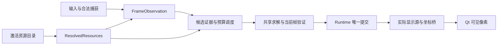

# 四模式识别、贴合与资源导入统一方案

核查日期：2026-11-11。状态：**P0 调查/设计完成；P1 空资源默认入口及 P2 四组合基础数据保存/选择已接资源页；S0 困难识别仍关闭，S1 保留观测资格限制；作者显示、登记来源角色与四模式回放尚未完成**。本文件同时作为现状清单、设计和实施台账，不另建重复任务说明。第 2–4 节现状引用绑定原核查 commit，后续实施状态另见第 8 节。

## 1. 范围与基线

- 工作区：`E:\codex\worktrees\cd7b\星图`。开始时工作树干净、detached HEAD，源码 `cc5100c6e3cea425ac4dbed82df92623754f81fa`，fetch 后与 `origin/main` 一致；文档分支为 `codex/unified-recognition-resources-plan-20261110`。
- 目标为原星图的 `s0:difficult`、`s0:nightmare`、`s1:difficult`、`s1:nightmare`。S1 `difficulty2` 是已停用的历史普通模式。当前 `experiments/qt_quick/` 实为默认产品客户端，不能按目录名忽略。独立 Python/C#、WPF、Qt/C# 迁移实验不归本任务，不改其代码或分支。
- 当前源码已包含 `7991dbbe` 之后 PR #126 的 S0 控件几何修复；不能据此推断 S1 问题已解决或实机已通过。
- [PR #111](https://github.com/chenhuanh9-a11y/xiaochao-assistant/pull/111) 已关闭、未合并，由 [PR #112](https://github.com/chenhuanh9-a11y/xiaochao-assistant/pull/112) 替代。#112 合并提交 `eb67407f7b5b3e608b0f4e90b50fb6ba294bd466` 经 `git merge-base --is-ancestor ... HEAD` 确认为当前祖先。复用既有通用 V2 作者包、制包器和快照，不重做 #111 的独立加载器。
- 用户允许新架构停止支持全部旧包，不授权现在删除原图、安装资源、个人数据、备份或历史事务。本轮只改文档，不执行资源迁移、清理、安装、程序启停、游戏操作或发布。

以下“现状”来自该 commit 源码及第 7 节本轮测试；“目标”均待实现。历史通过数量不当作本轮执行结果。

## 2. 四模式实际调用与验收清单

### 2.1 默认入口及四组合矩阵

[qt_client_entry.py:20](https://github.com/chenhuanh9-a11y/xiaochao-assistant/blob/cc5100c6e3cea425ac4dbed82df92623754f81fa/tools/qt_client_entry.py#L20) → `client.main` → [QtClient:125](https://github.com/chenhuanh9-a11y/xiaochao-assistant/blob/cc5100c6e3cea425ac4dbed82df92623754f81fa/experiments/qt_quick/client.py#L125) 构造 providers、LiveRuntime、Session。游戏输入/显式操作经 Session 到 runtime；捕获、控件观测、候选报告、最终显示是不同证据端点。

| 组合 | 楼层控件：入口、输入与输出 | 地图识别：实际核心与结果语义 | 贴合与依赖资源 |
| --- | --- | --- | --- |
| S0 困难 | `LiveRuntime._observe` → `observe_s0_map` → `locate_vertical_floor_controls` → `classify_label`。输入当前客户区帧及模式合同；输出地图界面观测、控件 ROI/标签/高亮、语义层及失败原因。层 ID `1/2`。 | `_rank_identity` → `NativeDifficultCandidateEngine.rank` → `MapIdentityEngine.rank`；已建立组可走 `rank_established_group`。输入当前帧、层、预算/组上下文；输出 rank rows 和入口/结构证据，由 runtime 提交。 | 共用 `_AlignmentHost.fit` → fast/recovery/independent fit → 当前帧 residual → commit。依赖 `difficult-native-manifest.json` interfaces、identity pack、typed NPZ、坐标/版本绑定、入口索引、出口图标及两层实际显示桥。 |
| S0 噩梦 | 同一 S0 detector/模板分类器；合同 `B1/1/2`，验证完整三行与实际高亮，不借困难槽位猜层。 | 同一 `MapIdentityEngine.rank` / `rank_established_group` 框架，使用噩梦 pack、入口和结构证据；资源池与门语义不等同于困难。 | 同一求解/验证/提交。依赖 `nightmare-map-pack.json`、shared-structure index、canonical coordinate pack、version bindings、`nightmare-entries/`、结构显示及可选作者绑定。 |
| S1 困难 | `_observe` → `detect_s1_floor`，完整带符号竖列 + 独立地图 UI 几何；输入帧、`s1/difficult` 与相关帧范围，输出 `observedFloorValidated` 等证据。层 ID `-1/-2/-3/-4`。 | `_rank_identity` → `_rank_s1_structure` → `qt_s1_structure_scan` → `StructureCandidateScanner.scan/rank_rows` → `StructureEvidenceSession.commit`。输入完整 catalog、当前层、预算/顺序；输出支持/未知/未扫描集合及 pose。**排序不等于正式身份确认**。 | 共用 host/solver；上层显式 ROI、prepared scan、多岛/组件恢复。基础根 `seasons/s1/difficult/`：native manifest、typed/坐标/入口/版本产品。私测坐标先验另有入口，不授予正式身份。 |
| S1 噩梦 | 与 S1 困难同一观测算法，传 `s1/nightmare` 与四负层合同。 | 同一 scanner/session，但 catalog 与完整候选池来自噩梦根；正式、手选、私测能力仍受当前产品策略限制。 | 同一求解/验证/提交；根 `seasons/s1/nightmare/`，各层参考和绑定独立，不能串用困难地图池。 |

关键代码依据：

- 层合同：[floor_contract.py:47](https://github.com/chenhuanh9-a11y/xiaochao-assistant/blob/cc5100c6e3cea425ac4dbed82df92623754f81fa/app/floor_contract.py#L47)。S0 包装 [s0_vertical_controls.py:199](https://github.com/chenhuanh9-a11y/xiaochao-assistant/blob/cc5100c6e3cea425ac4dbed82df92623754f81fa/app/s0_vertical_controls.py#L199)，标签消费 [floor_control_region.py:172](https://github.com/chenhuanh9-a11y/xiaochao-assistant/blob/cc5100c6e3cea425ac4dbed82df92623754f81fa/app/floor_control_region.py#L172)，列检测 `:331`；[s0_floor_templates.py:29](https://github.com/chenhuanh9-a11y/xiaochao-assistant/blob/cc5100c6e3cea425ac4dbed82df92623754f81fa/app/s0_floor_templates.py#L29)、`:54` 是代码合成模板，尚非外置素材库。
- S1 [s1_floor_observation.py:104](https://github.com/chenhuanh9-a11y/xiaochao-assistant/blob/cc5100c6e3cea425ac4dbed82df92623754f81fa/app/s1_floor_observation.py#L104)、`:169`；几何原语 [s1_map_ui_geometry.py:129](https://github.com/chenhuanh9-a11y/xiaochao-assistant/blob/cc5100c6e3cea425ac4dbed82df92623754f81fa/app/s1_map_ui_geometry.py#L129) 同样被 [S0:188](https://github.com/chenhuanh9-a11y/xiaochao-assistant/blob/cc5100c6e3cea425ac4dbed82df92623754f81fa/app/s0_vertical_controls.py#L188) 消费，不能按文件名前缀认定专属。
- runtime 分流：[client_live_runtime.py:6083](https://github.com/chenhuanh9-a11y/xiaochao-assistant/blob/cc5100c6e3cea425ac4dbed82df92623754f81fa/experiments/qt_quick/client_live_runtime.py#L6083)、`:1760`、`:1117`；S0 [map_identity_engine.py:737](https://github.com/chenhuanh9-a11y/xiaochao-assistant/blob/cc5100c6e3cea425ac4dbed82df92623754f81fa/app/map_identity_engine.py#L737)、`:998`，困难 [difficult_native_identity.py:64](https://github.com/chenhuanh9-a11y/xiaochao-assistant/blob/cc5100c6e3cea425ac4dbed82df92623754f81fa/app/difficult_native_identity.py#L64)。历史 `DifficultCandidateEngine` 不能代替当前 native 默认路径。
- provider 根及构建：[client_providers.py:214](https://github.com/chenhuanh9-a11y/xiaochao-assistant/blob/cc5100c6e3cea425ac4dbed82df92623754f81fa/experiments/qt_quick/client_providers.py#L214)、`:278`、`:334`；S1 scanner 注入 `:450`；报告/会话 [s1_structure_selection.py:91](https://github.com/chenhuanh9-a11y/xiaochao-assistant/blob/cc5100c6e3cea425ac4dbed82df92623754f81fa/app/s1_structure_selection.py#L91)、`:135`、`:235`。
- S1 静态回放能力仍声明 `liveValidated=False`，native context 仍有 live gaps：[s1_native_resources.py:18](https://github.com/chenhuanh9-a11y/xiaochao-assistant/blob/cc5100c6e3cea425ac4dbed82df92623754f81fa/app/s1_native_resources.py#L18)、`:133`、`:141`。四组合是统一目标，不是当前四组合均具相同自动权限的结论。

### 2.2 贴合的共享与外围分歧

现有真实共享链是：当前捕获/楼层 → 候选或已锁图 → `_AlignmentHost.fit` → `_fit_observation_uncached` → steady（适用时）/fast → 同层平移、登记层关系、入口复核恢复 → 独立求解 → 当前帧 canonical residual → runtime `_solve_observation` → group/core/render → 实际显示层与坐标桥 → Qt 像素。

依据：[host:156](https://github.com/chenhuanh9-a11y/xiaochao-assistant/blob/cc5100c6e3cea425ac4dbed82df92623754f81fa/experiments/qt_quick/client_live_runtime.py#L156)、[fit:355](https://github.com/chenhuanh9-a11y/xiaochao-assistant/blob/cc5100c6e3cea425ac4dbed82df92623754f81fa/experiments/qt_quick/client_live_runtime.py#L355)、[求解次序:559](https://github.com/chenhuanh9-a11y/xiaochao-assistant/blob/cc5100c6e3cea425ac4dbed82df92623754f81fa/experiments/qt_quick/client_live_runtime.py#L559)、[fast_structure_alignment.py:420](https://github.com/chenhuanh9-a11y/xiaochao-assistant/blob/cc5100c6e3cea425ac4dbed82df92623754f81fa/app/fast_structure_alignment.py#L420)、[single_map_structure.py:620](https://github.com/chenhuanh9-a11y/xiaochao-assistant/blob/cc5100c6e3cea425ac4dbed82df92623754f81fa/app/single_map_structure.py#L620)。首贴与重开都须当前帧验证，历史 pose 只是种子。

| 接缝 | 当前事实 | 需要收敛 |
| --- | --- | --- |
| ROI/组件 | 默认无 bounds 路径与 S1 显式 ROI 路径不同；后者有最多 32 岛分解及一致性复核。 | 一次 FrameObservation 明示地图/控件 ROI、遮挡/组件，求解策略依观测质量选路径；不能直接删除多岛恢复或一律扫描最大区域。 |
| 候选 | S0 rank 与 S1 scanner 产物、预算、续扫与会话不同。 | 提取实际证据生产和公共调度/消费循环，最终退出两套候选控制器；wrapper 不是完成。 |
| 状态 | RoundLayerGroup 管局内层关系，AlignmentCoreV2 管 pose/显示授权，runtime `_render` 管当前渲染；职责不同。 | runtime 唯一提交，group/core 为内部模型；worker 返回结果，不另写 UI/候选池，整理重复的外围上下文。 |
| 显示 | 作者/路线是显示；S0/S1 provider 的能力接入不全相同。 | 同一 DisplayResolver 返回实际来源与桥；缺作者可回退同层结构，缺结构不能借作者图识别。 |
| 取消/迟到 | 已有 Session generation、runtime epoch、capture、structure ticket、settings/display generation。 | 统一构造和校验，保留实际相关 guard，不能为了字段整齐删校验。 |

最终状态写者：[client_live_runtime.py:5747](https://github.com/chenhuanh9-a11y/xiaochao-assistant/blob/cc5100c6e3cea425ac4dbed82df92623754f81fa/experiments/qt_quick/client_live_runtime.py#L5747) 求解前/后及 commit 前核上下文，`:5970` 后更新 core/group/render；关图撤销 `:3379`。手动层意图 `_set_floor:2943` 与观测 floor policy 分开，观测函数返回不是直接改层的授权。Session 范围见 [client_session.py:163](https://github.com/chenhuanh9-a11y/xiaochao-assistant/blob/cc5100c6e3cea425ac4dbed82df92623754f81fa/experiments/qt_quick/client_session.py#L163)。显示消费者见 [client_route_preferences.py:106](https://github.com/chenhuanh9-a11y/xiaochao-assistant/blob/cc5100c6e3cea425ac4dbed82df92623754f81fa/experiments/qt_quick/client_route_preferences.py#L106) 和 runtime `:6145`；换作者不得改变身份/结构位姿/层，结构回退也须绑定实际渲染来源。

### 2.3 现有测试与未验内容

以下为可复用入口，不代表本轮全部执行。测试中真实调用了函数，不代表用了真实生产资源。

| 范围 | 测试及替身边界 | 仍需真实资源/实机 |
| --- | --- | --- |
| S0 两模式控件 | `test_floor_contract`、`test_s0_floor_highlight_geometry`；Qt `test_client_floor_region`、`test_client_s0_vertical`，含合成 glyph/曝光及 mock 分流；真实回放需 `S0_FLOOR_CONTROL_FIXTURE_ROOT`。 | 困难两层、噩梦三层原帧；亮/暗、过渡、遮挡、非地图，核实际 ROI 与层真值。 |
| S1 两模式控件 | `test_s1_recorded_floor_observation`、`test_s1_floor_observation`，数学竖列/map-interface 替身；真实回放需 `S1_FLOOR_FIXTURE_ROOT`。 | 各模式 B1–B4 完整客户区与裁剪；缺行/旧帧/高亮不稳不得猜层。 |
| S0 身份 | Qt `test_client_engine`，`test_native_similarity_runtime`、`test_front_gate_observation`、`test_side_entry_search`；部分真实 rank 注入空/合成资源。 | 导入资源构建实际 provider：正门/侧门/相似组/未知与不唯一，独立身份真值。 |
| S1 候选/资格 | `test_s1_structure_selection`，Qt `test_client_g_cycle_admission`、`test_client_g_cycle_solver_input`；adapter 可真实调用但捕获/solver fixture 非游戏。 | 两模式完整池、预算耗尽/未扫描/失败帧；首行或单候选不得自动升级正式身份。 |
| 四组合贴合/生命周期 | Qt `test_client_live_runtime`、`test_client_group_queue`、`test_client_session`；`test_shared_recovery_residual_contract`、`test_wall_raster_local_distances`。多处 synthetic provider/frame/fit/residual。 | 从正式入口到真实结构及实际图层：首贴/重开/换层/无门/缺绑定/错岛/取消/迟到/关图；正确可见像素和长期稳定性。 |

本轮未获得四组合真实准确率、实机采集/显示同步或输入到像素耗时，不能推断既有 S1 故障已修复。

## 3. 统一架构与必要例外

### 3.1 单一链路和提交者



以下是设计名，实施优先整理现有模块，不新增并列框架或流程工具。

| 目标模型/接口 | 输入输出及职责 | 替代范围 |
| --- | --- | --- |
| ResolvedResources | season/mode + 已激活目录 → 地图/层、typed reference、坐标/层关系、controls、入口、display 与版本身份；只读解析，资源管理器负责激活。 | 业务自行拼 `_internal`、S1 子根、作者平面和私测路径；禁止扫目录猜上下文。 |
| RunContext | request/opening/round、frame/capture、season/mode、相关 map/floor、资源版本/显示源和既有 generation；runtime 构造/验证，worker 消费。 | 分散构造和比对；逐个迁移 guard，不能用 mode 字符串代替资源身份。 |
| FrameObservation | 一次捕获 → map-open、控件 ROI、floor evidence、地图 ROI/组件、质量与未知原因。S0/S1 detector 只负责图像策略。 | scanner/fit/恢复重复裁剪与观察；detector 不私有管理 session 或提交层状态。 |
| CandidateEvidence/Report | 完整 catalog + observation + 预算/提示 → 支持/明确矛盾/未知、已扫/未扫、证据类型和临时 pose；同一调度器拥有池/续扫。 | 以 S1 新候选/调度逻辑为统一主链，把 S0 困难/噩梦迁入；参数化真实资源和层/入口语义后删除旧 S0 候选控制器，不长期并列保留。不同旧分数不直接相加；未知不排除。 |
| AlignmentRequest/Result | reference + observation + 可选历史/入口种子 → pose/residual、失败/取消/恢复来源、资源身份。共享 host/solver。 | 统一恢复/验证/预算，不按四组合复制；worker 不写业务状态。 |
| RuntimeState | 当前上下文 + 验证结果 → 候选/组/身份、当前层、pose/render。一个提交点写，UI 线程呈现快照。 | 候选、暂定显示、正式身份分开；S1 实验锁不得冒充正式。 |
| DisplayResolver | 结构 pose + 偏好 + 对应快照 → 实际图像和 display→reference 桥。 | 更新作者/路线/结构回退源只失效相关显示缓存，不隐式重识别或改身份。 |
| 统一诊断事件 | request/stage、outcome/reason、耗时、实际资源与图像范围，沿用有界本地日志/样本写者。 | proposal/verified/visible 终点分开，不另造审计系统或模式专属含义。 |

完成标准是旧重复控制与资源读取退出生产链；公共 wrapper 分别调用完整旧 S0/S1 控制器只是迁移中间态，每阶段列明剩余旧调用及退出条件。

**用户明确的 P3/P4 方向（2026-11-10）**：P3 向 S1 新识别逻辑统一，不能反向把 S1 改回 S0 控制流程。当前可核对的入口绑定 `c27e3b78`：[LiveRuntime._stream_s1_observation](https://github.com/chenhuanh9-a11y/xiaochao-assistant/blob/c27e3b78e0c9decd2ae8b3109bc0266597602b1b/experiments/qt_quick/client_live_runtime.py#L1167)、[provider 的 structure_scan](https://github.com/chenhuanh9-a11y/xiaochao-assistant/blob/c27e3b78e0c9decd2ae8b3109bc0266597602b1b/experiments/qt_quick/client_providers.py#L471) 与 [StructureCandidateScanner.scan](https://github.com/chenhuanh9-a11y/xiaochao-assistant/blob/c27e3b78e0c9decd2ae8b3109bc0266597602b1b/app/s1_structure_selection.py#L91)。P3 开始实施时复核实际默认调用和正式/私测资格入口，移除其 season/floor 硬编码须保留真实数据语义；统一调度不自动扩大证据资格。P2 暂沿用原 solver 核资源路径，不把这一步认作最终识别统一。

P4 首个可用贴合允许先显示，再继续复核；首次显示与最终复核完成是不同状态，不能仍把全部后续复核挡在首次显示前。复核发现偏差时更新变换，无效时撤销。当前帧、楼层、资源和显示来源等既有上下文约束仍须对应本次结果，暂定画面不得冒充正式身份或最终验证。纯位置修正复用已解码图片/纹理与稳定图片标识，只更新变换；实际图片/图层内容变化才重取图片，取消/换图/换层后的迟到结果不得恢复旧画面。验收分别记录首个可用像素、后续复核、位置修正和撤销，包含图片未重载的实际证据。

### 3.2 有证据的必要区别

1. **控件/层语义**：S0 模板与列验证、S1 带符号竖列/地图几何有实际差别；困难/噩梦层数不同。用导入的层映射/controls profile 和程序支持的 detector ID 表达；UI 名称、观测数字、结构 ID 分开，不能统一改成 F1/B1。
2. **门/入口能力**：S1 manifest 明确 `sideEntries=False`（`s1_native_resources.registration:73`）；统一策略按能力工作，无侧门返回缺口，不填假门位或空成功索引。
3. **结构/坐标/层关系**：每层实际结构和桥独立；无登记层关系可独立当前帧求解新 root，不猜投影。见 [round_layer_group_commit.py:14](https://github.com/chenhuanh9-a11y/xiaochao-assistant/blob/cc5100c6e3cea425ac4dbed82df92623754f81fa/app/round_layer_group_commit.py#L14)。
4. **证据资格**：S0 正式身份、S1 录帧候选和私测累积资格不同。统一状态消费，不以 flag、自述已验或 singleton 自动授权；资源包不能开启正式权限。
5. **相似组**：当前明确名单在 [client_group_registry.py:14](https://github.com/chenhuanh9-a11y/xiaochao-assistant/blob/cc5100c6e3cea425ac4dbed82df92623754f81fa/experiments/qt_quick/client_group_registry.py#L14)。目标外置为独立的 reviewed-group-registry 组件，保留人工复核来源、精确成员和入口/层范围；其生产登记入口只接受项目按现有复核方式发布的登记数据，见 4.3。普通基础/作者包不能新增、改写或扩大名单，`reviewed=true`、provenance 自述均不授予资格。局部兼容、动态候选永不扩名单；缺权威表就独立处理并报缺口。

ROI 生成、预算续扫、状态提交、排队/取消、错误格式、缓存和资源发现不是默认应保留的赛季分支；图像策略差别须由真实帧/契约证明。

## 4. 统一资源导入与独立生命周期

### 4.1 复用点与必须改造的限制

| 当前代码 | 复用 | 必须改变 |
| --- | --- | --- |
| [star_map_import.py:531](https://github.com/chenhuanh9-a11y/xiaochao-assistant/blob/cc5100c6e3cea425ac4dbed82df92623754f81fa/app/star_map_import.py#L531) | ZIP 路径/大小/重名/链接/完整性校验，inspect/install API。 | 固定 package ID、旧版本/协议和安装相对路径分支；新作者 validator 不能获得基础结构写权限。 |
| [generic_author_package.py:15](https://github.com/chenhuanh9-a11y/xiaochao-assistant/blob/cc5100c6e3cea425ac4dbed82df92623754f81fa/app/generic_author_package.py#L15)、[author_package_builder.py](https://github.com/chenhuanh9-a11y/xiaochao-assistant/blob/cc5100c6e3cea425ac4dbed82df92623754f81fa/app/author_package_builder.py) | 任意作者、图片与完整仿射校验、真实 provider 制包，无需逐作者登记代码。 | V2 只有显示，`requiresFiles` 绑定安装路径与精确底模字节。复用验证函数与输入，不维持长期旧入口。 |
| [author_resource_snapshots.py:22](https://github.com/chenhuanh9-a11y/xiaochao-assistant/blob/cc5100c6e3cea425ac4dbed82df92623754f81fa/app/author_resource_snapshots.py#L22)、`:190`、`:519` | 不覆盖旧版本、激活代际、逐层状态、提交见证与恢复。 | 目前仅作者有快照；基础/controls 无同等导入。需一个完整激活目录，不能逐包换指针留下混合依赖。 |
| [managed_base_resources.py:23](https://github.com/chenhuanh9-a11y/xiaochao-assistant/blob/cc5100c6e3cea425ac4dbed82df92623754f81fa/app/managed_base_resources.py#L23)、`:363`、`:981` | 所有权/冲突、锁、持久恢复与受控回滚。 | `_internal/managed-base-resources` 候选及源码库存仍由程序控制；无默认结构的新装不能当损坏去强修。 |
| [client_resource_startup.py:9](https://github.com/chenhuanh9-a11y/xiaochao-assistant/blob/cc5100c6e3cea425ac4dbed82df92623754f81fa/experiments/qt_quick/client_resource_startup.py#L9)、[client_paths.py:63](https://github.com/chenhuanh9-a11y/xiaochao-assistant/blob/cc5100c6e3cea425ac4dbed82df92623754f81fa/experiments/qt_quick/client_paths.py#L63) | 资源消费者租约与 pending 恢复。 | production root 绑程序 `_MEIPASS`，状态在安装 `work/`；要拆程序路径/资源根/快照使用期，全进程租约不能原样限制独立激活。 |
| [client_resources.py:471](https://github.com/chenhuanh9-a11y/xiaochao-assistant/blob/cc5100c6e3cea425ac4dbed82df92623754f81fa/experiments/qt_quick/client_resources.py#L471)、[client.py:143](https://github.com/chenhuanh9-a11y/xiaochao-assistant/blob/cc5100c6e3cea425ac4dbed82df92623754f81fa/experiments/qt_quick/client.py#L143) | 本地/在线同服务、`versioned=True`、资源变化通知。 | 入口接受全部资源类型，激活后 provider/任务/缓存一并失效，不只刷新作者列表。 |
| [build_qt_client.py:982](https://github.com/chenhuanh9-a11y/xiaochao-assistant/blob/cc5100c6e3cea425ac4dbed82df92623754f81fa/tools/build_qt_client.py#L982)、`:1069`、[build_qtifw_trial.py:94](https://github.com/chenhuanh9-a11y/xiaochao-assistant/blob/cc5100c6e3cea425ac4dbed82df92623754f81fa/tools/build_qtifw_trial.py#L94)、[qtifw_map_seed.py:140](https://github.com/chenhuanh9-a11y/xiaochao-assistant/blob/cc5100c6e3cea425ac4dbed82df92623754f81fa/tools/qtifw_map_seed.py#L140) | 程序/数据分区、Setup、安装保护；QtIFW release 也复用 trial 命名脚本。 | QtIFW 仍带 seed ZIP 并先修 managed base；只处理旧 Inno 不够。常规升级不再带入/重置活动基础和作者资源。 |

数据还有源码限制：[season_map_resources.py:19](https://github.com/chenhuanh9-a11y/xiaochao-assistant/blob/cc5100c6e3cea425ac4dbed82df92623754f81fa/app/season_map_resources.py#L19) 的固定 source version/布局集合，[s1_native_resources.py:45](https://github.com/chenhuanh9-a11y/xiaochao-assistant/blob/cc5100c6e3cea425ac4dbed82df92623754f81fa/app/s1_native_resources.py#L45) 的固定地图数/成员/层和 OpenCV 版本校验，[generic_author_base.py:162](https://github.com/chenhuanh9-a11y/xiaochao-assistant/blob/cc5100c6e3cea425ac4dbed82df92623754f81fa/app/generic_author_base.py#L162) 的赛季路径，以及 provider `:429–448` 的私测文件/固定摘要。不调整这些职责，新增地图仍要发程序，不能宣称独立更新完成。

### 4.2 实际外置范围

采用一个 `xingtu-resource-package` 容器、格式版本 1，内部组件按类型验证。容器清单与只读 catalog 已开始实现，组件语义 decoder 和正式样包尚未完成；不新增冻结 gate。一套版本/依赖/导入/恢复，组件 parser 验证数据语义，不另造四套安装事务。

**默认制包与交付边界**：基础结构 ZIP 一并提供干净结构、门/出口、楼层/坐标关系、配套识别贴合预处理和 controls 数据，用户不必另找控件下载包。包内保留 recognition-base 与 controls-profile 的组件及精确依赖划分；这是随结构资源发布，不是放回软件本体。作者路线图片、路点和逐层配准独立为 display/路线资源，不混入干净基础结构。

| 组件 | 进入受管理导入的内容 | 程序保留 |
| --- | --- | --- |
| recognition-base | 地图/层注册、typed NPZ 的 mask/墙/门/通道/实际消费特征、identity pack、结构/版本索引、坐标画布/变换、可靠层关系、入口模板/索引、侧门搜索产品、出口图标、基础结构显示素材/配置。包含当前消费者确需的参考图，不默认复制整份游戏原包。 | 求解、特征计算、证据验证与安全解码器；地图成员不硬编码。作者显示不反向授权结构身份。 |
| reviewed-group-registry | 项目明确复核登记的精确成员、season/mode/入口/层范围、依赖的实际结构版本及复核来源；独立版本分发。 | 登记来源资格与成员范围校验；普通结构/作者/动态扫描不得取得此权限，登记也不授予 pose。 |
| controls-profile | 合法层/标签映射、列/地图 UI 布局数据；S0 合成模板库及生成参数/来源；S1 几何 detector 的游戏布局 profile 与适用尺寸。同季两模式可依赖同一组件及不同层合同。 | detector 算法、数据类型/合理范围校验、通用数值稳定/安全阈值。新模板可更新数据，新控件机制可能要改算法。 |
| display | 作者/原生/结构显示图片与元数据、每层 display→reference 配准，精确依赖结构/坐标版本，允许层子集。 | 解码、仿射验证、渲染、用户选择。无作者时可显示同层结构自身来源。 |
| 可选 recognition-hints | 当前确有消费者的入口坐标 prior、预制索引、来源及坐标依赖；`s1-private-assets` 不绕过 resolver。 | 是否启用相应实验算法由程序策略决定；prior 只作种子，不替代当前帧验证。未采用实验产品不是强制基础依赖。 |

品牌、Qt 图标、教程和许可证仍为程序素材。不能按 `assets/`、`references/` 名称全部迁出；exporter 从授权真实资源输入解析消费者清单。原始游戏数据/未授权素材不进源码 Git，新格式也不授予分发许可。

S0 当前模板由 OpenCV Hershey 字形合成，并无现成模板图片包。先从当前生成器导出等价数据并验证分类消费，运行时从 controls 读取；缺模板明确不可用，不能在程序静默生成默认库。预处理缓存可从已导入数据重算，缓存不是默认基础资源。

软件携带算法与解码器。与地图结构绑定、计算重且可复用的轮廓、距离场、特征索引和入口描述随结构资源并绑定对应版本；控件模板/层映射随包内 controls 组件。当前帧特征、依赖视口的中间量和临时求解在运行时计算；已解码图片及可重算缓存留内存或独立本地缓存，不能改写导入包。这是目标归属，现有预处理消费者仍须逐项迁移并回放，不能因文档解释就宣称已经外置完成。

### 4.3 版本、依赖与持久目录

| manifest 字段 | 目标语义 |
| --- | --- |
| formatVersion | 容器/manifest 协议，与程序版本、资源内容版本分离。 |
| packageId / resourceVersion | 稳定逻辑 ID 与不可覆盖的内容版本；同 ID/版本异内容拒绝，新版保留旧版。 |
| components | componentId/type/schemaVersion、season/mode/map/floor 范围、实际能力与数据文件；能力逐项核验，不能自封正式资格。 |
| files | 组件内相对路径、大小和既有完整性 SHA256；不写安装路径，不叠加重复 hash/freeze 体系。 |
| dependencies | 精确 package/resourceVersion/component 引用及结构/坐标依赖闭包；缺失列明，不用程序显示版本/文件名推兼容。 |
| clientCompatibility | 所需资源协议、组件 schema、decoder/算法能力和必要范围。程序公开支持能力，包不能加载代码/脚本或注册未知算法。 |
| provenance | 来源、制包工具、适用游戏源版本；人工复核成员有来源记录。字段本身不是真实性认证或权限。 |

ResourceRoot 与 ProgramRoot 分开。建议默认当前用户 `%LOCALAPPDATA%\Xingtu\resources`，保存明确持久资源根设置。实施核对管理员启动及子进程得到同一用户/根，不以临时目录为默认；现有个人偏好/路线本轮不迁移。

```text
ProgramRoot/                         # Setup：EXE、运行库、界面素材、程序协议声明
ResourceRoot/
  packages/<packageId>/<resourceVersion>/   # 完整已验版本和清单，不原地重写
  catalog.json                       # 一次切换完整激活依赖集合和 generation
  staging/<transactionId>/           # 未发布数据，复用既有事务见证语义
  transactions/                      # pending/恢复；未知文件不自动认领
PersonalData/                        # 偏好、个人路线、记录，独立于资源所有权
```

Setup 只管理 ProgramRoot。ResourceRoot 的所有权来自导入记录，不来自新 EXE 清单；升级不覆盖它。不支持的资源保留并提示，不能清空。

基础、controls、display、hints 经**同一事务与 catalog**管理，一个归档可有多组件，也可分包依赖。首次完整导入激活闭包，后续只更新受影响包。作者先导入可为“已保存、缺基础/绑定”，只有依赖成立的层进入显示；基础包声明有文件却缺失属于损坏，整次拒绝。合法层子集须在覆盖范围明确表达，未覆盖层不可用。

**跨包唯一来源**：catalog 为每个实际识别键（season/mode/map/floor/产品角色）只绑定一个活动组件。首个协议版本进一步限定每个 season/mode 只选择一个 recognition-base 组件，由它完整声明该上下文支持的地图/层及局部资源树；一个 ZIP 可同时含四组合组件，仍是一套导入/事务，不是四套安装器。新增地图可更新该组件的数据版本，不要求逐地图写程序。暂不支持把多个基础包的不同层/地图合并成一个上下文；未来若支持，须实现内存 pack/typed-store 聚合消费者，不能合成 `_internal` 平面或只改 schema 宣称支持。部分地图/层还须由真实 provider 支持该声明，不能拿缺文件冒充层子集。

每个 season/mode 的 controls 角色同样只选择一个活动组件，组件内部确定不同视口 profile。不同 packageId 的基础/controls 声明重叠时不得按导入顺序、较新版本或同 bytes 自动抢占；默认拒绝激活并保留旧集合，明确替换时重算全部依赖再一次切换。display 可多作者并存，由偏好选择；结构回退来源仍唯一。

**权威登记来源**：项目复核后发布的登记索引是 reviewed-group-registry 的唯一生产来源，索引为独立资源数据，不跟程序版本逐条枚举成员。复用现有 HTTPS 下载及归档 bytes/SHA256 校验（[star_map_download.py:117](https://github.com/chenhuanh9-a11y/xiaochao-assistant/blob/cc5100c6e3cea425ac4dbed82df92623754f81fa/app/star_map_download.py#L117)），由资源服务记录索引条目与实际归档的来源关系。项目登记源角色由程序配置的项目来源入口赋予；现有任意可配置的作者下载 index_url、索引正文和包内字段都不能自行取得该角色，HTTPS 本身也不是人工复核证据。本地登记组件必须匹配已取得的项目发布索引条目；缺失/离线无法核实时仅保存为未启用，保留旧可信登记或独立处理。新增/改变成员先由项目实际复核再更新登记资源，不是确认普通包就生成资格；不新增签名服务或逐包程序白名单。现有下载索引尚无此角色区分，P2 须实现并测试；未实现前不能消费普通基础包的 groups 为名单。

### 4.4 完整导入与更新流程

1. 文件选择/在线下载统一 inspect：校验容器、协议、完整库存、语义/空间，计算新增/替换/依赖/受影响层。普通新增沿现有交互直接执行；必要替换/依赖停用显示具体影响后确认，不加泛化审批。
2. staging 写完整版本并重验，沿用路径/链接/大小/对象身份/锁/持久化规则。未知对象不覆盖；归档或依赖在预检后变化则重新检查。
3. 构造完整新 catalog，核对受影响闭包/坐标/层/能力、跨包来源唯一性和登记组件来源资格。新结构与旧作者绑定不匹配时默认保留旧激活集合，要求新绑定或明确接受停用受影响显示；不能猜配准或改哈希凑兼容。
4. staging 可与读取并行；**激活限无活动对局且相关 worker 排空后**，先撤销旧任务/像素授权。全进程 runtime 租约须改成资源使用期/激活的协调租约，不能偷偷释放仍被使用的租约。资源页/UI 壳不依赖基础包。
5. 唯一写者复核旧 catalog 和已知对象后，原子发布整个新 catalog，沿用已验证的 commit 见证。不得逐包激活留下混合集合，也不承诺多文件在断电下天然原子。
6. 可证明未提交时取消/崩溃恢复旧集合；提交后只核验/收尾，取消不能冒称撤销。提交见证的准备副本已出现而正式见证缺失时，无法区分“发布中断”和“已提交见证丢失”，须保留为结果未确定，不自动回滚。pending/见证/对象冲突时保留现场并给原因，仍能打开资源恢复页；不删除未知文件。
7. catalog generation 变化一次通知资源服务/provider/runtime/图库/作者/预览，失效相关缓存，迟到任务不能显示或确认。页面实例稳定，可见页补最新状态，隐藏任务有界。旧快照引用排空后释放内存，不自动删除磁盘历史。

缓存用实际组件版本/资源身份、map/floor、实际显示源及相关 generation；不能只按模式或路径缓存。收敛现有 `resourcesChanged` → provider invalidate → runtime invalidate 链，不能只刷新文字。

### 4.5 程序升级、旧包退役与免程序更新的边界

- 无默认结构时正常进入主壳/资源导入/诊断；四组合分别报缺 recognition-base/controls 的具体原因。禁用实际识别/贴合，不造假默认图、不静默退随程序结构，不因合法空状态弹损坏后退出。
- 常规程序升级保留 catalog、版本和个人数据，兼容则继续消费，不兼容则保留并提示。回退程序也先核资源协议，不能让旧启动修复覆盖新资源；已存在 pending 按其支持协议恢复，不能忽略。
- 新格式是唯一长期运行路径。旧 S0/S1 固定包和当前 V2 ZIP 在新入口明确 `legacy-format-unsupported`：“旧图包格式已停用，请获取新版资源包；已有文件已保留。”不自动走旧 importer 或安装树 fallback。
- 复用 V2 图片/配准验证及快照经验，提供一次性离线 exporter 转换有权使用的基础/作者数据，仅写新的输出位置，不改原件。历史 pending 的只读识别/受控恢复用于保全事务，不是长期旧包导入支持。
- 旧资源不自动成为新 catalog 所有物。首轮重新导入新包，旧平面/快照/备份不删；清空间另按明确清单与授权。安装器 reset/seed 和 managed-base 修复退出**新协议常规升级链**，同时保留历史未完成事务保护。

| 变化 | 只更新资源的条件 | 需要更新程序的情况 |
| --- | --- | --- |
| 支持模式新增地图/层、结构/入口更新 | 现有 schema、坐标、detector/solver 可表达且真实回放成立；成员不再代码枚举。 | 新门/层语义、特征或求解算法不支持。 |
| 新作者/路线/重配准 | display schema、仿射/坐标模型已支持，依赖明确。 | 新变换/图像编码未支持。 |
| 字形/布局变化 | 已支持 detector 的 profile 能表达并通过实帧。 | 新控件机制/采集协议或 detector。 |
| 预计算产品/OpenCV 变化 | 明确可移植 schema，或满足已有 decoder ABI/算法能力。 | 精确版本检查确有产物差别时重建资源或升算法；不直接删 OpenCV 检查。 |
| 新赛季 | 完整复用既有层/坐标/控件/证据模型，运行资格有证据。 | 出现新模型/策略；不承诺所有未来变化免发程序。 |

### 4.6 P1/P2 首条纵向流程的接口细化

首个容器采用顶层 `manifest.json`，数据为 `data/<componentId>/<path>`；安装原样保存为 `packages/<packageId>/<resourceVersion>/`，不复制/链接成安装 `_internal` 平面。manifest 包含第 4.3 节的字段；`components` 每项为 `componentId/type/schemaVersion/contexts/entrypoint/dependencies`，`files` 每项为 `componentId/path/bytes/sha256`。库存必须精确等于数据文件集。识别组件内可保留真实 `assets/`、`references/` 局部树，其 `resource-context.json` 明确实际 runtimeInterfaces；provider 获得该组件真实根，不再自行拼赛季子目录。

序列化只接受一种形状：组件 `contexts` 是 `[{"season":"s0","mode":"nightmare"}]` 对象列表，每项恰好 season/mode；不是字符串上下文列表。具体 map/floor 范围在该基础组件的 identity/typed 数据中声明，不再在组件上下文重复维护。`dependencies` 是别名到引用的字典，空为 `{}`，例如 `{"base":{"componentId":"s0-nightmare-base"}}`；不是引用列表，显示层的 baseDependency 按此别名解析。组件类型统一用 `controls-profile`。

引用分开表达：组件内文件只有相对 `path`；同包依赖为 `{componentId}`；跨包依赖为完整 `{packageId,resourceVersion,componentId,manifestSha256}`。resolver 展开后的 FileRef 总是完整组件身份加 path。沿用已有快照清单摘要绑定，避免同包 manifest 声明自身摘要的循环；不是新增逐地图程序白名单。

激活目录的最小形状为：

```json
{
  "schema": "xingtu-resource-catalog-v1",
  "generation": "本次激活代际",
  "contexts": {
    "s0:nightmare": {
      "recognitionBase": {"packageId": "example", "resourceVersion": "1", "componentId": "base", "manifestSha256": "完整摘要"},
      "controls": {"packageId": "example", "resourceVersion": "1", "componentId": "controls", "manifestSha256": "完整摘要"},
      "reviewedGroups": null
    }
  },
  "displays": []
}
```

此例只是接口形状，不是可导入的生产资源。空 contexts/displays 合法，四活动 context 严格区分，S1 普通不进入新协议。派生的逐层可用状态由实际解析生成，不重复落盘为包自述的验证结论。

`CatalogSnapshot` 提供 generation、assert_current、resolve_context、resolve_layer、resolve_display 及 FileRef 的有界读取。ContextResources 返回实际 base/controls/groups/displays 与逐角色缺口；BaseLayerContract 返回 typed/native FileRef、层、形状、坐标/结构版本与完整依赖；DisplayLayer 返回实际来源、矩阵、对应基础层与状态。缓存绑定该快照，不把路径等同永久信任。

作者语义从现有 V2 中复用图片编码/尺寸、仿射、结构/坐标/版本、权限为 false 和完整闭包验证，改为显式基础依赖别名和组件内图片/reference路径。不能复用旧 receipt 的安装命名空间，尤其不能继承 `SnapshotPackage.path()` 未命中时回退安装根的行为；新 PackageView 未声明文件就拒绝，跨组件必须显式引用。prospective catalog 读取 staging 中的真实组件，也不搭假平面。

事务复用既有有界身份读取、独占写入、不覆盖移动、文件匹配、hardlink/move 发布、pending 与 commit 见证；旧 `_activate_locked` 的作者收据/目标协议不直接套新类型。新激活事务只有固定业务写入目标 catalog.json，不接收包指定的任意目标。未提交新版本可保留未启用，提交前取消保留旧 catalog，提交后仅收尾；不靠自动清历史实现回滚。

第一条完整切片先用 S0 噩梦：空资源根真实 GUI → 文件选择新版基础结构 ZIP（含 controls 组件）及独立 display ZIP → prospective 校验 → 一次激活 → 实际组件根的 typed-native pack/store、原 engine/solver → 作者显示或同层结构回退 → 同一程序导入第二版并撤销旧任务。其余三组合随后接同一实现。controls 仅登记不够：运行时必须读取导入模板/层合同，S0 负号和干扰类竞争不因困难只有两层而缩减。P2 的成功还须四组合真实包回放，首条切片不能代替全阶段验收。

## 5. 分阶段实施与完成条件

各阶段按小批次交付并更新本文件，避免同时重写所有链路。

| 阶段 | 范围与交付 | 退出条件 |
| --- | --- | --- |
| P0 本轮调查 | 入口/写者/资源/测试、必要例外、统一方案。 | 文档与基线核查完成，不算运行统一。 |
| P1 路径/启动 | 拆 client_paths 的 ProgramRoot/ResourceRoot，单一只读 resolver，调整启动与 provider/资源服务，算法暂留。无结构可进资源页、缺项明确，个人数据不改写。 | 临时空根走默认启动/资源选择/失败反馈/旧任务失效，不能只 self-check。 |
| P2 完整导入 | 新容器、基础/controls/display、catalog/事务恢复、登记索引来源角色、一次性 exporter；同一程序首次完整导入、独立更新、多依赖激活。 | 四组合真实包从 resolver→实际 provider→原 solver 回放；错包/错依赖/重叠来源/假登记/中断恢复通过。先临时根，不改用户安装。 |
| P3 观察/候选 | 以实际 S1 新候选与调度链统一 S0 困难/噩梦，整理 observation、入口证据、预算/续扫与池。 | 默认入口实际用同一调度/提交；移除旧 S0 候选控制器，不以 wrapper 保留两套；未知/未扫/矛盾、相似组及证据资格如实保留。 |
| P4 贴合/显示外围 | 统一 ROI/恢复/context/提交；首可用结果先显示，后台继续复核、修正或撤销；位置更新复用图片/纹理。 | 首贴/重开/换层/换作者/取消同链；实际证明首次显示早于后续复核、纯变换不重载、无效会撤销、迟到结果不复活，不建四套 host。 |
| P5 Setup/退役/验收 | 新打包与 QtIFW/旧安装接缝、停止旧格式、真实 GUI/游戏。Setup 无默认基础结构/资源覆盖，同一程序消费第二版资源，升级保留数据。 | 最终远端 commit 的检查和 Setup 绑定；安装、实机、发布分别记录，未授权不安装/发布。 |

P2 先外置资源、沿用现有算法，可分清数据/路径与算法故障。P3/P4 不得长期停在 wrapper，每项记录被替代的实际旧调用。全流程验收前不宣传“统一完成”。

## 6. 验收标准与测试计划

### 6.1 场景与证据分层

| 场景 | 单元/组件 | 集成与真实资源回放 | Windows Setup | 实机/GUI |
| --- | --- | --- | --- | --- |
| 四组合一致/必要例外 | 参数化 context/floor/证据/取消；未知不排除、proposal 不确认。 | 各组合正确导入包→默认入口，追踪同一调度/solver/commit；控件策略可不同。 | 成品入口/协议/依赖实际对应源码。 | 真帧、门/遮挡、不唯一、最终贴合像素。 |
| 纯净无默认结构 | 缺组件非默认值，资源服务独立构造。 | 新临时根默认启动到资源页，开始/重试反馈，不触达空 solver。 | 干净用户安装启动，无包不退出/强修。 | 正确空状态是 GUI 验收，无需操作游戏。 |
| 首次完整导入 | manifest/引用、typed/坐标/图片验证。 | 文件选择→inspect/install→catalog→provider→求解→显示，完整四模式闭包。 | 冻结 helper、中文/长路径/权限、重启/正常退出。 | 实际选包及反馈，然后真实开图/贴合。 |
| 资源单独更新 | 同版异内容、依赖冲突、逐层状态。 | 同一程序二进制/commit 导入新版，核实际 reference/像素，旧任务/缓存不复活。 | 不跑 Setup 完成更新，重启仍新 catalog。 | 前后真帧的正确层/显示桥。 |
| 程序升级保留 | 程序/资源所有权隔离。 | catalog/版本/作者选择/个人路线保留；不兼容仅停用。 | 新装→导入→升级→重启；失败/取消/回退也保留，核实际消费。 | 升级后开图/作者选择；目录仍在不代表可消费。 |
| 缺包/缺层/依赖错 | 缺依赖、合法未覆盖、声明缺文件、坐标/schema 不支持分开。 | 只隔离受影响层/组件，无假默认/跨模式回退，其他健康包可管理。 | 缺资源非程序损坏，冻结提示与错误码一致。 | 错层不可显示，补正确包恢复。 |
| 重叠来源/伪造登记 | 跨 ID 重叠 base/controls 拒绝，普通包伪造 reviewed/provenance/成员不得授权。 | 保持旧 catalog；显式替换重算闭包；登记归档与发布索引一致仍须核精确范围及实际结构，离线无来源不启用新组。 | 冻结包不内置新成员列表，来源/角色记录重启保持。 | 多作者并存按偏好，资源冲突提示准确，不扩大手选名单。 |
| 损坏/不安全包 | 截断/库存/大小/hash、重名/越界/链接/超限、坏 NPZ/图片/矩阵。 | 整次拒绝、旧 catalog 不变；预检后归档/依赖变化也拒绝。 | 真实权限、空间不足的失败/恢复。 | GUI 清楚反馈，parser 拒绝无需用游戏证明。 |
| 中断/回滚 | staging、发布前、catalog commit、提交后清理故障注入。 | 真进程损失：提交前旧集、后新集；外来对象/坏 journal 保留，重复恢复幂等。 | 冻结 helper/锁/子进程，安装中断与资源 pending 接缝。 | 恢复页/取消/确认，资源恢复后再开图。 |
| 旧格式停止支持 | 旧 schema 分别拒绝，不自动 fallback。 | 旧包明确提示且旧原件/收据/备份不改；exporter 新输出走新入口。 | 带旧资源升级不清空/认领；旧 pending 不绕过。 | 格式停用及获取新版提示，不冒称成功。 |
| 关图/换层/结束/退出 | 当前 context/取消和单一写者。 | 阻塞 worker 后换资源/层/局再放行，无旧结果显示/确认，正常退出排空。 | 自有进程正常结束、重启加载正确 catalog。 | 像素真实撤销，后台/恢复仍同步，非仅日志。 |

真实回放必须从同一导入 catalog 建 engine，以保存的完整客户区帧走正式观察/候选/贴合；不能换容易成功的直接 solver。身份/层/pose 真值独立标注，求解前不注入答案；失败帧不移出统计，缺资源/真值记未知。

### 6.2 复用入口与取证

- P1/P2 复用 `test_generic_author_package`、`test_author_resource_snapshots`、`test_resource_transaction`、`test_managed_base_resources` 的输入/故障模型，改接新 parser/resolver/catalog 生产调用；旧测试通过不能替代新流程，不能全部 mock 核心。
- 资源变化接 Qt `test_client_import_upgrade_parity`、`test_s1_resources_changed_chain`、`test_probe_resource_context` 和恢复 helper/lease；逐项记录替身。Qt GUI 组单独进程，避免单例污染。
- `test_s1_production_*` 和 packaged resource 检查当前依赖固定库存；改造时核程序协议/消费者与外部真实包，不取消安全检查，也不把新地图继续写进程序 lock。
- 交付只用 Setup。记录最终同一远端 commit、版本、实际资源包/协议、完整性记录、Setup 字节数/SHA256；安装、实机、发布各自标状态。本轮不构建 Setup。
- 首贴约 500ms、锁图首贴成功后每次重开约 300ms 仍是目标；不得放宽正确性。计算与输入→首个正确可见像素分别记录 n/p50/p95/max、未显示和有真值的错层次数，注明判定窗口/百分位算法。回放起点是保存帧/事件注入，不能冒称真实按键端点。

## 7. 本轮执行记录、下一步与缺口

本节是 P0 调查完成时的执行快照，不代表后续实现始终停留于此状态；实施增量见第 8 节。

执行了工作区/规则/fetch、PR 状态/#112 祖先核验、实际调用/状态/导入/Setup 调查。两位只读 Explorer 分别调查识别与贴合，主任务核资源与集成；未操作用户程序/游戏。

环境：Windows CPython 3.13.3、OpenCV 5.0.0、NumPy 2.2.5、PySide6 6.11.1；并非已证明与生产 S1 manifest 匹配的完整资源环境。

```powershell
$env:PYTHONPATH='app;tools;tests;experiments/qt_quick'
$env:QT_QPA_PLATFORM='offscreen'
python -m unittest test_floor_contract test_s0_floor_highlight_geometry test_s1_recorded_floor_observation -q
python -m unittest test_generic_author_package test_author_resource_snapshots test_resource_transaction -q
```

- 控件/楼层组：18 项，16 通过、2 跳过，0.917s；真实 S0/S1 截图根未配置。合成像素/合同不等于游戏控件验收。
- 作者/资源事务组：65 项，64 通过、1 跳过（Windows 无 POSIX FIFO 类型检查），35.966s。生产 parser/文件系统/事务使用临时合成基础结构和 PNG/ZIP；故障/部分等待边界是显式替身，含本机 Windows stat/fstat 诊断；不是生产地图或 Setup 验收。
- 合计 83 项，80 通过、3 跳过。没有新增测试、新资源协议实现、算法修改或安装包。
- 文档的 40 个本地源码链接通过存在性与行号范围检查（初稿）；独立复核提出“登记来源资格”和“跨包重叠范围”两项边界，已补入 3.2、4.3、P2 和负例计划。此复核不是新架构运行验收。

下一步可直接实施 P1 的路径/启动分离和定向集成，再做 P2 的完整导入纵向流程。**调查/设计无阻碍，运行统一尚未实施。** 后续验收的具体缺口：

1. 仓库没有完整可分发的四组合结构/控件输入/作者素材，需要从有权使用的实际源导出新包并核库存，不能用空例子或合成 NPZ 填生产地图。
2. 本轮未配置私人完整客户区原帧及独立身份/层/pose 真值，无法给真实准确率/错层/端到端耗时；已知 S1 深层失败应纳入，不能移出通过统计。
3. 当前 S1 正式与实验能力不等价；提升正式自动识别需真实证据/算法验证，统一接口及外置数据不会自动完成提升。
4. 新 parser、完整 catalog 切换、基础 exporter、持久资源根、无结构 GUI、程序升级保留资源都是待实现项，作者快照回归不能代替。
5. reset/seed、旧 pending 保护与全进程租约接缝需实际改造；暂无新架构 Setup/覆盖升级/游戏验收，不因本方案承诺通过。

## 8. 实施增量

- 原生 goal 已创建且 active，无预算；目标为完整 P0–P5 及协调启动优化，不自动正式合并/发版/发布。
- P0 文档提交 `adab32a`、草稿 PR #131 已推送；生产基线仍是 `cc5100c6`，不把草稿文档算作新架构实现。
- 启动路径优化已单独完成至 `0ba7ce83`、草稿 PR #132，独立干净 checkout 的 Setup 已隔离安装验证。该包仍是原资源架构，不包含 P1/P2。启动测量和边界在本地交接记录，不能把其构建/GUI结果迁作统一资源验收。
- P1 路径预备提交 `42e7d66`：现有 RuntimePaths 增加 program_root/imported_resource_root，生产导入根独立于安装位置，个人路径保留；12 项定向测试及独立复核通过。resource_root 消费者暂未切换，不算 P1 完成；非法 LOCALAPPDATA/链接/文件父目录会明确阻断路径解析，这是新增行为。
- 新 PackageView/CatalogSnapshot/ResourceResolver 与共享有界读取已实现：显式组件库存、无安装根 fallback、稳定文件读取、上下文/返回视图的代际失效和程序指定的登记来源角色。运行时只检查清单与被读文件；完整库存校验是显式导入/激活预检，不反复扫描整包。入口缺文件或缺目录报告 unavailable，清单存在不等于可用；ready_for_validation 仍只表示可以进入语义验证，不是识别或游戏授权。
- 当前读侧定向测试使用真实临时目录/ZIP、合成声明与内容；原作者快照共享读取和历史/删除回归同时执行。尚未接默认启动/资源页/provider，没有新版实际地图包、真实四组合资源回放或统一架构 Setup，不宣称 P1/P2 完成。
- 读侧已提交并推送 `aff826d`。后续 `inspect_selection` 核完整库存、程序能力和精确依赖闭包，显示依赖不能重新激活旧基础组件；仍需程序 decoder 核语义，不把预检当地图可用。
- 正在验证单 catalog 的持久切换：固定 `catalog.json`，复用既有 ResourceRoot 锁、同句柄移动、no-replace 发布和元数据见证；不可变 journal 用已有对象 stamp 绑定 pending/commit，不增加另一种计划 hash。真实子进程在 pending、保留旧目录、新目录发布和 commit 后退出，覆盖 hardlink/move 两协议；见证准备中断/丢失、外来对象冲突保持现场。读侧 pending 先报恢复，不把移动窗口当空资源。这些是临时文件与进程损失验证，未证明断电耐久、语义 decoder、Qt 或游戏。
- 预检按 catalog 的实际激活上下文传播依赖；组件同时支持两模式，不要求同时启用两者。持久写入函数返回原创建句柄的对象身份，新 catalog 在绑定 journal 前重读实际 bytes 并核该身份，避免把被改写的 staging 重新当成已验证内容。目录/选择/激活定向 29 项通过；共享写入影响的资源锁及作者读取组联合执行 83 项，82 通过、1 POSIX FIFO 跳过。
- 新资源锁必须绑定持久 ResourceRoot，不能用每个安装的锁代替；旧安装锁仅保护旧 pending/历史恢复。下一切片先打通同一 resolver 的空资源 QtClient，再接新格式完整导入与实际消费者。

### 默认入口与保存清单接线

- 新格式 ZIP 流式检查及不可变保存已提交 `3b1507e`，版本清单已提交 `fcd2240`。快速清单不扫描 payload，完整检查显式执行；返回前重核 catalog 和已观察 manifest 的身份/摘要。合法 2000 文件包与读取期间实际替换的回归通过，行数据不包含完整 file inventory。
- 默认 `main → QtClient` 取消旧资源自动修复/复制；ProgramRoot 生命周期锁仍保护运行代码。识别 factory、两个图库 Backend、主页预览、资源服务共用一个 ResourceResolver，旧安装资源不作回退；个人数据路径保留。新版资源页用稳定 ID 的模型列出独立版本，导入只保存、不改 catalog。旧格式明确拒绝并保留原件。旧安装 pending 记录保留，Setup/reset 中断仍阻止越过程序保护边界。
- 默认入口离屏集成覆盖实际 QtClient/QML/worker：空根打开 → 旧格式失败反馈 → 新 ZIP 保存 → 列表实际出现一行 → 正常关闭/排空。替身限原生输入、采集、单实例 IPC 和网络；不是冻结安装版、物理可见像素或游戏验收。650×470、1000×720 渲染核对只证明该源代码资源页布局；不证明文件选择器真实选包。
- 初版把 component root 传给旧可信资源 loader 的桥接已撤回：真实临时样本证明嵌套 `resourcePath` 可越过 component，地图 ID 可进入个人样本写入路径。完整文件库存不足以校验 JSON 内引用。该撤回版本的四组合均报告 decoder 缺口；后续 S0 噩梦改由下述实际语义解码器接入，另外三组合仍明确不可用。图库/主页不读取未接通的 display。
- S0 controls 的程序内消费接缝已通过 LiveRuntime 实际观察测试：外置模板、重排控件、独立像素、楼层 ID 映射与点击结果；identity/ranking 使用明确 fixture，不是新包完整识别。默认新包 factory 不因这项局部通过而宣称可用。P2、P3–P5 和统一架构 Setup 尚未验收。

### P2 读取接缝与分配边界

- typed pack、坐标元数据、结构 store 与版本元数据的 reader 接缝已提交 `88335e3`；后续实际 `MapIdentityEngine` 继续传到正门、侧门、显式 typed index、侧门搜索及延迟出口读取。reader 模式缺 route loader 不退回磁盘，旧可信调用的 `None` 分支保留。实际组件文件/NPZ/图片测试及旧入口定向 38 项通过并独立复核；pack DTO、未使用的个人 memory 及专门到达 route 读取分支的几何替身已在测试注明。
- 组件 reader 每次读取核 PackageView 的库存、字节和当前代际，JSON 按字节/深度/节点限界并拒绝重复键及非有限值；NPZ 在 NumPy 分配前核真实 ZIP 目录和 NPY 声明。外层 ZIP 同样在 `ZipFile` 前限制真实成员/目录；可变源的目录解析绑定已核实的有界元数据快照，正文继续用原 descriptor 的完整性及事务校验。校验后原地改写 4096 成员的回归不再先创建全部 ZipInfo。
- 上述 ZIP/NPZ/reader 定向 58 项通过并独立复核。当前授权源库存 855 项的既有 bytes/SHA 全匹配，其中 511 NPZ、133 JSON、2314 数组声明通过通用预检。这不代表 typed 角色、canvas/图结构、嵌套引用、可写 ID、真实帧求解或新包语义激活通过；当时默认外部识别 factory 尚不可用。JSON 深度/节点检查发生在 JSON 解析之后，NPZ 头预检不代替后续正文 CRC 与有限值检查。
- native identity DTO 的导入读取分支另核 pack/map/floor/route-profile ID 的单 Windows 路径段、大小写碰撞、maps/floors 数量、声明楼层及规范相对资源路径；旧可信路径分支保留。缺失图层仍保留为竞争者，不因尚无 typed 产品而删图。真实 PackageView 正反例及原 provider 共 17 项通过并独立复核；授权源 S0 困难和 S1 两模式的现有 native 元数据兼容。此项只完成 ID/声明边界，不替代完整 base decoder 的 typed 语义和资源依赖闭包。
- 共享结构的导入读取分支在现有像素解码前核实际 NPZ 角色声明：有界 Unicode metadata、uint8 掩码尺寸/同形、显式 canvas、known/unknown 成对、墙段数量和数值 dtype。header 按 NumPy 的原始成员优先规则对应实际载荷，不能用 `mask.npy`/`mask.npy.npy` 别名检查另一张小图；有效 unsigned 墙数据保留，非法 Unicode 码点仅在 metadata 转换边界归一为数据失败。相关 47 项通过；授权源四组合 252 个 typed 图层经真实 reader 分支完成二值解码，另有两层 S0 困难 legacy 结构尚不在此 typed 范围。正文 CRC、二值与墙坐标仍由原 loader 检查，既有坏 CRC 异常策略保留；不把这些结果称为新包识别或实帧贴合通过。
- 首条 S0 噩梦 exporter 输出同一 ZIP 内的 base 与 controls，保留 26 图、78 typed 层及入口预处理，旧 identity schema 2 明确转为 native DTO schema 1；作者图片、相似组和额外候选索引不进入此基础包。真实 89 个源文件核对既有库存，测试产物为 4,347,661 字节、92 data files；实际 inspect→不可变保存→PackageView/reader→typed/entry/exit/controls 往返核对 26 图、78 层、26 main/78 local entries、720 模板与完整 12 类。仅为后续语义接入的测试输入，未激活 catalog 或默认 factory。
- exporter 仅写显式输出，先在同目录唯一临时文件完成复制/flush/fsync，再复用现有同句柄归属和内容校验进行无覆盖发布；失败只清理原临时对象，外来替换保留。10 项导出测试及独立复核通过，含写入 64 字节后失败再重试、flush/fsync 失败和外来对象保护。关联 ZIP/reader/角色/入口联合 95 项通过；原始源数据和测试产物均不提交到 Git。
- CI 入口修复已提交 `8c40fab`：只读自检使用实际 imported resolver；关闭、换季、重新采集、引导 QML 清理、程序保护边界及存储保留 fixtures 与默认入口一致，独立定向 76 项通过。远端 CI 与扩展旧打包预期仍单独跟进，不称完整 P2 或全库通过。

### S0 噩梦基础组件语义解码

- `decode_native_base(PackageView)` 首个语义切片处理 S0 噩梦自包含基础组件，返回带实际视图代际检查的 pack/store/adapters/versions/入口对象；不拥有候选算法、catalog、个人数据或显示授权。真实测试包得到 26 图、78 typed 层、26 main/78 local entries。显式 unavailable 图层保留在完整竞争池中，返回具体 gap；后续 S1 接线见下节，不能借接口声称四组合完成。
- 引用按实际字段和文档锚点核对，包含合法的 entry 相对 `../sourceIndex`；作者/renderer provenance 不作为运行路径。调用实际解码器前核入口数组、必需文本与 gates、矩阵/search header/网格；逐层实际读取二值图、canvas、binding 和版本。搜索预处理的全部消费字段按现有 `prepare_arrays` 从实际入口/门几何重建并严格比较，重建前限制 orientation 和网格规模；未用 hash/baseline 替代数学关系。
- 独立复核实际复现并修复了派生搜索数据不符仍可用、必需 DTO 字段遗漏及内部 NPZ 错误未归一三类问题；16 项回归及不同 fresh Reviewer 复核通过。真实原包在 OpenCV 4.12.0/NumPy 2.2.6 下的 26 个 F2 预处理重建无数值差异，并经实际 side-door pool 保留 26 图。该证据不是 rank/fit、完整候选调度、真实帧或游戏验收。
- 新资源测试加入既有 Windows joint 工作流的 packaging 组，沿用逐模块独立进程及全失败汇总，不执行 Setup 或游戏。本地按同一模块列表独立执行 26 个模块，237 项全通过、无跳过，测试用时合计 177.226 秒。远端 `ed298aa` 四条工作流成功，joint 的 packaging 组失败，暴露 Windows 临时目录短路径/长路径不一致；不将本机通过替代该 CI 结论。

### S0 噩梦默认工厂与目录激活构建

- 默认 imported 工厂已使用同一 `build_native_engine` 构建真实 typed-native engine、外置 controls、入口读取及共享结构底图。个人 memory 保持原独立路径，构造不写个人数据；不读取旧内置包、portable seeds、作者图片或未登记相似组。此为 P2 数据接线，P3 仍须向实际 S1 候选/调度链迁移。
- Imported 工厂仅缓存构建成功的 engine，失败报告仍为 `prepared=True`，防止页面自动重试循环；再次显式请求会重新校验真实资源，包含被 decoder 包装的瞬时读取失败。语义拒绝也在显式请求时重验，不放宽校验。共享旧工厂继续缓存失败，目录代际变化、旧构建和缓存命中仍核对当前资源。
- 真实测试 ZIP（4,347,661 字节，SHA256 `9680e52108beb2b7e1010be8cce0dbf9e82002b115f160086b69e47debc0e997`）经保存、prospective views 两次语义构建、实际 catalog 发布、默认 factory 重新构建，保留 26 图、78 typed 层、26 main/78 local entries，controls 为 B1/F1/F2。实际同层结构回退输出 1620×1920 RGBA。隔离构造未写个人 memory；完整命令与回执在本地任务目录。
- 该轮保存 6.413 秒、catalog 操作 40.715 秒（其中两次 prospective 构造 20.132/20.510 秒）、active 构造 29.706 秒；这是一次资源校验/构建测量，不是识别计算或首次可见像素耗时。尚未验证 rank/fit、资源页启用、实际采集、Setup 或游戏。

### S0 噩梦资源页启用

- 保存版本仍不改变选择；同一 ZIP 包含唯一匹配的 base/controls 时，资源页提供明确的 S0 噩梦启用按钮。启用先取得 Session 空闲资源租约，再拿 ResourceRoot 写锁；使用当前目录 stamp，校验 prospective views 并交给既有 catalog 发布/恢复。其它上下文、显示和登记选择保持原值，依赖不符时拒绝，不能悄悄删掉。
- 两次语义校验调用同一个实际 engine 构造函数，每次语义校验结束即丢弃临时 engine；实际默认工厂从新目录重新构建。重复启用会重新校验内容，但保持 generation 和成功缓存，不重复发资源通知。本局或后台任务运行时不允许切换；取消、失败、残留 pending 恢复、退出排空及迟到 UI 回调沿既有状态负责人处理。失败后的清单读取可暴露恢复入口，提交后的清单失败不会把已经完成的切换说成失败。
- 独立复核运行 helper 与 UI 共 15 项通过；主任务的 UI/旧资源管理/默认 main 入口共 16 项通过。真实 QML delegate 的 `clicked` 信号经过实际服务和目录事务，最终默认工厂可用；650×470、1000×720 离屏像素可读。输入材料为合成导出 ZIP，不证明物理鼠标或文件选择器实选。
- 真实 4,347,661 字节 ZIP 也通过同一离屏组件按钮启用：26 图、78 typed 层、26 main/78 local entries，选用上下文为 `s0:nightmare`，生成 1620×1920 RGBA 结构底图，资源变更通知 1 次、错误 0 次、个人学习目录未创建。最终回执保存 5.700 秒、启用 34.429 秒、active 构造 24.971 秒；这是资源操作测量，不能作为识别、贴合或首个可见像素耗时。尚未验证完整 QtClient 的激活旅程、rank/fit、真实采集、Setup 或游戏；其余三组合与 display decoder 仍待实施。
- Windows 路径修复 `0b7ae5f`、S0 噩梦工厂 `569edb8`、资源页 `97b65e9` 的五条远端工作流均已成功。另一次合成 S0 像素经实际 imported engine → LiveRuntime → capture/rank 的负向探针，实际 rank 调用一次，无唯一身份确认或异常；不把这一无关像素反例算作真实帧正向识别/贴合通过。

### S1 困难基础数据与控件参数

- 同一 native decoder 复用 typed/canvas/坐标/版本及有界入口校验，新增 S1 困难的精确 14 图、四层 `-1/-2/-3/-4`、shared profile 合同。14 条正门只提出候选、不授权身份或位姿，56 条局部轮廓不冒充语义侧门；不补造 anchors/search/exit。原 S0 噩梦的 F1 正门与侧门搜索语义保留。S1 若提供 canonical→legacy 矩阵只接受精确单位矩阵，不填造缺省 bridge。
- exporter 扩展现有 `--season/--mode`，默认 S0 噩梦保持，先新增 S1 困难；S1 噩梦泛化见后节。实际 identity、typed NPZ、neutral 和三份 entry JSON 保留源字节，版本/坐标只补真实组件引用与 reference-only lookup；作者显示不进入基础包。S1 正门的 `game-entry-room-proposal` 来源与局部结构来源保留区别。源库存及现有无覆盖发布/失败恢复继续执行。
- S1 controls 为同 ZIP 的独立组件，外置负四层合同、固定/扩大搜索域和 X、加减按钮及 rail 的实际形状参数。外置固定列也需独立 UI 与邻接证明，屏蔽按实际 full-client ROI；无效边界和空带返回未验证。程序默认 `controls=None` 保持原 S0/S1 行为及资格。所有外置 profile（含默认数值）当前只返回观察候选，`automaticFloorEligible=False`、`observedFloorValidated=False`、`validationScope=external-controls-unreviewed`；没有以包声明继承源码默认探测器的回放资格。
- 新 decoder 7 项和原 S0 decoder/工厂 28 项通过；独立 decoder 复核 10 项及额外 4 个反例通过。producer 新 5 项与原 10 项通过，外置控件 14 项及受影响默认路径回归通过并独立复核。真实截图回放因 `S1_FLOOR_FIXTURE_ROOT` 缺失跳过；数学像素不代替真实源图、实机或游戏。
- 真实 S1 困难测试 ZIP 为 1,156,554 字节，SHA256 `b8232ab84df718fbbee2070b40d9060d5f362b690397c4a0a5935af5722307f2`；65 个实际源文件与 855 项库存绑定。主任务实际 inspect→保存→decoder/controls 得到 14 图、56 typed 层、14 main/56 local entries；同包参数在合成像素上读出 `-1`，仍保持外置未复核资格。该次资源/合成观察往返 12.575 秒，未激活 catalog，不是 rank/fit 或可见像素耗时。后续默认工厂及资源组件接线见下节；真实控制截图、完整 QtClient 旅程和 Setup 尚未验证，不能称 S1 实时识别可用或 P2 完成。

### S1 困难默认工厂与结构扫描接线

- `ImportedS1NativeContext` 仅适配已解码 base 与实际 controls，所有元数据入口核对两组件当前性；不重造旧磁盘 native manifest、legacy 显示绑定或私测坐标。已有显示消费者从同层共享结构生成底图，矩阵保持实际单位桥。外置控件尚未取得源截图回放资格，`liveReady`、`candidateReady`、自动楼层和手动开图观测仍为 false；另行声明显式传入楼层的数据扫描能力，不能借此绕过 LiveRuntime 的观测资格。
- 默认 imported 工厂支持 S1 困难的数据构造，S1 个人学习关闭、不加载 portable seed；正门/局部轮廓仍走真实有界 reader。程序侧 `semantic_side_entries=False` 禁止无语义侧门的上下文读取 anchors/search/exit 或启动延迟出口识别，不以错误字符串代替能力。旧调用默认 true，S0 噩梦语义侧门保持。
- 从旧 S1 provider 提取同一 `attach_structure_scanner` 装配，旧 provider 显式传入其私测 fitter，新 imported provider 仅传已校验共享结构。S1 `engine.rank` 进入实际 `StructureCandidateScanner`，扫描入口、进度回调和返回均核资源当前性；没有转回 S0 entry rank 或旧资源 fallback。导入方要求私测 fixed fit 时明确拒绝，不能隐式读私测资产。此项复用 S1 算法，不等于 P3 的 S0 向 S1 链迁移已经完成。
- 新默认工厂 3 项集成通过：真实 fixture ZIP 保存、两次 prospective 校验、catalog 发布、默认 factory、结构回退；合成黑帧调用实际 scanner，完整保留 14 个竞争者且不授予身份/自动选择；替换 catalog 后旧上下文和 scanner 失效并重建缓存。fixture 为微型合成结构，黑帧是负例，不证明实际地图正向识别、贴合、自动采集、GUI 或游戏。
- 同一真实 S1 困难 ZIP 另经隔离根保存、两次 prospective admission、catalog、默认工厂和实际结构底图，得到 14 图、56 typed/14 main/56 local，底图 RGBA 1860×1320。保存 4.649 秒、启用 26.569 秒、active 构造 17.201 秒；资源操作不能当作首贴或首像素耗时。合成 1920×1200 黑帧在显式 `-1` 层调用实际 `engine.rank`，预算 0.05 秒返回 `budget-unresolved`，已扫 1/未扫 13、排除 0，身份/自动选择/live 均 false；实测该负向 rank 0.269 秒。此证据不含真实帧正向识别、贴合或实时采集。
- 受影响 S0 decoder/默认工厂、语义接缝、旧 provider/季节/运行合同合计 63 项通过（232.122 秒）。独立复核另运行语义/decoder/context 16 项及两个 S0 真实资源边界；工厂复核运行 5 项现有边界与 6 个明确替换 host 的 scanner 探针。新增三个 unittest 模块已接入现有 CI 独立进程循环；本地结果不替代本次提交的远端工作流结果。

### S1 困难资源页数据启用

- 沿用同一 `activate_context`、空闲 Session 租约与 catalog 发布/恢复，不新增事务。资源页按实际包内 base/controls 的 contexts 提供启用选项；S1 按钮为“启用 S1 困难数据”，按钮旁和成功/重复启用消息均说明自动楼层识别尚未验证、仍不可用，不改变工厂的 live/candidate 资格。程序固定的选项列表不随包行状态重建，卡片、按钮及列表模型保持原实例。未实现上下文仍拒绝；后续 S1 噩梦接线见下节。
- 新 helper 回归 1 项通过（67.033 秒），以微型合成源 fixture 导出真实 ZIP，实际执行两次 prospective admission、默认工厂与 scanner，核对其他上下文/登记引用/display 保留和幂等 catalog；原 S0 helper 8 项通过（60.678 秒）。新 GUI 回归从旧 service 的 `canActivate=False` 先失败，修后 2 项通过（65.984 秒）：真实离屏 QML 鼠标事件启用、忙碌会话及错误上下文拒绝、重复启用不改 catalog、不重复通知、稳定按钮实例和未验证提示。控件/结构源仍为合成 fixture，不算真实截图识别。
- 主任务另用上述真实 1,156,554 字节 S1 ZIP，经过实际离屏资源组件鼠标事件、Session 租约、两次 prospective 校验、catalog 和默认工厂，保留 14 图/56 typed 层、14 main/56 local，结构 RGBA 1860×1320，选择 `s1:difficult`，通知 1/错误 0、未写个人学习数据，`liveReady=False`。保存 4.003 秒、启用 23.610 秒、active 构造 16.357 秒，均为资源操作耗时。650×470 与 1000×720 页面的按钮和提示已核实际渲染图；不代表文件选择器实选、完整 QtClient 激活、源截图楼层回放、rank/fit、物理首像素、游戏或 Setup 通过。

### S1 噩梦复用同一数据链

- 按显式 mode 参数复用 producer、decoder、S1 context、默认工厂、scanner 和资源启用流程。噩梦读取 `seasons/s1/nightmare` 及既有登记池 `107001..107015`，15 图、四负层、60 typed 层、15 main/60 local；保持 proposal-only、无语义侧门与外置控件未验证资格。包声明所需 `native-s1-nightmare-base-v1` 由程序实现承接，不以包声明授予身份、自动楼层或 live 权限。困难与噩梦的 source prefix、map pool、控件 context 和成功文案分别对应实际模式。
- 新 N producer 3 项和原 D producer 5 项通过（57.715 秒），源 fixture 为 8×8 合成结构。主任务新 N service/默认工厂/实际 scanner 两项通过（79.831 秒），含负四层扫描及错误 context/controls 拒绝；首轮有一项测试误期异常类型，实际代码已正确拒绝，改为既有 `ImportedProviderUnavailable` 合同后用最终 source 重新全跑通过。受影响工厂/资源服务 9 项（2.038 秒）、S0/S1 困难 GUI 3 项（77.603 秒）通过。两个新增模块接入既有 CI 独立进程循环。
- 独立 producer 复核以同一 fixture 比较 `46d2300` 和当前 D 的全部 65 份 base payload/controls，字节不变；同进程 D→N→D 不串模式。真实 N ZIP 的 66 份原样文件（60 typed、pack/index/neutral 与三份 entry）另与源及既有库存对应项逐字节一致；本次读取源 69 份，根库存共有 855 项，二者不混计。
- 真实 N 测试 ZIP 为 1,167,359 字节，SHA256 `0ab2157e8e90f71792e2c73a0b5e5cfedb44b064f285d1434a2c00ffb0c9c659`。主任务独立复核产物字节/摘要，并经实际离屏 QML 鼠标事件、Session 租约、prospective 校验、catalog、默认工厂和同层结构底图，得到 15/60/15/60、RGBA 1980×1440、选择 `s1:nightmare`，通知 1/错误 0、学习目录未写、live 仍 false。单次保存 3.752 秒、启用 23.400 秒、active 构造 16.237 秒；不是首贴或首像素耗时。
- 同一真实包在显式 `-4` 层用合成 1920×1200 黑帧调用实际 `engine.rank`，预算 0.05 秒返回 `budget-unresolved`，已扫 1/未扫 14、排除 0，身份/自动选择/live 全 false；单次负向 rank 0.292 秒。该证据不含真实帧正向识别/贴合、源截图楼层资格、完整 QtClient 旅程、文件选择实选、游戏或统一架构 Setup；S0 困难、显示包与 P3–P5 仍未完成。

### S0 困难导入前置接缝

- 真实源需保留 30 图、58 native typed 层与 map29 两个 `legacy-clean-working-draft` 竞争层；native source/version 视图仍为 29 图，不把两层改成已绑定 game-layout 或已验收 native。混合入口已含 30 main/60 local，不重复追加 legacy entries。map29 的非零坐标桥、根相对 entry 引用、静态出口 marker、缺 native passport/anchors/search 与仅两条 legacy passport 资料须分别处理，不能套 S0 噩梦或 S1 空 gates 合同。metadata-free legacy NPZ 有界读取接缝见后段；当前 S0 困难 decoder 与默认工厂只接入基础数据，识别尚未放行（见后段）。
- 已修正实时资格消费者：factory report、运行状态/命令列表、主页状态及输入/控件前置检查、实时意图与实际 `_get_engine(require_live=True)` 均尊重显式 `qt_live_ready=False`。旧可信 S0 未声明该字段时保留原默认；显式 true 行为保留，S1 已有候选资格例外不扩大到 S0。`require_live=False` 仍可读取数据。本项只处理已有能力字段的消费，不授予困难数据、旧 rank 或 legacy fit 资格。
- 新回归 5 项修前有 8 处失败：S0 false 被报告为 true、实际 require-live 未拒绝、开始本局成功且采集被启用。修后连同 factory/season/S1/runtime 合计 102 项通过（3.625 秒）；含无解释 gap 时仍拒绝、状态与意图阻断、采集和 rank 均未执行，以及旧 S0 默认/true 保持。测试以 engine DTO 替换重资源构造、以 fixture 替换采集；真实 factory report、offline adapter、runtime snapshot/dispatch/getter 执行，不能迁作真实资源或游戏验收。
- 主页 coordinator 的同类前置反例另有定向回归：runtime 已拒绝开始时，主页仍曾显示可以开始，并先调用输入启用和控件更新。困难/噩梦两处修前失败，修后真实 coordinator→Session 链会先提示一次资源未就绪，不派发开始、不尝试启用输入或更新控件；资源反馈/coordinator/前述 5 项合计 65 项通过（0.552 秒，包含与前组重复的 5 项）。窗口/输入 API 和 engine 为 fixture，未操作用户程序。
- `AuthorStructureResourceStore` 的外置分支现要求显式 index/root，JSON 和实际文件经 reader，不回退磁盘或环境默认路径；调用方可绑定 `check_current`，构造、cache 命中、route/shared-reference 及迟到结果均核对，失效清 cache 并传播。独立 metadata-free legacy 头预检复用原 NPZ 成员解析和大小预算，不把 typed 的必需 metadata 改成可选；已有正文二值/墙段解码保留，未用 edge/distance 不膨胀分配。两个实际正文损坏反例分别覆盖普通 load 和 typed shared-reference 委托：header 通过后 DEFLATE 解码失败，外置分支返回 None，可信直接分支保留原异常；当前性异常仍传播。
- 新 legacy reader 与原 typed/shared IO 合计 25 项通过，含真实 PackageView、越界/未声明不回退、cache/迟到结果失效及确定性坏压缩正文。另以真实旧 index 与两份原 NPZ 在私有临时 PackageView 中加载：F1 2379×2894/296 墙段、F2 1491×2894/277 墙段，原 source class/未验收状态及 null layout 保留；同字节 manifest 实际替换后拒绝 cache 并清空。该临时组件仅检验 3 文件 IO，不是完整 native base，未执行 decoder、factory、catalog 启用、identity/fit、GUI、游戏或 Setup。

### S0 困难基础数据解码

- 公共 `decode_native_base` 新增 S0 困难数据合同。完整 identity/混合入口保留 30 图、30 main/60 local；typed/source/version 视图仅含原生 29 图/58 层，map29 两层由独立 metadata-free legacy 引用适配，不伪造 layout、typed metadata 或 source version。源 index、NPZ、merged entries 与旧 passport 原样保留；旧结构的草稿状态、空 layout、非零 crop→canonical 桥和反向矩阵分别核对。
- Native main 仍为无身份/位姿授权的 proposal；local 的静态出口 marker 不变成门宽、状态或向外方向。源缺少 native passport 时显式跳过读取，保留 `entry-passports-source-unavailable`；两条真实 legacy glyph passport 都在 F1，F2 coverage 明确 incomplete，不补空 native 文件或扩大完整性。bundle 的 `rank_ready`、语义侧门和 native passport 可用性均为 false；直接 engine builder 在数据解码后明确返回 `native-base-rank-unavailable`，不把数据可读当作旧 S0 rank 资格。
- 制包器通过声明的 S0 manifest 和库存选择基础结构，转换 identity DTO、补实际组件引用、移除作者图显示依赖；控件复用完整 720 模板/12 类，仅按困难的 1/2 层合同配置。真实测试 ZIP：`s0-difficult-native-2.104.3034860-p2-export-v1.zip`，4,046,049 bytes，SHA256 `d1bcc98cdfdb105ae0324d0915ef7d28cff041081bafe63fa1ab0419a8ddf54f`。源 71 文件、输出 73 数据文件；67 份原样文件逐个匹配 855 项库存中的真实原件，其他基础数据为三份明确转换的 JSON 与新 context。真实 ZIP 保存至私有临时资源根并从公共 decoder 回读 30/58/2/30/60，15.543 秒，未创建 catalog 或 engine。
- 新微型合成资源测试保留完整 30 图竞争池、两个旧二值产品和多 glyph/F2 缺口，验证缺候选/缺 legacy、提权 proposal/marker、根相对引用错配、草稿/坐标资格篡改及 passport 错绑/重复拒绝。旧结构适配器另经 5 项及独立审阅；后续默认工厂和资源页的数据接入见下段。这些解码测试本身不证明识别/贴合、完整 GUI、游戏或统一架构 Setup，不将数据往返称为 P2 或四模式验收完成。

### 数据就绪与识别资格的消费

- 成功构造和 cache 命中共用同一能力报告，`dataReady` 表示数据 engine 已取得，`rankReady`/原 `available` 表示可执行 rank；显式 `qt_rank_ready=False` 不会被普通或 imported factory 的 cache 命中改回 true，也不会保留 live 可用资格。未声明该字段的旧 engine 按原默认处理。首次构造失败、成功后 binding 失效或 imported 当前性校验失败均同步撤销数据/rank/live 资格，写入具体失败类别；恢复后重新取得 engine 可恢复资格，不冻结失败状态。
- 离线识别的实际 dispatch 在首次和缓存 engine 上均核资格；实时 `_get_engine(require_live=True)` 及 native engine 公开 rank 入口同样拒绝 false，读取数据的 getter 保留。主页在数据就绪但尚无识别资格时说明识别功能未开放，不误报文件损坏或要求重复导入；输入与采集前置保持拒绝。
- 这些是 engine DTO/资源绑定及采集替身下的真实 factory、offline、runtime、coordinator/native 入口回归，不是 S0 困难默认工厂接入或实帧识别。新负例先复现 6 处失败及 1 处 error，主页另有错误提示反例；独立审阅又复现晚失败残留 live=true，新增 2 项回归修前 3 处失败，覆盖成功→失效→重试恢复与首次构造失败。修后 provider/offline/runtime 99 项、资源反馈/coordinator 61 项分别通过；新测试只加入候选 core，不加入缺少该文件的两个历史 baseline。

### 导入上下文的组件绑定与引用

- S1 原有的 base/reader/root/ref、controls 和楼层合同校验集中为共享数据上下文；S1 保留原错误类别与观测资格，不复制生命周期逻辑。S0 困难的独立适配器复用这些检查，提供 native/legacy 引用与真实 pending native bindings；两种引用不合并成一种 native 资格，不读取旧 author/RGB 磁盘上下文，也不在此接入 rank 或启用入口。
- S0 控件对象新增当前性检查，缓存合同在 catalog 或同字节 manifest 替换后也会拒绝，不仅在初次读取时校验。定向反例修前未抛失效异常；修后 S0 控件/观测 15 项、共享逻辑提取后的原 S1 上下文 6 项、新困难上下文 4 项通过。困难用完整 30 图微型合成 ZIP、公用 decoder 和真实 SharedReferenceProvider 验证两类引用、实际 manifest 替换失效、跨安装 base 拒绝及返回元数据不回写；这些是数据和组件引用证据，不是完整客户端、默认 S0 困难 factory 或游戏验收。

### S0 困难默认工厂与数据选择

- 默认构造器仍要求 rank 可用；数据工厂与 prospective activation 显式请求数据构造，沿用同一 decoder/context/engine，不临时复制困难 scanner。两类结构引用通过同一 provider，semantic/passport 行为按 bundle 实际能力设置；仅追加原有 legacy passport/coverage，保留缺 native passport 的错误，不重复 merged entries。D engine 具有 `dataReady=True`，rank/available/live 均为 false，不挂 S1 scanner，不启用学习或便携种子。
- 资源页固定选项增加“启用 S0 困难数据”，稳定 suffix 为 `-s0-difficult`；新启用与重复启用均明确说明识别功能尚未开放。保存不写 catalog，选择沿用 Session 租约、prospective 包视图、事务提交/取消恢复与一次通知；重复不改 generation。四种已登记的数据组合现在都受支持，原“不支持 S0D”负例改为未知 S2 上下文，仍保留支持组合之间包错配的拒绝与 catalog 不变检查。
- 完整 30 图微型合成 ZIP 经真实服务导入→租约→helper/catalog→默认数据工厂、native/legacy 底图及缓存资格检查，2 项修前失败，修后通过；直接 rank/实时 getter/开始本局仍拒绝，未采集、未创建学习目录。旧 helper/服务/默认 builder 拒绝回归 16 项，以及旧 S0N 工厂、构造后读取失败、S1 实际扫描 3 项分别通过。资源页组件交互与真实包证据单独记录，不冒充完整 QtClient、实帧识别/贴合、游戏或 Setup 验收。
- 新离屏 QML 测试通过实际鼠标点击启用按钮，保存阶段通过服务 API，不经过文件选择器；核对忙时 Session 租约、按钮/模型实例、一次通知、重复选择与全部数据资格。微型包 1 项通过（67.340 秒），同一测试链换真实 `d1bcc98c…f54f` 包 1 项通过（79.879 秒）：保存 4.319 秒、指针到选择完成 26.600 秒，0 错误/首次与重复均总计 1 次通知，30 图 60 层 RGBA 实际尺寸分别记录；data=true、rank/live/candidate/available=false，未学习或采集。以上为一次离屏诊断，含短暂可控等待以观察租约，不是识别延时或物理首像素测量。650×470 与 1000×720 的保存态截图已核对，新按钮与不可识别提示无裁切；完整 QtClient/原生输入/游戏仍未测。

### 独立作者显示组件与默认显示接缝

- 新 display payload 使用 `xingtu-author-display-component-v1`，不复用旧安装目录或收据发现。共享提取原 V2 的图像、权限、仿射、画布和引用校验，保留旧 V2 错误类别及旧 S1 审批名单；不新增逐包批准表。图像归 display 组件，结构引用归唯一声明的当前 base 依赖；公共 decoder 经实际 provider 核对引用文件、地图/楼层/variant/profile、尺寸、坐标空间及版本。PNG alpha、JPEG 与完整仿射保留；包自报 reviewed 始终只得到 `user-provided-unreviewed`。
- 默认 imported 工厂只合成选中的 display views。矩阵按实际 reference→canonical 的 `S` 与作者 display→reference 的 `M` 组成 `S @ M`，显示消费者再桥回 reference；基础 adapter、身份、楼层、scanner 和 rank/live 资格不变。私有 adapter 的画布元数据来自实际 reference，不从作者声明补权威。非 native 的 legacy 引用保留 `reference-role-unavailable`，不以作者图补 native layout 或结构资格。
- 可选组件损坏、重 profile 冲突、缺层或注册失效只使作者显示不可用，回退实际同层结构与单位显示桥。注册和图片使用组件 reader，cache 命中也重读；BGRA 只读像素缓存限制 6 项/96 MiB。解码后及 cache 锁释放后核当前组件/catalog，`prepare_display_layer` 的全部成功返回均再核 engine；目录换代须拒绝，不能改回旧结构继续返回。owned optional 缺 binding 不走普通磁盘图片读取。
- 主任务执行 `python -u -m unittest -v test_imported_author_display test_imported_author_displays`，当时 11 项通过（321.416 秒），使用微型完整 S1D ZIP、公用保存/解码器、真实默认工厂与显示入口；旧 map29 另用完整 S0D fixture 核其角色缺口。非单位 `S` 一项仅替换数学基准返回值，没有替换结构 provider 或求解器。后补 cache 发布切换回归：仅移除最后两次 current 检查时 1 项失败（44.396 秒），当前实现同项通过（46.060 秒）；其中仅以 cache 锁回调模拟切换时机，catalog、reader 和像素链均实际执行。两个模块分别加入候选 data/runtime CI 分组，不加入历史 baseline。
- 旧通用作者包/仿射 15 项、旧 S1 作者/透明图 23 项及原显示偏好/消费者 24 项回归通过。原偏好测试的中文路径 `cv2.imread` 预期读取在 HEAD 旧实现上独立复现为 None，改为比较 fixture 的已知完整像素，未降低像素断言。首轮新 runtime 的两处测试构造错误与中间失败日志均保留，未计入通过结果。
- 该读取切片未提供新作者包 producer、作者启用按钮或图库消费；后补 prospective display 校验见下节。当前 `load_imported_browse_context` 仍返回空图库与提示，不能把默认显示适配称为 GUI 作者导入已完成。四模式作者 runtime 联合回放、真实作者素材、完整客户端/实帧/物理像素/游戏与统一架构 Setup 未验收；P2 来源/登记角色及 S0N 完整池资格边界、P3–P5 仍待完成。

### 启用事务中的作者语义核验

- 原 `activate_context` 的 prospective callback 现在使用同一基础 engine/provider 严格解码当前上下文中选中的 display；不以普通 factory 的可选显示回退代替启用验证。同一 profile 有两个含义或没有可显示层时明确拒绝。其他上下文的未启用显示资料仍保留，不能因此获得当前上下文的显示资格；现有精确依赖检查保持。
- 两次语义核验和重复选择复用原 callback；事务 pending 阶段仍使用当前操作/取消 guard，不套旧 catalog snapshot。解码失败或第二次作者解码后的取消均保留原 catalog，沿用原恢复流程，不增加事务或状态写者。
- 提权作者样本经实际 `activate_context` 修前 1 项失败（47.042 秒，未抛拒绝），修后连同双次实际解码/一次幂等重验、重 profile 拒绝共 3 项通过（129.135 秒）；第二次真实作者解码后的取消另 1 项通过（49.284 秒），核原字节恢复及无 pending marker。仅用 wraps/取消时机回调记录生产解码，没有替换 base、图片、catalog 或事务。
- 原 S0/S1 helper 共 10 项通过（131.217 秒）。原 S0 正例曾用同上下文的 `{}` 作为 inert display，新语义检查正确拒绝，8 项旧首轮保留 1 个 error；正例改用实际 S0N reference 和 PNG 的完整 ZIP，原 `{}` 输入另保留为明确拒绝且 catalog 不变的负例，没有移除失败样本或减弱断言。新增作者模块接入候选 runtime CI。以上仍是 fixture 组件/事务证据，不含作者启用按钮、图库、真实素材或 GUI/游戏验收。

### 作者版本的正常选择与更新

- 新 `activate_display` 从真实声明确定单一上下文，只使用该上下文已经选中的 base/controls，不自动切换基础资源。按 catalog 中精确的 `(packageId, componentId)` 找至多一个旧版本并原位替换；版本号不排序，其他 display 的顺序和所有 contexts 保留。更新保持 profile/context，作者名称、显示名称、图片及配准可变。同一上下文的 profile 歧义拒绝，不新增跨上下文的全局作者限制。
- codec 与启用层共用有界 `read_display_identity`，此头只用于路由和确认替换范围，不读取旧图片/旧 base，不授予显示资格。故旧图片损坏可以换有效新版；旧 manifest 或绑定头不可读时保留原 catalog，明确返回 `resource-previous-display-metadata-unavailable` 及旧精确引用，不用新声明猜测旧作用域。暂不提供未知范围的强制退役/替换动作。
- 初次检查及两次 prospective callback 均核旧/新声明；候选仍经原 selection 依赖闭包、真实 engine/provider 和完整 display 解码。幂等选择重验当前上下文的所有作者一次，generation 和 catalog 字节不变。正常更新后旧 engine/cache 拒绝旧 catalog，默认工厂取得新版实际像素，身份/楼层/rank/live 不因作者更新改变。
- `test_client_imported_author_selection` 当时 6 项通过（379.885 秒），覆盖添加/替换/幂等、新版 BGRA 与透明度、其他作者/上下文、坏旧图片修复、坏旧元数据拒绝、身份改变/歧义拒绝、有效历史 base 不得自选、坏新图片/提权/错依赖、第二次检查取消恢复。后补旧绑定头在两次检查间被改坏 1 项通过（57.824 秒）：恢复原 catalog、清 pending，并保留外部制造的坏头，不擅自还原原件。两组为 7 个不同用例，未称同一次全量运行。共享头提取后的原 codec 6 项通过（145.956 秒）。首轮两处测试构造错误及失败日志保留：一次 callback 会重验两个作者；改写 manifest 后原 PackageView 本就应过期，下一故障通过预先取得的 fixture 路径注入，未放宽生产当前性。
- 作者 codec/显示/启用前验证/版本选择四模块移入独立 `packaging-imported-display` 候选组；原资源 60 模块与新选择模块的精确多重集保持为 61 项，按 legacy/data/runtime/display 分成 10/31/16/4。保留每模块进程、失败汇总、25 分钟上限和历史 baseline；避免新增的数分钟作者往返重新挤进原运行组。新分组的实际远端耗时仍待核。作者 UI、图库、多依赖联合启用及真实四模式作者验收仍未完成。

### 独立作者 ZIP 制包与可取消发布

- `tools/export_author_display_component.py` 提供 `export_component` 和 CLI `--help`。输入是精确安装 base 引用、注册 JSON、图片根及输出包 ID/版本；注册 schema 为 `xingtu-author-display-registration-v1`，根字段为 `schema/profileId/authorName/displayName/layers`，每层给 `mapId/floor/image/matrixDisplayToReference`。程序通过公共 base decoder 与实际 provider 派生引用文件、画布和版本，图片 bytes 原样进入独立 display 组件。默认组件 ID 为 `display-{season}-{mode}`，可显式指定；跨模式用不同组件 ID 可同时保留。
- PNG alpha、JPEG 和完整 affine 沿用共享校验，注册 JSON 按公共 reader 的 16 MiB 上限先做文件大小检查。实际 ZIP 经公共 inspect/save/display decode 往返后，再复用已有同目录临时文件、内容/身份核验和无覆盖移动发布；产物随后由资源选择启用。缺 typed reference 明确拒绝，不补 legacy native layout 或权威资格。
- 独立复核发现最终 ZIP 哈希期间到达的取消仍会发布。保留实际 public export 红例（1 项失败），修后在最终哈希后及实际移动前核取消。既有 `_publish_output`/`_move_owned` 新增默认 None 的可选回调；Windows 在同一个独占句柄完成身份/内容验证后、无覆盖重命名前调用，POSIX 在验证后、移动/链接前调用。默认调用形状、原文件核验及只清自己临时文件的逻辑保留；移动已成功后不再把实际成功改报取消。
- 扩充 producer 12 项通过（148.660 秒），包括四个取消时机、真实超限注册文件和原 PNG/JPEG/配准正反例；四个取消定向项另通过（62.458 秒）。真实 copy/hash/原生 rename 执行，hook 只控制取消到达时机。旧 native publisher 10 项通过（12.165 秒）、真实 owned move 1 项通过（0.187 秒）；不同 fresh Reviewer 独立复验关键 5 项（86.310 秒）及目标竞争/替换临时文件保留 2 项（0.043 秒），未见阻断。探索阶段错 hook 和失败日志保留，没有改称通过。
- 作者 data 两模块（codec/producer）与显示/启用 lifecycle 三模块分组，资源模块精确总数增加为 62；其余检查、25 分钟上限及历史 baseline 保持。当前动态制包证据仅为完整 synthetic S1D fixture；其他三模式、真实作者素材、文件选择器/作者启用 UI、图库、实帧/物理像素、游戏及统一架构 Setup 仍未验证。

### 单上下文 B/C/display 联合切换

- `activate_context(..., display_refs=())` 现在可明确提交作者新增/更新子集；不是完整替换列表，不自动寻找新作者或停用遗漏项。仅接收目标上下文的 refs，按同一 logical component 原位替换并保留其他作者/contexts；重复请求同一 logical component 拒绝。`activate_display` 和该入口共用锁内 proposal/幂等/严格校验/事务生命周期，没有互调公开 API 重入锁或新增事务。
- 幂等同时比较目标 base/controls 和拟选 displays，故仅改作者也会换 generation。最终 proposal 的现有依赖闭包决定能否提交：活动 B1/D1 与新 B2/D2 可一次切换；遗漏仍依赖 B1 的 E1 时明确拒绝，原选择保留。退出集合的旧图片或旧 base 正文无需再次解码，旧作者头仍重读并确认 scope；若其他保留依赖仍指向旧包，整包库存检查不会跳过。
- 新联合入口 3 项通过（273.076 秒）：用同一完整 synthetic 源建立 B/C 新容器版本，旧 NPZ/作者 PNG 损坏后仍能切到 B2/C2/D2，默认 factory 显示新版像素、旧 engine 拒绝；只改 D 和完整重复请求分别验证新/原 generation。另含遗漏作者依赖拒绝、重复更新键拒绝、第二次实际解码后取消恢复整个 B/C/D catalog。源内容并非真实游戏地图升级，不把容器版本切换说成游戏新版识别。
- 共享生命周期改动后的原作者真实像素/坏旧头修复/两检查间坏头及原 S0 helper 合计 12 项通过（314.863 秒）；未替换 engine/provider/reader/事务，hook 只制造取消或输入损坏时机。新联合模块加入候选 display lifecycle 组，资源模块总数为 63、五组 10/31/16/2/4；所有原模块和既有检查保留。作者资源页与图库、任意四上下文联合启用、真实素材/实帧/GUI/游戏及 P2 全阶段仍未验收。

### 作者制包的其余模式边界

- 新增独立模式模块，以完整 synthetic S0N、S0D native、S1N 源各导出一次，再执行实际 producer → inspect/save → decode/runtime；4 项通过（93.143 秒）。核对默认 componentId、实际结构引用/画布/版本、原 PNG bytes、完整仿射及 BGRA alpha，作者始终为 user-provided-unreviewed，base 身份、入口、rank 和坐标桥不变。S0D 的实际 legacy map29/floor1 返回 typed-reference-unavailable，ZIP 未发布，不补假 native 绑定。
- 原 S1D producer 证据保留；新增模块加入 display-data 组，资源模块精确总数为 64，五组 10/31/16/3/4。首轮 fixture 准备错误日志保留，未改 producer 或放宽断言。这是四种上下文的合成组件证据，真实作者素材、GUI/文件选择、实帧与游戏仍未验证。

### 资源页的作者组件选择与失败准备恢复

- 资源页按已保存清单提供单上下文 display 的显式启用按钮，不在 UI 线程读取声明或解码图片。作者和基础选择共用原空闲 Session 租约、单 worker、取消/关闭排空、实际最终库存和完成通知；作者仍经实际 `activate_display` 严格校验及事务。缺活动基础、原作者声明不可读、重 profile 等问题有对应提示，保存不自动选择，启用组件不自动改变对局作者偏好。
- 每包作者按钮使用稳定子模型，状态变更只 reconcile 有变化的字段，不重建包卡或作者按钮。实际 QML 鼠标启用、键盘重复启用和显式 profile 的生产 `prepare_display_layer` 核对透明 BGRA/完整 M、身份与 rank/live 不变；健康重复启用的 catalog、模型、按钮与 engine 保持。650×470 与 1000×720 两份离屏选择后截图已检查，不代表物理首像素。
- 故障样本为启动准备时作者 PNG 损坏，恢复原 bytes 后再次显式启用：修前实际生产显示入口仍返回 shared-structure，1 项失败（62.591 秒）。现在工厂只查询是否曾发生可选组件准备失败，成功幂等重验后才通知现有资源拥有者重新准备；legacy 角色能力缺口不当成可重试失败。沿用 `resourcesChanged → Runtime → OfflineRuntime → factory` 的全局失效边界，不另写 cache、不改 catalog generation；失败重试不声称保留其他上下文缓存。
- 最终纯查询实现的健康重复与坏 PNG/坏 manifest 恢复两项通过（185.759 秒），实际连接 Runtime 资源失效，恢复后重新取得 author-route 与透明像素，catalog bytes 不变。独立 Reviewer 对最终恢复项另跑 1 项/两 subtests（121.574 秒）通过。此前初版完整 4 项通过（220.038 秒），改为唯一失效拥有者后只重跑受影响两项，不把两次合称一次全量。原基础启用 UI 7 项（45.308 秒）、默认空资源 QtClient 与保存服务 9 项（2.213 秒）通过；取消/关闭时仅延迟实际 helper 来控制时机，未替换校验、事务或 engine。
- 远端 `eea64f0` 四条 workflow 成功，联合工作流 16 组成功，display 组约 25 分钟时取消；此前三个模块分别完成 6/312.437s、4/232.421s、7/583.698s，joint 模块被中断，不能算通过。joint 与新增作者 UI 归独立 integration 组，原 64 模块全保留再加 1 个，共 65，六组 10/31/16/3/3/2，18 个 matrix 项；25 分钟上限、逐模块进程、失败汇总及历史 baseline 不变，分组实际远端结果待核。
- 当前默认 `routeChoices` 与图库仍由空 imported browse 返回；设置中的作者选项尚未接入新组件，旧“显示资源尚未通过解码校验”提示也待该下游一起替换。因此本切片证明组件选择与显式 profile 显示消费者，不证明默认作者选择/图库完整旅程。Coordinator 清视图与 QtClient timer 重准备未在本新增 UI 组中完整执行；实际文件选择器、真实作者素材、实帧、游戏及 Setup 同样未验收。下一切片接公共 browse 与有界像素 provider，不能硬编码新作者选项补通过。

### 共享小文件读取的分配修复

- 实测共享 `read_stable_file` 读取 8,192 B 文件、传入 128 MiB cap 时，原 `read(cap + 1)` 的 tracemalloc 峰值为 134,227,354 B，单次 0.023985 秒。改为已核 regular/max-bound 的首次 fstat 尺寸加 1，峰值为 18,305 B，单次 0.000399 秒；同一 Windows 11 / CPython 3.13.3 真实文件测量，不是应用端到端或冷启动时间。不能仅凭 CI 被中断的读取堆栈把它判为全部超时根因。
- 分配回归原实现实际失败（峰值 134,227,874 B）；修后三项通过，覆盖真实分配、首次 fstat 后追加字节仍拒绝、精确 cap 接受及超限拒绝。原路径换 inode 同 bytes、Windows ctime/fstat 域和读中变化等 5 项定向检查通过（0.035 秒）。长度、前后 fstat、重新打开路径身份、链接检查和原错误映射保持。新模块加入 data 组，原 65 模块不删减，共 66，六组 10/32/16/3/3/2；既有分片与时限保留。

### 同源作者选项与有界图库像素

- `load_imported_browse_context` 从当前 selected base/display 的公共解码器生成实际作者、地图和楼层元数据；默认设置选项与图库使用同一读入口，保留真实负楼层及覆盖缺口。可选作者损坏不隐藏其他可用作者，取消和 catalog 换代仍拒绝旧结果，不访问旧安装树或用假层补列表。结构身份、位姿及 rank/live 资格不由作者声明或预览授予。
- 图库与独立预览使用注册的 `QQuickImageProvider`，不把资源的本地路径当图片 URL。强制异步 worker 复用实际作者 reader 和 6 项/96 MiB BGRA cache，输入仍限 1,600 万像素；按实际请求尺寸缩小，Qt 接管返回像素。请求、解码、复制前后核组件/snapshot/provider 代际；Qt 的 imported 图片缓存关闭，缓存命中不得绕过 reader。已有 ComponentRef、文件 stat 和清单身份用于内容比较，没有新增摘要或资格名单。空闲且内容未变保留 URL，进行中的请求或前次失败换新 URL。
- 构建中的 metadata job 受其取消令牌控制；provider 接受快照后由资源 snapshot 和 provider 代际拥有像素生命周期，健康刷新不会连带取消已打开的独立预览。主图库按页面及所属窗口可见性加载，窗口最小化也停用内容更新；routeChoices 保持及时更新。隐藏期间已接受 worker 正常排空且不写模型，恢复后读取最新状态；资源事件立即撤销旧 URL，保留行键、选择及稳定作者卡模型。
- 首页作者缩略图从同一实际 profile 读取，每地图一层、最多 3 张、每张不超过 400×250，以有界 PNG data URI 返回；取消/资源代际检查与原首页最终消费者的 generation 过滤保留。默认结构 profile 的首页预览仍待接入，不借作者图补结构资格。
- 新核心 4 项通过（89.006 秒），含实际组件元数据/像素、坏作者隔离、warm cache 文件变化、取消、健康刷新实例/URL不变、后台结果排空、换版撤旧及 actual QML 异步 worker/迟到图拒绝和恢复；hook 只控制返回时机，未替换解码器或 reader。独立 Reviewer 另跑 Backend/实际 provider 两项通过（57.160 秒），发现仅看 Item.visible 漏窗口 hide/minimize 的 P2；实际 QQuickWindow 回归修前 1 项失败（0.120 秒），修后通过（0.180 秒）。修正后原图库布局/操作/刷新/默认空启动共 22 项通过（16.429 秒）；Info 独立进程 15 项通过（1.828 秒），原 S1 资源通知撤销 3 项通过（1.357 秒）。
- 初期 QML enum 到 Python 的读取改为明确 int 投影；fixture 移入既有 owned WORK_ROOT 并写原 marker，未放宽程序目录检查。一次错误的 ItemDelegate textFormat 属性造成实际 QML 编译失败，移入 Text 内容项后修正；失败日志保留。组合执行 Info 曾遇进程全局日志序号污染，按既有 CI 每模块独立进程通过，未修改断言。上述各组不是同一次全量运行，也不代表默认作者完整交互已验收。
- 默认 `client.main` 的实际旅程现已执行：从仅种入基础/作者资源及起始 S1D 游戏上下文开始，通过真实 Gallery 导航、赛季/难度与作者卡、使用作者按钮，验证偏好持久保存及 session applied profile；B/C/display 与 catalog bytes 不变，实际 data/rank=true、live/candidate/自动楼层=false、capture=0。默认 QML Image.Ready 后另核实际 provider 与窗口 buffer 的精确输入像素、正常退出及 650×470/1000×720 截图。整模块 2 项通过（39.481 秒，其中另 1 项是 Repeater 查找/点击的最小 harness 回归，不称两个完整旅程）；输入作者是明确的 5×3 合成色块，不是真实作者或游戏地图。native 输入、采集、绑定/IPC/网络及 probe/onboarding 隔离，其余资源、设置、协调、Session、factory、QML 与像素消费者没有替换。
- 该默认入口检查实际抓到小窗口预览虽 Ready 却被 clip 为 1 px，窗口像素为白色；原失败及截图/几何记录保留。现将详情和操作放入一个滚动区、返回与标题同行，图像高度计入完整固定区域，小窗口地图可见，下面的操作可滚动访问。Tab/Backtab 焦点自动滚入可视区，鼠标焦点不推动内容；原窄窗业务断言保留，测试改用真实 wheel 输入、等待移动结束后点完整可见控件。最终旧图库/操作/刷新/空启动共 23 项通过（18.383 秒）。前几轮 harness 的非法 ID、QObject/visual tree 查找、schema 位置、disabled 点击与 compact 步骤误判均留在失败日志，未当成产品修复或通过。
- 其余三模式补充 S0N、S0D native、S1N 的实际 producer → inspect/save → catalog → browse/assets 往返，3 项通过（62.320 秒），复用各自完整合成源并核透明像素、完整仿射、实际引用/楼层、base identity/rank/bridge 与 catalog stamp 不变。未选择的 decoy 不进入结果，旧作者发现接口与实际入口 rank/geometry 包装计数均为零；核心 reader/provider/decoder 未替换。S0D legacy29 保持真实缺口，不能制出假作者层。早期测试 adapter 取值位置错误日志保留，最终更强断言使用独立完整重跑结果；这不是四模式真实 GUI 或游戏验收。
- 不同 fresh 最终 Reviewer 接受完整 source，并独立跑布局 7 项（1.748 秒）、默认 UI 2 项（38.949 秒）通过；另在实际 514×386 QQuickWindow 发送 Tab/Backtab 各 18 次，详情内焦点控件均在 clip 视口内，无 QML warning。独立两尺寸图片已看，合成图可见；该次 offscreen 字体为方框，不能证明中文字体呈现。主任务加载现有系统中文字体的两尺寸图片另行检查，不据此推及物理/其他机器字体。
- 新核心、模式矩阵与默认 UI 模块登记在现有 integration 组，原 66 模块全保留，共 69，六组 10/32/16/3/3/5，18 个 matrix 项与历史 baseline/时限不变。文件选择器实选、真实作者素材、四模式作者完整 GUI、实帧、物理像素与游戏均未验收。`158e52a` 与 `627bcad` 各自五条远端 workflow 已成功；本图库切片须核对自己的最终远端 commit，不借用旧成功作为当前验收。单上下文 B/C/display 联动更新的用户界面、P2 来源/登记角色与 S0N 完整池、P3–P5 仍未完成。

### 联合切换的显式停用与审阅版本绑定

- `activate_context` 接受 `remove_display_refs`：仅能明确停用精确已选的全局 display 组件，不删除文件、不读取被停用项的旧声明，也不推测其模式。遗漏作者保持原选择，仍须满足最终依赖；重复、不在原选择中的 ref，以及与更新项同 logical component 的停用请求均拒绝，不能用“停用＋新增”绕过原旧新 profile/context 核对。基础、控件、其他上下文及 reviewedGroups 仍沿同一 proposal 和事务处理。
- 可选 `expected_catalog_stamp` 复用现有 snapshot stamp，在写锁内、准备新集合与创建 engine 前核对用户审阅的选择；显式 `None` 表示审阅时尚无 catalog，省略参数保留原调用方式。过期草案明确拒绝，不自动改配套版本；没有新增 catalog/schema/hash 或事务。
- 主任务执行 `python -u -m unittest -v test_client_imported_author_joint_activation`，7 项/184.043 秒，6 项通过；唯一 error 为测试故意破坏旧 manifest 后再次取受保护的 `view.root`，未放宽生产校验。将文件路径提前保存后，独立 Reviewer 补跑该正例 1 项通过（46.238 秒），核实际 B2/C2/新版作者像素、显式退出坏旧清单组件、原文件保留及其他选择不变；这两次不能称为一次 7 项全绿。新增能力修前实际入口另有 1 error（27.087 秒，不接受停用参数），失败日志均保留。
- 其余通过项包含已有配套升级与遗漏依赖拒绝、精确 ref/重复/更新冲突拒绝、审阅后 catalog 变化在实际 engine 调用前拒绝，以及第二次真实 base 构建后取消恢复 B/C/被停用作者与原 catalog bytes、不修复或删除其坏旧文件。仅包装真实 decoder/build 调用以控制取消时机，不替换资源、engine 或发布事务。现有 integration 模块包含这些回归，无新增 CI 模块或调整时限；本切片尚未接资源页配套选择面板，不代表 GUI/游戏验收。

### 资源页配套选择草案与单次提交

- 资源页基础启用先由后台只读规划器核当前 catalog、作者头与精确依赖；不读取候选图片、不占 Session 租约、不改选择。仅提供已保存的同 package/component、同 profile/context 且精确依赖目标 base 的版本；没有默认选项，不自动取最新。其他上下文和兼容作者保留；坏旧头不猜范围，明确显示“适用模式未知”，只供全局停用。每行可见原 package/version/component，停用说明文件保留。
- ResourceService 在 UI 线程独占草案、选择和稳定模型，QML 常驻对话框只传 plan/row/choice ID；全部作者明确处理后，旁列 B/C 版本及更新/停用摘要，通过现有租约、`activate_context`、审阅 stamp 和发布/恢复提交一次。规划期间允许只读核对，实际启用仍须空闲；提交被拒绝时保留草案供重试。新资源操作不能越过待定草案；离开页面取消准备或丢弃草案，迟到结果不重开，关闭排空。隐藏窗口收起面板、恢复保留同一草案；提交已接受后的取消仍由原事务决定实际成功或回滚。
- 规划器 6 项通过（43.228 秒），使用实际 ZIP/保存/headers/依赖，候选坏图片也只作待最终校验的选项；覆盖精确候选、多版本不代选、其他/兼容上下文、未知旧头、取消和读取中 catalog 换代。fixture 首次另一个上下文的 profileId 不符合 `author-*` 格式失败，修正输入并保留日志。
- 新 Service/QML 模块 2 项通过（43.822 秒），实际资源页鼠标开始、键盘显式选择配套作者和停用另一组件、鼠标提交，核新 B/C/display、真实透明像素、data/rank/live 资格、原文件和其他上下文不变、一次通知、模型实例及无 pending；实际租约冲突拒绝提交并保留选择。另一项包装真实 planner 返回时机，核页面取消后迟到值不重开、审阅期间 catalog 变化拒绝及租约释放，未替换 parser/engine/事务。两种窗口截图已检查，仍为合成输入/离屏组件证据，不是默认 QtClient 完整旅程、文件选择器或游戏。
- 实现期首轮指针辅助未等待页面延迟库存读取，按钮正确处于 busy；后续按实际阶段等待，业务断言保留。另强类型 Window 引用在 QQuickView 上不可见，显式可见性回归先失败，再沿现有图库方式使用 var 引用，最终可见/隐藏恢复断言通过。旧 S0 回归因新增只读阶段的即时 pendingWrites 断言先失败（1 项/1.950 秒）；现在分阶段核只读未写与实际提交占租约，并继续核真实 active round 阻止发布。旧取消/关闭测试只改为处理 Qt 事件以推进计划→提交，未放宽最终断言或用更易成功入口替换。原 S0 7 项（21.683 秒）、S1D 2 项（32.899 秒）、S0D 1 项（35.582 秒）、保存/空启动/旧图库 24 项（15.984 秒）分别通过；旧作者指针/键盘重复 1 项（39.325 秒）在窗口引用调整前已通过，不借其声称最后一次完整重跑。
- 新 planner 与面板模块加入原 integration 组，原 69 资源模块保留，共 71，六组 10/32/16/3/3/7；18 个 matrix、逐模块进程、失败汇总、历史 baseline 和 25 分钟保留。图库 `f97fcfb` 远端四条 workflow 成功，联合回归 17 组成功，但默认图库作者应用等待失败；该失败报告的 Session 快照来自退出后，不能当作失败当刻的准备状态，正在独立诊断。`97368fc` 自己的五条远端 workflow 全部成功，其中联合 run `42941995401`；该提交未改默认图库测试，不能据此宣称 f97 失败根因已修。本面板切片仍须核最终 commit 的远端结果。P2 项目来源/登记角色、S0N 完整池及 P3–P5 继续待做。

### 默认图库测试的超时终止与准备前提

- `f97fcfb` 失败报告将退出后的 Session 状态覆盖到原故障上，不能据此判定失败当刻资源未准备。独立追到实际 `client.main → shutdown_client → drain.processEvents` 后，以真实 prepare 完成再延迟返回、在原作者按钮禁用时强制 deadline，复现测试驱动超时后仍继续 collector：Session 已关闭后迟到保存一次作者偏好，最终 applied 为空、failure phase 被改成 use-author-applied。远端最初为何超时仍缺其 pre-close 原始文件，这个受控同态不能代替远端根因证据。
- 仅修改默认图库测试 harness：watchdog/collector 异常均冻结失败阶段与退出前深拷贝快照并停止轮询，终止后输入 helper 不再推进旅程；退出后不再覆盖故障现场。新增有界阶段计时及 failure evidence 路径，生产代码、资源与断言语义不变。旧受控对照 lateWrites=1，新版同类 deadline 对照 lateWrites=0、偏好未写，两者内部旅程均应失败、正常清理；外层对照 exit 0 只表示预期故障行为已被核对，不算完整旅程成功。
- 启动阶段等待实际 Session 非 busy/非 contextPending、同 S1D 的 prepared/dataReady/rankReady 及 engineConnected 后再进入交互；不把 `_initialized` 的“inspect 已发出”当资源已准备，不注入 engine 或预选作者。首次准备沿相邻真实资源 UI 测试的 90 秒上限，ready 后保留原 60 秒交互/正常退出预算；准备或核心能力失败仍失败，不放宽偏好、applied profile、精确像素、能力及正常退出断言。
- 最终原模块 `python -u -m unittest -v test_client_imported_gallery_ui`：2 项通过（43.499 秒，另 1 项仍为最小查找 harness）。独立受控真实 prepare 返回延迟 50 秒的完整旅程另 1 项通过（91.937 秒）：从测试旅程起点到实际 ready 为 61.7566 秒，随后图库交互 8.5745 秒、正常退出且无迟到写；普通一次为 12.3029/8.5284 秒。n=1 各自仅是 fixture 等待/交互时序，不是 CI 分位、冷启动或物理端到端性能，也不证明游戏。原失败、对照脚本及日志保留；未新增 CI 模块、修改 job 时限或将失败样本移出统计。
